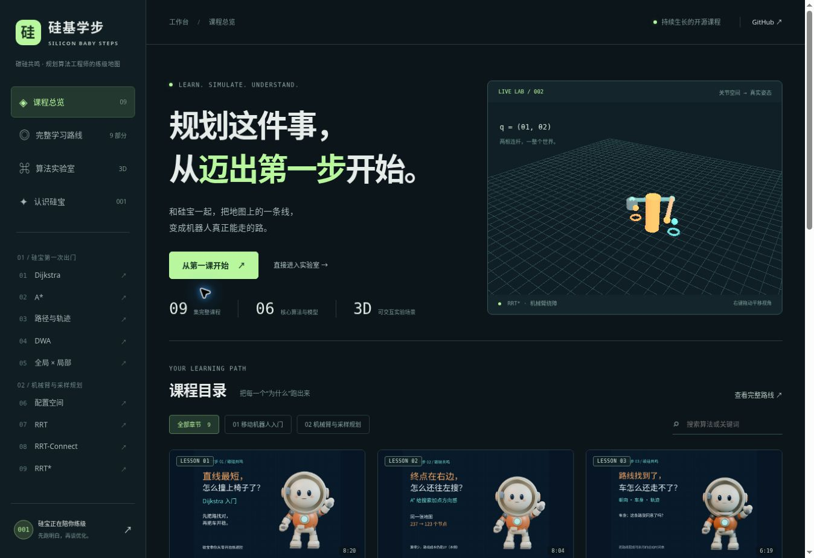
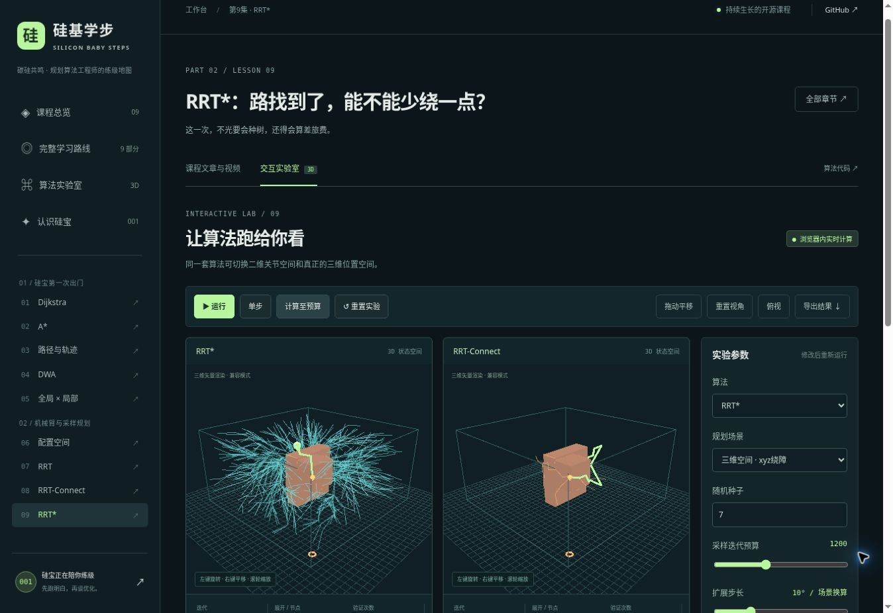

# 硅基学步 · Silicon Baby Steps

接手或续作本项目，请先读 [一页快速交接](docs/HANDOFF.md)，再按任务查对应手册。

**和硅宝一起，从“别撞上椅子”，走到机械臂规划、时间参数化与关节验收。**

「碳硅共鸣」的规划算法课程与交互实验网站。每节课都包含**结构化文章、头部完整视频、可调参数的算法实验**。算法在浏览器里实际运行，可播放、暂停、单步、固定随机种子做对照，也可直接“计算至预算”查看完整结果。





## 一键安装并启动

需要 **Node.js 22.12+**，推荐 Node.js 24 LTS。首次安装会从 npm 下载锁定版本的依赖；之后网站不需要账号、API密钥或在线推理服务。

### Linux / macOS

```bash
git clone https://github.com/luckyPT/silicon-baby-steps.git
cd silicon-baby-steps
bash start.sh
```

### Windows

可在克隆后直接双击 `start.bat`。也可以使用 PowerShell：

```powershell
git clone https://github.com/luckyPT/silicon-baby-steps.git
cd silicon-baby-steps
.\start.ps1
```

打开 [http://localhost:4173/](http://localhost:4173/)。停止服务按 `Ctrl+C`。也可直接使用 `npm ci && npm run dev`；Windows若本机脚本执行策略阻止 `.ps1`，使用这两条 npm 命令即可。

### Docker 一条命令

```bash
docker compose up --build -d
```

同样访问 [http://localhost:4173/](http://localhost:4173/)。容器使用多阶段构建和 Nginx，视频支持HTTP范围请求，方便拖动播放进度。Docker 配置已提供；本次开发环境没有 Docker 守护进程，验证以本地 Node 安装、构建及浏览器实测为准。

> 完整MP4与文章配图均在仓库内，首次克隆会下载全部课程媒体。没有依赖会过期的临时视频链接。

## 课程总目录

另附 [硅宝自我介绍视频](public/media/00/video.mp4)，网站提供“认识硅宝”入口。

当前视频按三个部分更新。知识路线保留原先九部分体系，控制相关内容集中在后段。

| 集数 | 本节内容                             | 文章                          | 完整视频                         | 对应交互实验 / 源码                                                                         |
| ---- | ------------------------------------ | ----------------------------- | -------------------------------- | ------------------------------------------------------------------------------------------- |
| 01   | Dijkstra：先别撞上椅子               | [讲义](public/articles/01.md) | [MP4](public/media/01/video.mp4) | 栅格、成本、障碍编辑；[grid.ts](src/algorithms/grid.ts)                                     |
| 02   | A\*：给搜索加一点方向感              | [讲义](public/articles/02.md) | [MP4](public/media/02/video.mp4) | 启发权重、Dijkstra对照；[grid.ts](src/algorithms/grid.ts)                                   |
| 03   | 路找到了，车就能走吗？               | [讲义](public/articles/03.md) | [MP4](public/media/03/video.mp4) | 三种时间安排、速度与加速度限制；[trajectory.ts](src/algorithms/trajectory.ts)               |
| 04   | DWA：椅子会动，怎么办？              | [讲义](public/articles/04.md) | [MP4](public/media/04/video.mp4) | 动态窗口、候选轨迹、移动障碍；[dwa.ts](src/algorithms/dwa.ts)                               |
| 05   | 第一部分收官：让算法组队上班         | [讲义](public/articles/05.md) | [MP4](public/media/05/video.mp4) | 参考途经点与局部规划交接；[dwa.ts](src/algorithms/dwa.ts)                                   |
| 06   | 机械臂的地图，为什么画在关节角度里？ | [讲义](public/articles/06.md) | [MP4](public/media/06/video.mp4) | 三维二连杆、关节滑块、配置空间与整段检碰；[environments.ts](src/algorithms/environments.ts) |
| 07   | RRT：老板让我找路，我先种了棵树      | [讲义](public/articles/07.md) | [MP4](public/media/07/video.mp4) | 随机采样、扩展与检碰；[sampling.ts](src/algorithms/sampling.ts)                             |
| 08   | RRT-Connect：两棵树，怎样接上头？    | [讲义](public/articles/08.md) | [MP4](public/media/08/video.mp4) | 双树、Connect与回溯；[sampling.ts](src/algorithms/sampling.ts)                              |
| 09   | RRT\*：路找到了，能不能少绕一点？    | [讲义](public/articles/09.md) | [MP4](public/media/09/video.mp4) | 选父、重连、后代更新与成本曲线；[sampling.ts](src/algorithms/sampling.ts)                   |

| 10 | Informed RRT* | [讲义](public/articles/10.md) | [MP4](https://letsgogo.top/planning/media/10/video.mp4) | 椭圆采样与RRT*对照 |
| 11 | 路径后处理 | [讲义](public/articles/11.md) | [MP4](https://letsgogo.top/planning/media/11/video.mp4) | 快捷连接、圆角与复检 |
| 12 | 时间参数化 | [讲义](public/articles/12.md) | [MP4](https://letsgogo.top/planning/media/12/video.mp4) | 匀速、梯形与短任务三角形 |
| 13 | S曲线与jerk | [讲义](public/articles/13.md) | [MP4](https://letsgogo.top/planning/media/13/video.mp4) | 六秒梯形与七秒S曲线 |
| 14 | 关节约束验收 | [讲义](public/articles/14.md) | [MP4](https://letsgogo.top/planning/media/14/video.mp4) | 两关节幅值验收、统一时间伸缩 |

- **当前第一部分**：01—05，移动机器人入门，已收官。
- **第二部分**：06—11，配置空间、采样规划与路径后处理，已收官。
- **第三部分**：12—14，梯形速度、S曲线与关节约束验收，已收官。
- 浏览器内可按算法搜索、筛选课程、记录本机学习进度；文章具有段落、分节、图片与本节内容索引。

## 长期九部分知识路线

这是知识组织，不等同于视频集数。随着教学重心转向规划算法，配置空间与机械臂采样规划已在第06集提前展开。

1. **硅宝第一次出门**：规划与执行、车身约束、最小系统；移动平台绕障、到站验收。
2. **认识自己的身体**：状态、坐标、运动模型与可达性；车体和关节的执行边界。
3. **先找到一条路**：地图、检碰、Dijkstra、A\*、Hybrid A\*、RRT系列；迷宫、窄通道、倒车入库。
4. **有路了，为什么还是走不了**：路径与轨迹、样条、多项式、速度规划、加速度与jerk、DWA / TEB；急弯与动态障碍。
5. **把车开稳**：PID、积分饱和、Pure Pursuit、Stanley、前馈与反馈；直线、圆、S弯与失稳分析。
6. **提前想几步再行动**：状态空间、线性化、QP、LQR、MPC、软硬约束；无解、超时与实时计算。
7. **给硅宝制造麻烦**：状态估计、坐标链、多频率、延迟噪声、模型失配；故障传播与异常恢复。
8. **从轮子升级到机械臂**：正逆运动学、雅可比、奇异位形、自碰撞、时间参数化与执行接口。
9. **从能演示到能交付**：需求验收、指标体系、场景覆盖、自动回归、日志回放与部署；综合项目和故障分析。

后续路线继续按“主线 + 工业案例”展开；网站明确区分已完成课程与后续规划。

## 三维实验怎么操作

| 输入                 | 行为                               |
| -------------------- | ---------------------------------- |
| 左键按住拖动         | 旋转视角                           |
| **右键按住拖动**     | **沿屏幕平面平移视角**             |
| 滚轮 / 触控板缩放    | 拉近或拉远                         |
| 双指触屏手势         | 缩放与平移                         |
| 拖动平移按钮         | 将左键也切换为平移；右键仍保持平移 |
| 重置视角 / 俯视      | 恢复默认相机 / 从上方观察          |
| 空格（非输入框焦点） | 运行或暂停                         |

右键菜单在三维区域内被阻止，避免与平移冲突。编辑栅格地图时，左键可设起点、设终点、增删障碍；右键仍负责平移。

优先使用 Three.js WebGL 渲染；设备无法创建 WebGL 时，自动使用 Three.js SVGRenderer 进行**同一套三维场景的投影渲染**。它仍支持旋转和平移，低配置设备上帧率可能较低。没有用预录动画冒充算法运行。

## 每个实验能改什么

- **Dijkstra / A\***：地图、四/八邻接、障碍膨胀、地面进入成本、A\*启发权重。八邻接禁止从障碍拐角切过去；权重1使用可采纳启发式，大于1不承诺最优。
- **路径与轨迹**：固定“向右2米，再向上2米”，比较瞬间拐弯、停车转向、限速限加速度。默认约束下第三种方案用时10.5秒，可修改速度、加速度与角速度限制。
- **DWA**：速度动态窗口、轨迹预测时域、避障评分、动态障碍、参考途经点引导。对比模式增加第二组预测时域。
- **配置空间**：改变两个关节角与圆柱障碍半径，同步观察三维姿态和二维关节空间；检查起点到当前配置的整段连接。
- **RRT / RRT-Connect / RRT\***：算法、场景、种子、采样预算、扩展步长、邻域半径、目标偏置；可并排对比，并导出参数、路径与统计JSON。
- **采样规划场景**：二维关节空间的三维机械臂，以及真正以 `(x,y,z)` 为状态的三维绕障空间。

### 读实验数字前，先统一口径

1. 栅格搜索的立体画面只是三维展示，状态仍是二维格子。机械臂也只有两个规划自由度；三维空间场景则是三维状态。
2. 机械臂内部用弧度计算，界面路径长度换算为角度；它不是末端移动米数。空间绕障使用米，栅格使用转移成本。
3. 视频第09—10集的原始Python实验采用**整段运动验证预算**；网站采用**采样迭代预算**，并另外显示运动验证次数。它们不是同一预算口径，也不是相同计算时间。
4. 同种子保证同配置、同算法可复现；不同算法消耗随机数与检碰预算不同，不保证样本逐个对应。播放速度改变的是回放速率，不是算法性能。
5. RRT\*比较累计成本，重新连接后向全部后代传播成本，并排除祖先形成环。保留原始路径，不把平滑结果当原始输出。
6. 第05集实验的引导线是明确给定的参考途经点，用于演示模块交接；它不冒充在该界面运行出的A\*路径。
7. DWA使用简化差速运动学、预测障碍和保守安全筛选；场景仍可能局部停滞。机械臂与空间规划也都是几何教学模型。

## 仓库结构

```text
public/articles/          每集Markdown讲义与文章原始JSON
public/media/01…14/       每集完整MP4、封面和正文插图
public/media/manifest.json 影片时长、尺寸与SHA-256
src/content/catalog.ts   当前章节与长期九部分路线
src/algorithms/           可独立测试的浏览器算法实现
src/ui/                  三维场景、关节地图、实验控制面板
experiments/original/    第07—14集原始Python算法及核验参考
scripts/                 一键启动、媒体核验、历史资料导入
tests/                  算法正确性与回归测试
.github/workflows/       自动验证与手动GitHub Pages部署
```

## 开发与验证

```bash
npm ci
npm test
npm run verify:media
npm run build
npm run preview
```

测试覆盖加权Dijkstra/A\*一致性、无路可达、禁止切角、起终点被膨胀区阻挡、机械臂整段检碰、两种空间中三种采样规划器的确定性与有效路径、RRT\*成本与无环结构、默认10.5秒轨迹、DWA执行步的障碍间距。

`npm run verify:media` 核验全部14集的MP4 SHA-256、文章、封面与图像链接。`experiments/original/README.md` 说明如何重新运行Python视频实验。

### GitHub Pages

仓库自带手动部署工作流，不需要改代码：

1. 在仓库 **Settings → Pages → Source** 选择 **GitHub Actions**。
2. 在 **Actions → Deploy course to GitHub Pages → Run workflow** 运行部署。
3. 等部署任务成功后，使用任务返回的页面地址。

使用相对资源路径和Hash路由，支持仓库子路径以及本地静态部署。推送和PR会自动跑 `Validate course`，不依赖是否启用了Pages。

## 增加下一章

1. 在 `src/content/catalog.ts` 登记标题、知识点和实验类型。
2. 添加 `public/articles/15.md`、`public/media/15/video.mp4`、封面与正文配图。
3. 更新 `public/media/manifest.json` 的时长、字节数和SHA-256；同步媒体核验脚本的章节数量。
4. 复用或新增实验模块，补必要的算法回归测试，再构建与推送。

## 主要技术资料

- [Three.js OrbitControls](https://threejs.org/docs/pages/OrbitControls.html)：旋转、缩放与平移。
- [RRT原始资料（LaValle）](https://lavalle.pl/rrt/)；[RRT-Connect论文](https://www.kuffner.org/james/papers/kuffner_icra2000.pdf)。
- [RRT\*原始论文](https://arxiv.org/abs/1105.1186)；[OMPL RRTstar实现](https://ompl.kavrakilab.org/RRTstar_8cpp_source.html)。
- [Vite静态部署](https://vite.dev/guide/static-deploy.html)。


## 第10—14集完整视频与同步

新增视频原片全部无损保留：`course-media/` 存储每段不超过10MiB的原始字节，`manifest.json`记录每段及完整MP4的字节数与SHA-256。运行 `npm run dev`、`npm run build` 或 `npm run verify:media` 会先自动拼回 `public/media/10…14/video.mp4`。也可单独运行 `npm run assemble:media`。网站仍播放与下载完整MP4；分段仅用于适配上传接口，不切分观看，不改变清晰度、帧率、音轨或时长。

每章继续保留独立结构化文章、完整视频、可调参数实验和有条件说明的对比。后续头条号不再新发配套文章，Git讲义仍持续更新，既有文章保留。

第10集网页按采样迭代计预算，Python视频按6000次整段验证计预算。第11集圆角切向连续但曲率跳变；第12—14集标量S曲线不证明关节jerk有限，统一放慢只让本例速度与分段加速度幅值满足教学限值。不是力矩、负载、跟踪或真机安全认证。

主站由 `luckyPT/luckyPT` 的 `Publish letsgogo.top` 工作流联合构建，读取本仓库main并发布到 `/planning/`。课程提交与主站部署分别核验，不能把其中一步当作全部完成。制作规范见 [WORKFLOW.md](docs/WORKFLOW.md)。
