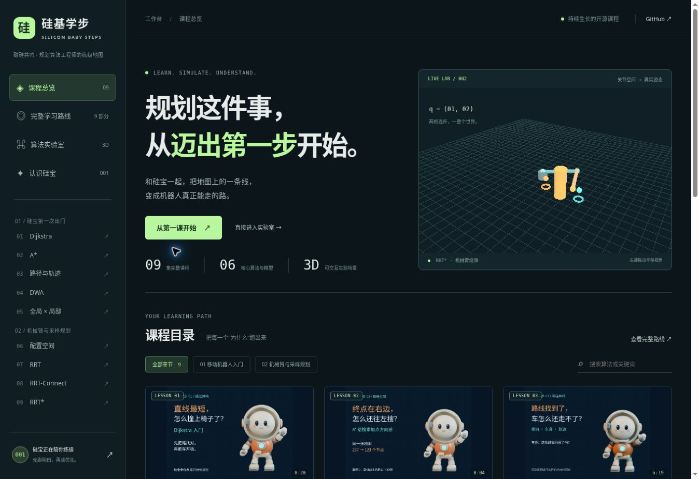
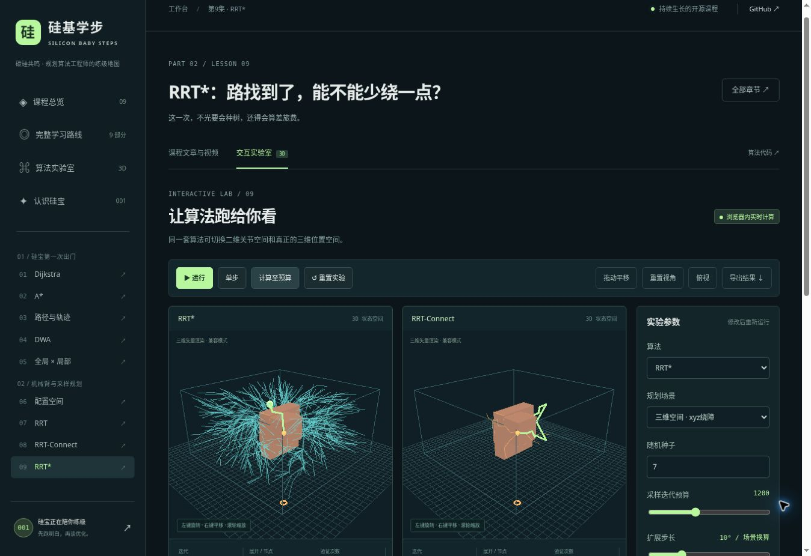

# 硅基学步 · Silicon Baby Steps

接手或续作本项目，请先读 [一页快速交接](docs/HANDOFF.md)，再按任务查对应手册。

**和硅宝一起，从“别撞上椅子”，走到机械臂规划、时间参数化与关节验收。**

「碳硅共鸣」的规划算法课程与实验网站，已同步第01—26集。每章保留结构化讲义、头条与抖音观看入口、可运行实验和有条件的对比。第01—18集保留浏览器实时实验；第19—26集新增真实日志阶段回放，并提供可重新计算的Python源代码。





## 一键安装并启动

需要 **Node.js 22.12+**，推荐 Node.js 24 LTS。首次安装会从 npm 下载锁定版本的依赖；之后网站不需要账号、API密钥或在线推理服务。

### Linux / macOS

```bash
git clone https://github.com/luckyPT/silicon-baby-steps.git
cd silicon-baby-steps
bash start.sh
```

### Windows

可在克隆后直接双击 `start.bat`。也可以使用 PowerShell：

```powershell
git clone https://github.com/luckyPT/silicon-baby-steps.git
cd silicon-baby-steps
.\start.ps1
```

打开 [http://localhost:4173/](http://localhost:4173/)。停止服务按 `Ctrl+C`。也可直接使用 `npm ci && npm run dev`；Windows若本机脚本执行策略阻止 `.ps1`，使用这两条 npm 命令即可。

### Docker 一条命令

```bash
docker compose up --build -d
```

同样访问 [http://localhost:4173/](http://localhost:4173/)。容器使用多阶段构建和 Nginx，提供讲义、实验与平台视频链接。Docker 配置已提供；本次开发环境没有 Docker 守护进程，验证以本地 Node 安装、构建及浏览器实测为准。

> 2026-11-01起，仓库与网站不再托管视频；旧MP4、视频分段及自动拼接流程已移除。26集均使用已核对的头条、抖音具体作品链接，打开网页不会自动加载第三方播放器。

## 课程总目录

另附 [硅宝自我介绍视频](https://www.douyin.com/video/7699038912559189298)，网站提供“认识硅宝”入口。

当前视频已更新到第五部分。知识路线保留原先九部分体系，控制相关内容集中在后段。

| 集数 | 本节内容 | 文章 | 完整视频 | 实验 |
|---|---|---|---|---|
| 01 | 两点之间直线最短，机器人怎么先撞上了椅子？ | [讲义](public/articles/01.md) | [头条](https://www.toutiao.com/i7699096839652295202?enter_from=mp_group_management) · [抖音](https://www.douyin.com/video/7699121065598946611) | 浏览器实时实验 |
| 02 | 终点就在右边，机器人为什么还往左搜？A星来算这笔账 | [讲义](public/articles/02.md) | [头条](https://www.toutiao.com/i7699130126021198371?enter_from=mp_group_management) · [抖音](https://www.douyin.com/video/7699137591181856063) | 浏览器实时实验 |
| 03 | 路线找到了，小车为什么还走不了？先问问车身 | [讲义](public/articles/03.md) | [头条](https://www.toutiao.com/i7699150735082881576?enter_from=mp_group_management) · [抖音](https://www.douyin.com/video/7699150797765872896) | 浏览器实时实验 |
| 04 | 路线有了还撞椅子？DWA怎样现场挑动作 | [讲义](public/articles/04.md) | [头条](https://www.toutiao.com/i7699172382656774682?enter_from=mp_group_management) · [抖音](https://www.douyin.com/video/7699172553251720474) | 浏览器实时实验 |
| 05 | 算法都及格，小车怎么还到不了？A星与DWA组队验收 | [讲义](public/articles/05.md) | [头条](https://www.toutiao.com/i7699269822949720591?enter_from=mp_group_management) · [抖音](https://www.douyin.com/video/7699270786548354323) | 浏览器实时实验 |
| 06 | 手过去了，胳膊却撞了？机械臂规划先认识配置空间 | [讲义](public/articles/06.md) | [头条](https://www.toutiao.com/i7699294952539128355?enter_from=mp_group_management) · [抖音](https://www.douyin.com/video/7699295913080081691) | 浏览器实时实验 |
| 07 | 老板让我找路，我先种棵树：RRT怎样给机械臂规划 | [讲义](public/articles/07.md) | [头条](https://www.toutiao.com/i7699324841610035763?enter_from=mp_group_management) · [抖音](https://www.douyin.com/video/7699324703738989878) | 浏览器实时实验 |
| 08 | 两棵树怎样接头？RRT-Connect给机械臂找路 | [讲义](public/articles/08.md) | [头条](https://www.toutiao.com/i7699341342391943699?enter_from=mp_group_management) · [抖音](https://www.douyin.com/video/7699341355457269034) | 浏览器实时实验 |
| 09 | RRT\*：路找到了，能不能少绕一点？ | [讲义](public/articles/09.md) | [头条](https://www.toutiao.com/i7699519275551998515?enter_from=mp_group_management) · [抖音](https://www.douyin.com/video/7699634180744924443) | 浏览器实时实验 |
| 10 | Informed RRT*：把采样花在有希望的地方 | [讲义](public/articles/10.md) | [头条](https://www.toutiao.com/i7699820611157213736?enter_from=mp_group_management) · [抖音](https://www.douyin.com/video/7699820450464976155) | 浏览器实时实验 |
| 11 | 路径后处理：删点、圆角与碰撞复检 | [讲义](public/articles/11.md) | [头条](https://www.toutiao.com/i7699880533995684387?enter_from=mp_group_management) · [抖音](https://www.douyin.com/video/7699880582800543012) | 浏览器实时实验 |
| 12 | 时间参数化：给路径排时刻表 | [讲义](public/articles/12.md) | [头条](https://www.toutiao.com/i7699905971586155062?enter_from=mp_group_management) · [抖音](https://www.douyin.com/video/7699906833640656143) | 浏览器实时实验 |
| 13 | S曲线：让加速度也有过渡 | [讲义](public/articles/13.md) | [头条](https://www.toutiao.com/i7699916300927255078?enter_from=mp_group_management) · [抖音](https://www.douyin.com/video/7699916617785822527) | 浏览器实时实验 |
| 14 | 关节约束验收与统一时间伸缩 | [讲义](public/articles/14.md) | [头条](https://www.toutiao.com/i7700021350827688477?enter_from=mp_group_management) · [抖音](https://www.douyin.com/video/7700043846838701327) | 浏览器实时实验 |
| 15 | RRT已经会找路了，为什么还要学别的算法？ | [讲义](public/articles/15.md) | [头条](https://www.toutiao.com/i7700272491863851547?enter_from=mp_group_management) · [抖音](https://www.douyin.com/video/7700399414707277083) | 浏览器实时实验 |
| 16 | 人工势场：目标拉我，障碍推我，怎么还走不动？ | [讲义](public/articles/16.md) | [头条](https://www.toutiao.com/i7700408520349237796?enter_from=mp_group_management) · [抖音](https://www.douyin.com/video/7700408605547285775) | 浏览器实时实验 |
| 17 | PRM / Lazy PRM：先修路，再按需验路 | [讲义](public/articles/17.md) | [头条](https://www.toutiao.com/i7700442833659937295?enter_from=mp_group_management) · [抖音](https://www.douyin.com/video/7700445660482391332) | 浏览器实时实验 |
| 18 | CHOMP / STOMP：让整条路线一起改 | [讲义](public/articles/18.md) | [头条](https://www.toutiao.com/i7700843119977218579?enter_from=mp_group_management) · [抖音](https://www.douyin.com/video/7700843660887346483) | 浏览器实时实验 |
| 19 | 第19集：TrajOpt / GPMP2——路径变顺了，怎么还会撞？ | [讲义](public/articles/19.md) | [头条](https://www.toutiao.com/i7700976084032782883?enter_from=mp_group_management) · [抖音](https://www.douyin.com/video/7700976205746441535) | [回放与Python复现](https://letsgogo.top/planning/#/lesson/19/lab) |
| 20 | 硅基学步20：先撒点，再排队，怎样越找越好？ | [讲义](public/articles/20.md) | [头条](https://www.toutiao.com/i7700999537648812544?enter_from=mp_group_management) · [抖音](https://www.douyin.com/video/7701508978290740495) | [回放与Python复现](https://letsgogo.top/planning/#/lesson/20/lab) |
| 21 | 第21集：路太多，先算哪条才不白忙？ | [讲义](public/articles/21.md) | [头条](https://www.toutiao.com/i7701740477032268315?enter_from=mp_group_management) · [抖音](https://www.douyin.com/video/7701740599908650259) | [回放与Python复现](https://letsgogo.top/planning/#/lesson/21/lab) |
| 22 | 第22集：GCS——绕哪边、怎么走，能一起算吗？ | [讲义](public/articles/22.md) | [头条](https://www.toutiao.com/i7701864388675879424?enter_from=mp_group_management) · [抖音](https://www.douyin.com/video/7701864455054871823) | [回放与Python复现](https://letsgogo.top/planning/#/lesson/22/lab) |
| 23 | 第23集：LPA*——路口突然封了，还要从头算吗？ | [讲义](public/articles/23.md) | [头条](https://www.toutiao.com/i7702118227245007369?enter_from=mp_group_management) · [抖音](https://www.douyin.com/video/7702118524835138856) | [回放与Python复现](https://letsgogo.top/planning/#/lesson/23/lab) |
| 24 | 第24集：D* Lite——走到一半，前面封了怎么办？ | [讲义](public/articles/24.md) | [头条](https://www.toutiao.com/i7702130589977018920?enter_from=mp_group_management) · [抖音](https://www.douyin.com/video/7702130800925412659) | [回放与Python复现](https://letsgogo.top/planning/#/lesson/24/lab) |
| 25 | 第25集：ARA* → AD*——时间不够，先交哪条路线？ | [讲义](public/articles/25.md) | [头条](https://www.toutiao.com/i7702450608313336335?enter_from=mp_group_management) · [抖音](https://www.douyin.com/video/7702606063450787112) | [回放与Python复现](https://letsgogo.top/planning/#/lesson/25/lab) |
| 26 | 第26集：RRTX——障碍一动，原来的搜索树还能用吗？ | [讲义](public/articles/26.md) | [头条](https://www.toutiao.com/i7702632127849824831?enter_from=mp_group_management) · [抖音](https://www.douyin.com/video/7702632275036491048) | [回放与Python复现](https://letsgogo.top/planning/#/lesson/26/lab) |


第16—18集当前交互实验明确使用**二维静态点机器人教学视图**；它们不是三维机器人仿真或真机验证。默认实验在浏览器内计算，播放是此次计算的过程回放。原始Python和数值证据保存在 `experiments/original/16…18/`；随机实现不同的地方不宣称逐点一致。

- **当前第一部分**：01—05，移动机器人入门，已收官。
- **第二部分**：06—11，配置空间、采样规划与路径后处理，已收官。
- **第三部分**：12—14，梯形速度、S曲线与关节约束验收，已收官。
- **第四部分**：15—22，静态规划与优化，已收官。
- **第五部分**：23—26，增量修复、移动起点、限时改善和采样图复用；下一集时空A*尚未制作。
- 浏览器内可按算法搜索、筛选课程、记录本机学习进度；文章具有段落、分节、图片与本节内容索引。

## 长期九部分知识路线

这是知识组织，不等同于视频集数。随着教学重心转向规划算法，配置空间与机械臂采样规划已在第06集提前展开。

1. **硅宝第一次出门**：规划与执行、车身约束、最小系统；移动平台绕障、到站验收。
2. **认识自己的身体**：状态、坐标、运动模型与可达性；车体和关节的执行边界。
3. **先找到一条路**：地图、检碰、Dijkstra、A\*、Hybrid A\*、RRT系列；迷宫、窄通道、倒车入库。
4. **有路了，为什么还是走不了**：路径与轨迹、样条、多项式、速度规划、加速度与jerk、DWA / TEB；急弯与动态障碍。
5. **把车开稳**：PID、积分饱和、Pure Pursuit、Stanley、前馈与反馈；直线、圆、S弯与失稳分析。
6. **提前想几步再行动**：状态空间、线性化、QP、LQR、MPC、软硬约束；无解、超时与实时计算。
7. **给硅宝制造麻烦**：状态估计、坐标链、多频率、延迟噪声、模型失配；故障传播与异常恢复。
8. **从轮子升级到机械臂**：正逆运动学、雅可比、奇异位形、自碰撞、时间参数化与执行接口。
9. **从能演示到能交付**：需求验收、指标体系、场景覆盖、自动回归、日志回放与部署；综合项目和故障分析。

后续路线继续按“主线 + 工业案例”展开；网站明确区分已完成课程与后续规划。

## 三维实验怎么操作

| 输入                 | 行为                               |
| -------------------- | ---------------------------------- |
| 左键按住拖动         | 旋转视角                           |
| **右键按住拖动**     | **沿屏幕平面平移视角**             |
| 滚轮 / 触控板缩放    | 拉近或拉远                         |
| 双指触屏手势         | 缩放与平移                         |
| 拖动平移按钮         | 将左键也切换为平移；右键仍保持平移 |
| 重置视角 / 俯视      | 恢复默认相机 / 从上方观察          |
| 空格（非输入框焦点） | 运行或暂停                         |

右键菜单在三维区域内被阻止，避免与平移冲突。编辑栅格地图时，左键可设起点、设终点、增删障碍；右键仍负责平移。

优先使用 Three.js WebGL 渲染；设备无法创建 WebGL 时，自动使用 Three.js SVGRenderer 进行**同一套三维场景的投影渲染**。它仍支持旋转和平移，低配置设备上帧率可能较低。没有用预录动画冒充算法运行。

## 每个实验能改什么

- **Dijkstra / A\***：地图、四/八邻接、障碍膨胀、地面进入成本、A\*启发权重。八邻接禁止从障碍拐角切过去；权重1使用可采纳启发式，大于1不承诺最优。
- **路径与轨迹**：固定“向右2米，再向上2米”，比较瞬间拐弯、停车转向、限速限加速度。默认约束下第三种方案用时10.5秒，可修改速度、加速度与角速度限制。
- **DWA**：速度动态窗口、轨迹预测时域、避障评分、动态障碍、参考途经点引导。对比模式增加第二组预测时域。
- **配置空间**：改变两个关节角与圆柱障碍半径，同步观察三维姿态和二维关节空间；检查起点到当前配置的整段连接。
- **RRT / RRT-Connect / RRT\***：算法、场景、种子、采样预算、扩展步长、邻域半径、目标偏置；可并排对比，并导出参数、路径与统计JSON。
- **采样规划场景**：二维关节空间的三维机械臂，以及真正以 `(x,y,z)` 为状态的三维绕障空间。

### 读实验数字前，先统一口径

1. 栅格搜索的立体画面只是三维展示，状态仍是二维格子。机械臂也只有两个规划自由度；三维空间场景则是三维状态。
2. 机械臂内部用弧度计算，界面路径长度换算为角度；它不是末端移动米数。空间绕障使用米，栅格使用转移成本。
3. 视频第09—10集的原始Python实验采用**整段运动验证预算**；网站采用**采样迭代预算**，并另外显示运动验证次数。它们不是同一预算口径，也不是相同计算时间。
4. 同种子保证同配置、同算法可复现；不同算法消耗随机数与检碰预算不同，不保证样本逐个对应。播放速度改变的是回放速率，不是算法性能。
5. RRT\*比较累计成本，重新连接后向全部后代传播成本，并排除祖先形成环。保留原始路径，不把平滑结果当原始输出。
6. 第05集实验的引导线是明确给定的参考途经点，用于演示模块交接；它不冒充在该界面运行出的A\*路径。
7. DWA使用简化差速运动学、预测障碍和保守安全筛选；场景仍可能局部停滞。机械臂与空间规划也都是几何教学模型。

## 仓库结构

```text
public/articles/          每集Markdown讲义与文章原始JSON
public/media/01…26/       封面和正文插图（无视频）
public/experiments/       19—26集精简真实阶段记录
public/media/manifest.json 章节、配图和平台观看地址
src/content/catalog.ts   当前章节与长期九部分路线
src/algorithms/           可独立测试的浏览器算法实现
src/ui/                  三维场景、关节地图、实验控制面板
experiments/original/    第07—26集原始Python算法及核验参考
scripts/                 一键启动、媒体核验、历史资料导入
tests/                  算法正确性与回归测试
.github/workflows/       自动验证与手动GitHub Pages部署
```

## 开发与验证

```bash
npm ci
npm test
npm run verify:media
npm run build
npm run preview
```

测试覆盖加权Dijkstra/A\*一致性、无路可达、禁止切角、起终点被膨胀区阻挡、机械臂整段检碰、两种空间中三种采样规划器的确定性与有效路径、RRT\*成本与无环结构、默认10.5秒轨迹、DWA执行步的障碍间距。

`npm run verify:media` 核验26集的讲义、封面、正文配图、双平台具体作品链接和新集实验记录，并拒绝发布目录内出现MP4、视频分段或播放清单。45项测试包含原有算法回归与本次链接迁移、目录和真实失败记录检查。

### GitHub Pages

仓库自带手动部署工作流，不需要改代码：

1. 在仓库 **Settings → Pages → Source** 选择 **GitHub Actions**。
2. 在 **Actions → Deploy course to GitHub Pages → Run workflow** 运行部署。
3. 等部署任务成功后，使用任务返回的页面地址。

使用相对资源路径和Hash路由，支持仓库子路径以及本地静态部署。推送和PR会自动跑 `Validate course`，不依赖是否启用了Pages。

## 增加下一章

1. 在 `src/content/catalog.ts` 登记标题、知识点和实验类型。
2. 添加对应 `public/articles/NN.md`、封面与正文配图。核对平台实际作品页后，在 `src/content/platform-links.json` 登记地址；不添加媒体字节、视频分段或私有素材入口。
3. 更新 `public/media/manifest.json` 的章节与平台链接；同步媒体核验脚本的章节数量。
4. 复用或新增实验模块，补必要的算法回归测试，再构建与推送。

## 主要技术资料

- [Three.js OrbitControls](https://threejs.org/docs/pages/OrbitControls.html)：旋转、缩放与平移。
- [RRT原始资料（LaValle）](https://lavalle.pl/rrt/)；[RRT-Connect论文](https://www.kuffner.org/james/papers/kuffner_icra2000.pdf)。
- [RRT\*原始论文](https://arxiv.org/abs/1105.1186)；[OMPL RRTstar实现](https://ompl.kavrakilab.org/RRTstar_8cpp_source.html)。
- [Vite静态部署](https://vite.dev/guide/static-deploy.html)。


## 视频链接与部署

26集的头条和抖音具体作品地址集中维护在 `src/content/platform-links.json`，UI与校验使用 `platform-videos.ts`。已移除旧MP4、所有字节分段、分段清单与拼接脚本；自我介绍也改为平台入口。保留封面、正文插图和数值记录。普通删除不会清除Git历史对象；本次没有重写历史或强推。

主站由 `luckyPT/luckyPT` 的 `Publish letsgogo.top` 联合构建，读取本仓库main并发布到 `/planning/`。课程提交、主站部署、线上章节分别核验。原论文与算法边界见各集讲义，制作规范见[WORKFLOW.md](docs/WORKFLOW.md)。

第19—26集网页回放读取实际Python输出，切换阶段与路线对照，不宣称在浏览器运行了原求解器。重新计算：进入对应 `experiments/original/NN`，安装其 `requirements.txt` 后运行 `python experiment.py`。第23—26集重算后可用 `python scripts/export-recorded-labs.py` 刷新网页记录；其他集读取随源代码保留的简表。第22集需要其声明的Drake/Clarabel依赖。
