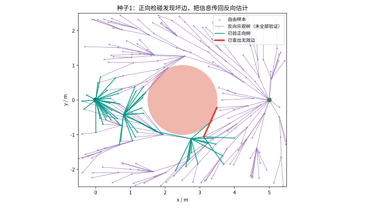
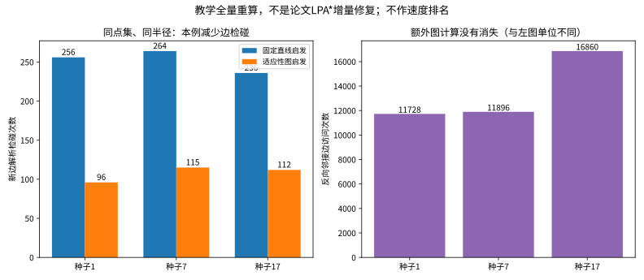
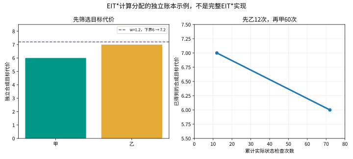
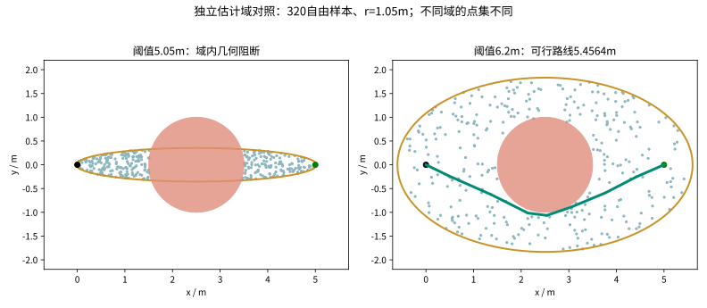

# 第21集：路太多，先算哪条才不白忙？

第四部分“静态环境规划加餐”收官。主线是**改善启发信息与分配验证工作**，承接第20集的批量采样与搜索。AIT*、EIT*以及2025年论文中的Multi-Informed Trees（MIT*）提供不同的机制。本章自写实验仅拆解组件，不是完整规划器复现，不比较官方性能。

## 1. 先明确两本账

路径的目标代价与规划计算成本是不同量。例如路径长度用米，边检碰用调用次数，状态检查用被检查的配置数，实际耗时用秒。不能把这些单位混在一个“更快”结论里。

正向A*式排序常用 $f(x)=g(x)+\hat h(x)$。对长度目标，欧氏距离 $\hat h_E(x)=\|x-x_g\|$ 是便宜下界，但不反映障碍绕行。

## 2. AIT*：从反向估计到正向验证，再反馈

AIT*用非对称双向搜索配合逐渐加密的随机几何图。反向搜索用便宜的边代价估计计算当前图的乐观启发信息，正向搜索据此安排真实边验证；发现无效边后，把信息反馈给反向搜索。原论文通过LPA*式修复减少更新工作。

图1：本章种子1的一次真实碰撞反馈。紫色边未必可行，不能把反向树交给机器人执行。

在正权冻结图上，可以写成 $\hat h(v)=\min_u[\hat c(v,u)+\hat h(u)]$，目标值为零。只删除已证实无效的边、尚未验证边保留乐观权重时，所得值不会高于当前图上真实可行最短代价。它**不自动成为连续空间最优代价的下界**，本实验不据此裁剪整个连续采样域。

独立手算：甲的键为 $1+1+1=3$；乙为 $1+1.5+2=4.5$。甲的后续捷径被证实碰撞，重算后键为 $1+1+4=6$，于是乙先接受检查。数值只演示排序，不是图1的点集数据。

## 3. 同一图上的实际实验

起点(0,0)、终点(5,0)，圆障碍中心(2.5,0)、半径1m。二维点机器人，自由域矩形[-0.5,5.5]×[-2.5,2.5]。每组240个自由样本，加起终点共242个顶点，连边半径1.05m；同一随机种子内两策略共享完全相同点集与连边。不同种子点集不同。

基线是固定欧氏启发的正向A*；适应版在遇到无效边后缓存检查结果并重启正向搜索，反向以Dijkstra**全量重算**。这是AIT*启发的机制变体，未实现论文的批次加密、LPA*增量修复及全部队列策略。两策略最后都与独立解析全验图Dijkstra核对，得到同一个冻结图最短代价。

| 种子 | 无向候选边数 | 固定启发：边检碰 | 适应启发：边检碰 | 适应版反向邻接访问 | 图上最短长度/m |
|---|---:|---:|---:|---:|---:|
| 1 | 2932 | 256 | 96 | 11728 | 5.528620 |
| 7 | 2974 | 264 | 115 | 11896 | 5.568366 |
| 17 | 2810 | 236 | 112 | 16860 | 5.493944 |

图2：本例少验边的同时增加反向图计算。两个子图单位不同，不能相加；所有计数以实际日志为准。完整日志也保留Python局部计时，但该计时不用于跨算法速度结论。独立oracle的工作不计入两策略。

总计算应至少区分 $T=T_{sample}+T_{reverse}+T_{forward}+T_{check}$。本例解析圆障碍检碰很轻，不能外推高维机械臂的真实性能。

## 4. EIT*：利用工作量估计

EIT*除代价下界外，还利用代价估计和剩余验证工作估计，正向采用AEES式边队列，反向使用自适应稀疏检查。工作量估计可用状态检查数，通常不要求可采纳；不能与代价下界混为一谈。实际算法的上下界维护不可被一个加权和随意替代。

图3：**独立机制账本，非EIT*实现**。甲、乙的合成目标代价为6、7（并非图中欧氏长度），实际状态检查账本分别60、12次。假设下界L=6，w=1.2时允许代价≤7.2，两者合格，先检查预计省力的乙；w收紧到1后检查甲。累计检查12→72，代价7→6。检查点在几何场景上实际执行，未模拟每次检查的墙钟耗时，也不宣称累计工作更少。

## 5. MIT*：首解前的估计采样域

本章MIT*明确指Zhang等人的《Estimated Informed Anytime Search for Sampling-Based Planning via Adaptive Sampler》，不是其他同名工程。其研究组合了首解前的估计域、障碍附近自适应采样和与边长有关的稀疏检查。本章只介绍这些组件，不复现完整论文基准。

论文用已验证前缀与乐观后续形成 $\hat s=g_F+\hat c+\hat h$，再构造 $\gamma=g_F/\hat s$、$e_\gamma=\sqrt{1+(1-\gamma)^2}$、$\tilde s=\hat s e_\gamma$。本章独立手算2+1+2=5，γ=0.4，e≈1.166，阈值≈5.831。γ是构造量，**不是经过校准的成功概率**。

二维长度目标可用 $\|x-x_s\|+\|x-x_g\|<\tilde s$ 定义椭圆域。两端相距5m时，$a=\tilde s/2$，$b=\sqrt{\tilde s^2-25}/2$。未验证估计阈值不是已知可行路径代价上界；用它局限探索需有扩域、恢复覆盖与重搜机制。本实验直接设置两个阈值作为控制变量，不声称实现论文自动更新流程。

图4：阈值5.05m时b≈0.354m。所有连续起终点路线必穿过x=2.5截面，该截面在域内完全被半径1m圆障碍阻断，因此增加样本也不能在这个域内绕行。阈值放宽到6.2m，重新采320个自由样本、同半径1.05m，种子1得到5.456408m可行折线，解析整段检碰通过。不同域点集不同，不作速度或采样效率比较。

附带障碍自适应采样组件：基础点自由则接收；撞障碍后在附近高斯扰动，沿连接线寻找有效点；所有点重新检查边界、估计域和碰撞。它不是全套MIT*策略，也不保证窄通道必有点。

## 6. 稀疏检碰不能替代最终验收

独立反例：线段(0,0)→(5,0)，小圆中心(1.25,0)、半径0.12m。只查t=0、0.5、1三点都通过；整条线段穿过圆。101个等距点能发现本例，但对任意更小障碍仍不能推出连续安全。本章所有最终返回折线都用解析线段—圆检碰复验，而不是依赖显示帧或稀疏点。

## 7. 收官与适用边界

16集人工势场回答局部决策；17集PRM/Lazy PRM回答路网复用；18—19集回答整条轨迹优化；20集回答批次采样与搜索；21集回答启发信息与计算分配。按问题选择机制，保留代价、预算、成功与失败条件。

论文渐近性质有对应假设。有限样本最短≠连续空间全局最短；本章教学组件不继承完整规划器证明。静态二维点机器人，不是高维性能复现、真机执行或动态重规划。

## 参考资料（只使用原论文与官方文档）

1. Strub & Gammell，AIT* and EIT*: Asymmetric bidirectional sampling-based path planning，IJRR，2022。https://arxiv.org/abs/2111.01877 ；https://doi.org/10.1177/02783649211069572
2. Strub & Gammell，Adaptively Informed Trees (AIT*): Fast Asymptotically Optimal Path Planning through Adaptive Heuristics，2020。https://arxiv.org/abs/2002.06599
3. Zhang等，Estimated Informed Anytime Search for Sampling-Based Planning via Adaptive Sampler，TASE，2025。https://arxiv.org/abs/2508.21549 ；https://doi.org/10.1109/TASE.2025.3590084
4. OMPL官方AIT*与EIT*文档：https://ompl.kavrakilab.org/classompl_1_1geometric_1_1AITstar.html ；https://ompl.kavrakilab.org/classompl_1_1geometric_1_1EITstar.html

制作核对日期：2026-10-28。画面与旁白含AI辅助制作；图表来自本章实际日志及明确标注的独立手算。
