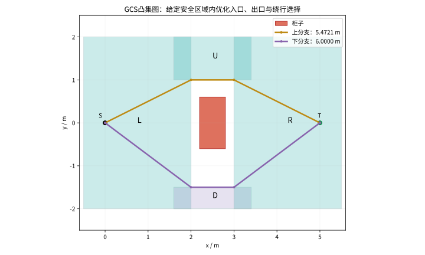
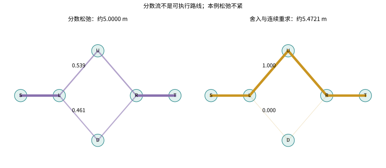
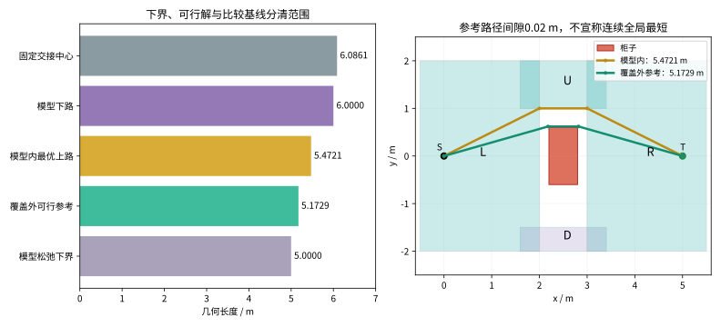
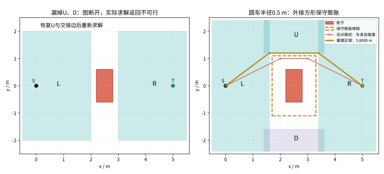

# 第22集：GCS——绕哪边、怎么走，能一起算吗？

第四部分静态规划补篇。GCS（Graphs of Convex Sets，凸集图）把图上的离散路线选择与凸集合中的连续变量放入同一个模型。本章调用Drake的实际GraphOfConvexSets实现和Clarabel求解器，采用二维点机器人的一阶几何长度模型；没有实现机械臂动力学或真实机器人执行。

## 1. 为什么用凸区域

凸集合满足：任意$a,b\in X$、$0\leq\lambda\leq1$，都有$(1-\lambda)a+\lambda b\in X$。当整个区域已经被证明安全，区域内两端之间的线段也安全。区域的安全性、覆盖程度和建图成本必须单独交代。

起点$S=(0,0)$，终点$T=(5,0)$，单位米。障碍为$[2.2,2.8]\times[-0.6,0.6]$。安全矩形如下：

| 区域 | x范围 | y范围 |
|---|---|---|
| L | [-0.5,2] | [-2,2] |
| U | [1.6,3.4] | [1,2] |
| D | [1.6,3.4] | [-2,-1.5] |
| R | [3,5.5] | [-2,2] |

边为S→L、L→U、U→R、L→D、D→R、R→T。每个相邻区域都有重叠，整张图只有上、下两个无环候选分支。区域由本实验人工给出，没有把自动凸区域生成计入算法成果，也没有覆盖全部自由空间。

## 2. 本章真正求了什么

走廊节点变量为$z_i=(p_i^{in},p_i^{out})\in X_i\times X_i$。选中的边$i\to j$约束$p_i^{out}=p_j^{in}$，每块区域贡献$\|p_i^{out}-p_i^{in}\|_2$。图路径为$\pi$时，目标是$\min\sum_{i\in\pi}\|p_i^{out}-p_i^{in}\|_2$。源、终点用四维重复坐标Point表示。

整数选边$\phi_e\in\{0,1\}$与连续交接位置同时存在；不能因为集合是凸的就说一般GCS全部变成了简单凸问题。Drake通过凸松弛、候选路径舍入与固定路径的凸限制求解处理这两类变量。本实验显式指定Clarabel，不依赖Mosek许可。

更高阶贝塞尔曲线可写成$q(s)=\sum_kB_k(s)P_k$，基函数非负且和为1，故控制点凸包包含整条曲线。在凸安全区域内约束控制点，可约束整段曲线。这里采用一阶特例；高阶平滑、连接速度、时间与动力学需要额外模型。画面光点按几何弧长回放，不能据其速度比较求解器耗时。

## 3. 手算与实际数值核对

上分支最优交接点为$(2,1)$、$(3,1)$，总长$2\sqrt5+1=5.472135955$米；下分支为$(2,-1.5)$、$(3,-1.5)$，总长$2(2.5)+1=6$米。对每条固定分支，目标是凸函数；在这些边界点，x方向梯度指向允许区间外、y方向梯度指向障碍侧，满足凸问题的一阶最优条件。分别固定两条完整分支求解再与解析值核对，确认本有限模型最优值。

上路若固定两个重叠区域的中心$(1.8,1.5)$、$(3.2,1.5)$，得到$2\sqrt{1.8^2+1.5^2}+1.4=6.086149806$米。比较共享同一上走廊与长度目标，差别只是交接点是否参与优化，不构成跨规划器性能结论。

| 舍入随机种子 | 松弛数值下界/m | 舍入可行路线/m | 上分支/m | 下分支/m |
|---|---:|---:|---:|---:|
| 1 | 4.999999998 | 5.472135955 | 5.472135955 | 5.999999999 |
| 7 | 4.999999998 | 5.472135955 | 5.472135955 | 5.999999999 |
| 17 | 4.999999998 | 5.472135955 | 5.472135955 | 5.999999999 |

三个种子只改变舍入随机数，是同一张地图的复核，不是三张独立测试环境。实际松弛的上路流量约0.538773，下路约0.461227；分数流不能拿去执行。舍入结果再检查区域归属、交接连续性、整段解析线段—矩形检碰、路径几何长度与目标代价一致性。

## 4. 下界、模型内最优与覆盖范围

数值上$L_{LB}\approx5.0000\leq L^*_{model}\leq L_{feasible}\approx5.4721$米，相对上下界差$(L_{feasible}-L_{LB})/L_{LB}\approx9.44\%$。这是不紧的松弛；仅凭这一对上下界无法证明舍入解最优。这里另外枚举了仅有的两个图分支并与解析结果核对。所有数值判定保留求解容差，并非形式化精确证书。

更短的另一可行折线为$(0,0)\to(2.18,0.62)\to(2.82,0.62)\to(5,0)$，长5.172901940米，距原障碍至少0.02米。这条线经过给定凸区域覆盖外，不能放进当前图模型。它只反证“模型内最优=完整自由空间最优”的错误推断，本章没有声称它本身是连续空间的全局最短路线。

## 5. 两次失败与恢复

删去U与D后，图失去起终点之间的通路，实际GCS返回不可行；这不代表现实自由空间无路。恢复U与相应连边后，可行上路线重新出现。不能靠增加求解迭代次数弥补模型中缺失的走廊。

把点机器人换成半径0.5米的圆形车身，旧上路在y=1处距柜子顶面只有0.4米，会碰撞。本实验用半宽0.5米的外接方形做保守膨胀，障碍变为$[1.7,3.3]\times[-1.1,1.1]$；这是对圆形车身的充分保守条件，拐角并非精确圆形Minkowski和。

按膨胀障碍重新提供L=[-0.5,1.6]×[-2.4,2.4]、U=[1.4,3.6]×[1.2,2.4]、D=[1.4,3.6]×[-2.4,-1.6]、R=[3.4,5.5]×[-2.4,2.4]。重新求解得到$(0,0)\to(1.6,1.2)\to(3.4,1.2)\to(5,0)$，长5.8米，并通过整段对膨胀障碍的独立检碰。

## 6. 验收、成本与边界

实验分别记录区域构建、图结构、优化求解与几何检查的概念成本；本章人工给定区域，不提供自动建图性能指标。重复工位可复用有效区域，但障碍或机器人形状变化后必须重查有效性。本章不比较求解器墙钟速度，不外推高维机械臂性能。

`experiment.py`含断言：三种子舍入与解析上路一致、下路解析值核对、分数流确实存在、下界不高于可行值、两分支限制解穷举核对、路径连续性与区域归属、整段解析检碰、漏覆盖不可行、旧身体路径失效与新区域恢复。运行结果写入`qa/experiment.json`；简表为`qa/summary.json`。

静态二维几何模型未纳入定位误差、制动距离、控制跟踪、扭矩、动态障碍或真机执行。安全区域的成立是结论前提。论文的一般性质依赖原文假设，不能由这一张地图的数值实验推出。

## 原始资料

1. Marcucci, Petersen, von Wrangel, Tedrake. Motion Planning around Obstacles with Convex Optimization. 2022预印本，2023 Science Robotics。https://arxiv.org/abs/2205.04422
2. 作者官方项目与Drake实现说明：https://github.com/RobotLocomotion/gcs-science-robotics
3. Drake GraphOfConvexSets Python API：https://drake.mit.edu/pydrake/pydrake.geometry.optimization.html
4. Drake GraphOfConvexSetsOptions：https://drake.mit.edu/doxygen_cxx/structdrake_1_1geometry_1_1optimization_1_1_graph_of_convex_sets_options.html
5. Tedrake课程轨迹优化讲义：https://manipulation.mit.edu/trajectories.html

制作核对日期：2026-10-29。GCS是较新的代表性优化框架，不把2023论文描述为2026刚出现的算法。图表取自本章实际求解日志；画面与旁白含AI辅助制作。
