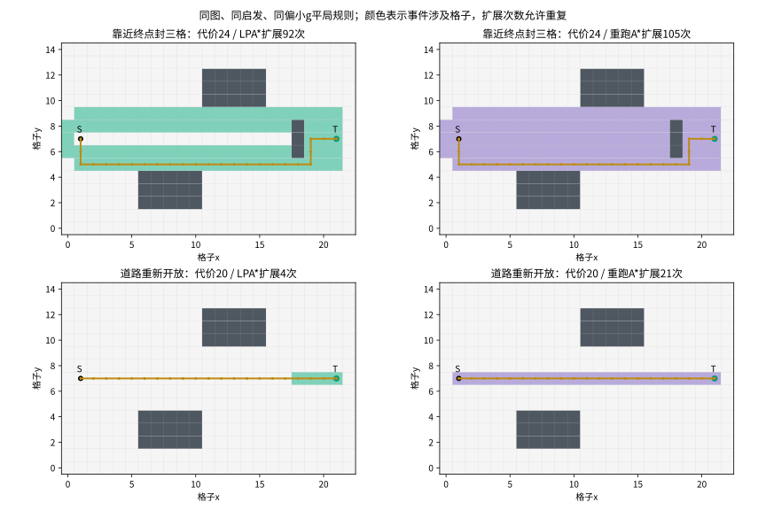
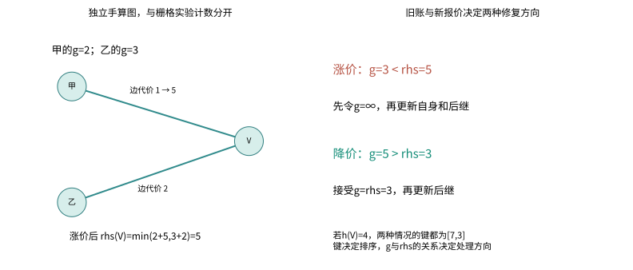
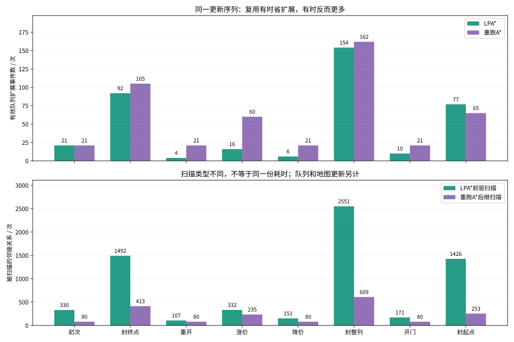
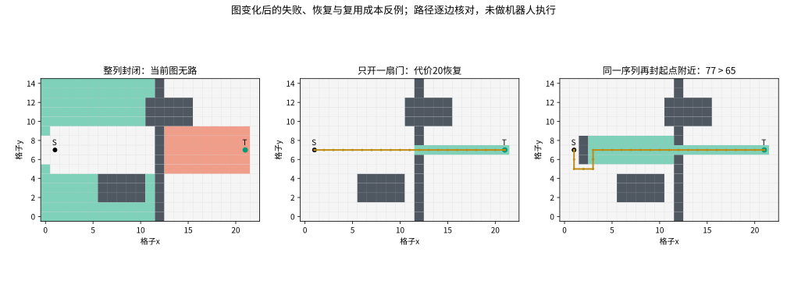

# 第23集：LPA*——路口突然封了，还要从头算吗？

第五部分“环境变化与搜索复用”开篇，承接第四部分已完成的静态搜索与优化。LPA*（Lifelong Planning A*，终身规划A*）是经典增量启发式搜索。本章按基础伪代码自写可运行实现，没有调用官方LPA*工程库，也不把2004年经典研究说成刚出现的新算法。

## 1. 这次改变了什么问题

起点和终点固定，在图的边代价变更后反复查询最短路线。保留g、rhs与待处理队列，用新的边代价修复旧搜索状态。机器人在查询期间没有移动；地图变化由实验直接给出，未实现感知、地图融合或未来行人预测。

主实验是23×15四邻接栅格，S=(1,7)，T=(21,7)。货架占据x=6…10,y=2…4以及x=11…15,y=10…12。没有对角线或切角。通常相邻边代价为1；任何端点格被封，相关边代价为∞。软代价格的相邻边取两端格代价最大值，代价始终≥1。演示路径代价用“代价单位”，不统一说成米或秒。

一致启发为曼哈顿距离$h(v)=|x_v-x_T|+|y_v-y_T|$，h(T)=0。四邻接相邻格的h差绝对值≤1，而可走边代价≥1，故所有地图版本都满足$h(u)\leq c(u,v)+h(v)$。如果另把边代价降低到1以下，不能不加修改地沿用这个启发。

图1：来自实际扩展事件日志。LPA*青色表示接受新报价，浅红表示撤销过时旧账；同一节点可能重复处理，图中着色格数不是扩展事件数。紫色为重新运行A*涉及的格子。所有最终路径按当前地图逐边检查。

## 2. 旧账g与一步前瞻rhs

$g(v)$是程序当前保存的起点代价估计，不是机器人累计行驶里程，也不是变更后立即正确的距离。

$rhs(S)=0$；对其他节点，$rhs(v)=\min_{u\in Pred(v)}[g(u)+c(u,v)]$。它根据前驱估计与当前边代价重算。一般有向图必须区分前驱和后继；本实验为无向四邻接图，二者集合相同。基础版本并不把一次rhs重算当成全局正确答案。

$g(v)=rhs(v)$叫局部一致，不等时把v加入待处理队列。初始化所有g、rhs为∞，再令rhs(S)=0并将S入队。之后保留状态跨查询使用。

图2是独立小图，不对应图1栅格的具体g值。甲、乙旧账为2、3，边代价1、2，故rhs(V)=min(2+1,3+2)=3。甲边涨到5后，rhs(V)=min(2+5,3+2)=5，g(V)仍为3：旧账过于乐观。

基础修复有两个方向：g>rhs时接受g←rhs，再更新后继；g<rhs时先设g←∞，再更新自身与后继，让依赖旧低代价的节点重新报价。反过来，旧g=5、降价后的rhs=3时应走接受分支。不能只处理封路，不处理重新开放或降价。

## 3. 排队与停止

令$m(v)=\min(g(v),rhs(v))$，键$K(v)=[m(v)+h(v),m(v)]$按字典序比较，先第一项、再第二项。实现另用稳定的节点坐标/序号消除完全相同键的歧义。不是将两个关键字再相加。

独立手算中取h(V)=4，涨价和降价两种状态的键都为[7,3]；键决定处理顺序，具体接受还是撤销仍由g与rhs关系决定。

只在$g(T)=rhs(T)$且$TopKey(U)\geq K(T)$时停止。队列为空时队首键按[∞,∞]处理。不要求全图清空不一致节点；本实验第一次查询结束仍有44个不一致节点保留，当前终点路径已满足条件。

图改变时，先将本批全部新边代价安装好，再对所有受影响有向边的终点更新rhs，批内去重通知，最后执行修复。Python堆采用带版本号的惰性删除，过期堆项不计有效扩展，但单独记录。

## 4. 同一更新序列的真实结果

A*与LPA*共享图、曼哈顿启发及偏向较小g的平局规则。首次查询两者均21次扩展、代价20。LPA*没有清空先前状态，A*每次从头开始。A*有效取出终点也计一次；LPA*接受或撤销一个有效队列项都计一次，同一节点可能扩展多次。

| 阶段 | 当前最短代价 | LPA*扩展 | 重跑A*扩展 | LPA*前驱扫描 | A*后继扫描 | LPA*入堆 | LPA*过期项弹出 |
|---|---:|---:|---:|---:|---:|---:|---:|
| 初次 | 20 | 21 | 21 | 330 | 80 | 65 | 0 |
| 封终点 | 24 | 92 | 105 | 1492 | 413 | 180 | 92 |
| 重开 | 20 | 4 | 21 | 107 | 80 | 15 | 2 |
| 涨价 | 22 | 16 | 60 | 332 | 235 | 43 | 20 |
| 降价 | 20 | 6 | 21 | 151 | 80 | 10 | 3 |
| 封整列 | 无路径 | 154 | 162 | 2551 | 609 | 306 | 209 |
| 开门 | 20 | 10 | 21 | 171 | 80 | 29 | 0 |
| 封起点 | 24 | 77 | 65 | 1426 | 253 | 186 | 109 |

主演示顺序：初次搜索；封(18,6),(18,7),(18,8)；三格重开；(16…19,7)格代价升至4；降回1；封x=12整列；只重开(12,7)；在这个历史状态上再封(2,6),(2,7),(2,8)。最后的反例保留前面全部更新历史，不能当成另一张独立初始图的统计。

图3：重开时4对21次扩展并不等于约5倍速度。LPA*还扫描107次前驱邻接关系，A*为80次后继扫描，两种扫描触发机制不同。实际队列入堆、过期项以及rhs更新另有日志。没有报告墙钟速度排名，没有把地图变化检测、图构建、oracle或渲染算进这些搜索计数。

概念账本为$T=T_{diff}+T_{rhs}+T_{queue}+T_{search}$。本实验边变更由已知格子直接产生，未评估从传感器地图发现变更的成本。对不同平局规则、图结构、实现和硬件，不外推本章数字。

## 5. 失败、恢复与反例

图4：封整列后，当前有限图被切断，终点g=rhs=∞且返回空路径，不能拿旧路径凑数。只开(12,7)后，修复恢复代价20的路线。图上无路不等于未知现实自由空间必无路。

最后再封起点附近三格，LPA*扩展77次，重跑A*为65次，复用这次更费扩展。少量地图变更也可能影响大量后继。算法并不承诺“改了几格就只处理几格”或“每次都比A*更快”。

## 6. 独立核验与复现

每个主阶段与独立反向Dijkstra的最短代价一致。Dijkstra不读取LPA*的g、rhs或队列；它在当前图上从终点重算。另以种子1、7、17生成三条独立的14×10栅格随机开关序列，每条30次，共90次变更，逐次与重跑A*和oracle核对代价。三个序列的初始空图相同，之后更新不同，不夸大为90个独立环境。

路径验收独立检查：起终点、每步曼哈顿距离恰为1、所有节点非阻塞、相邻关系、按原始软代价重新累计总代价；不可达时返回空路径。终点一致和队首停止条件都有断言。测试通过覆盖这些输入，不能替代面向所有情形的证明或工业验收。

运行`python experiment.py`，输出`qa/experiment.json`和真实扩展事件。生成图解时设置`COURSE_CJK_FONT`为自己的中文字体路径，再运行`python make_notes.py`。公开仓库保留代码、JSON与文本SVG；完整视频、音频和人物模型单独交付。

## 7. 下一层问题

本集处理固定起终点下的图变化；移动起点可继续研究D* Lite。未来何时出现移动障碍，需要预测、时间维度与安全策略；车身尺寸、跟踪、制动和实时预算也未纳入当前图模型。演示的三维网格和光点只是教学回放，不能当成机器人已执行或已完成动态避碰。

## 原始资料

1. Koenig, Likhachev, Furcy. Lifelong Planning A*. Artificial Intelligence, 155(1–2), 93–146, 2004. DOI: 10.1016/j.artint.2003.12.001。作者论文：https://www.cs.cmu.edu/~maxim/files/aij04.pdf
2. 作者项目与实验口径说明：https://idm-lab.org/applet.html
3. 作者论文索引及勘误：https://idm-lab.org/bib/abstracts/Koen04a.html 。本章采用基础版伪代码，不用有勘误的优化版第27行。
4. CMU原始出版记录：https://publications.ri.cmu.edu/lifelong-planning-a

核对日期：2026-10-29。所有数字取自本章实际运行；图2独立手算有明确标注。画面与旁白含AI辅助制作。
