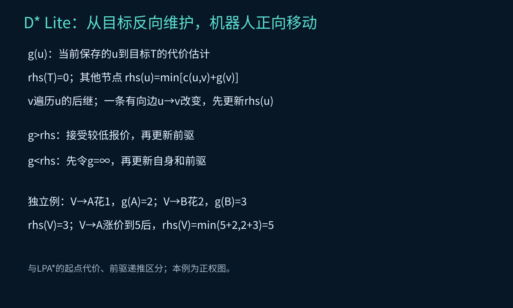
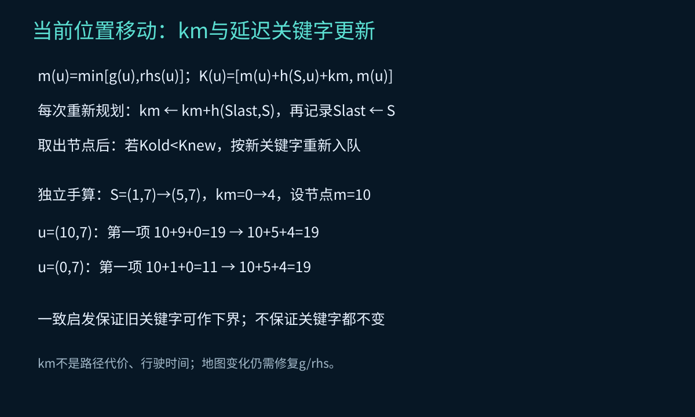
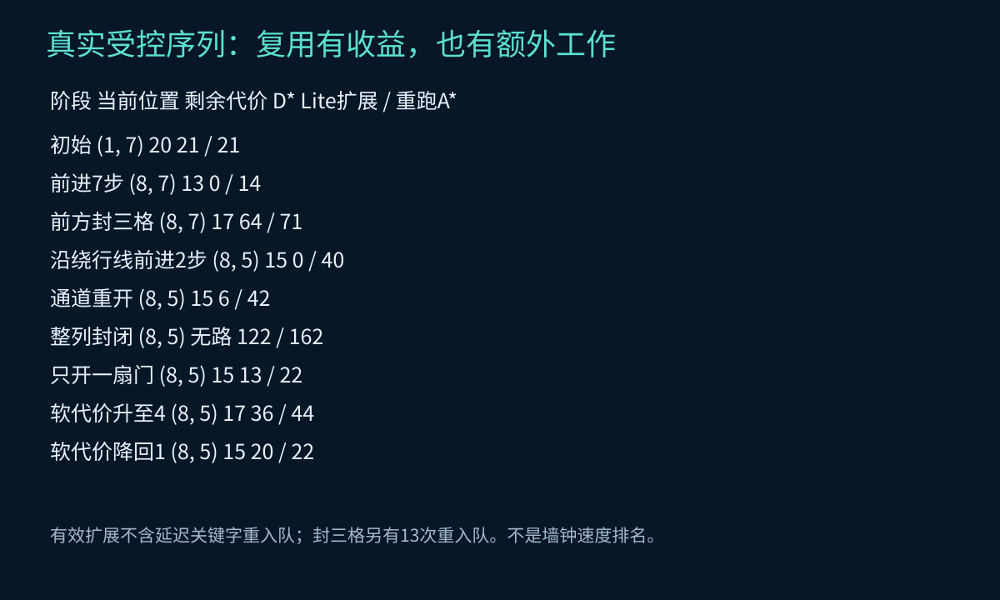
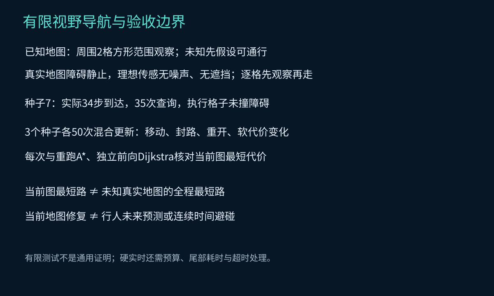

# 第24集：D* Lite——走到一半，前面封了怎么办？

## 1. 从LPA*接到移动中的重规划

上一集固定起终点，处理图代价变化。本集目标固定、当前位置移动，继续保留g、rhs和优先队列。自写实现对应Koenig与Likhachev的AAAI 2002论文基础版Figure 3，不是官方库复现。每次规划在机器人静止时完成，之后离散移动一格；不涉及连续动力学。

## 2. 从目标反向维护

本集g(u)是u到目标的代价估计，与上一集从起点出发的估计不同。

$$rhs(T)=0,\qquad rhs(u)=\min_{v\in Succ(u)}\{c(u,v)+g(v)\}.$$

有向边u→v改变，首先更新源节点u的rhs；修复时目标代价向前驱传播。在无向栅格，前驱后继集合相同，但这个事实不能替代方向理解。



*图1：独立手算图，不对应主栅格具体节点和扩展计数。*

当g>rhs，接受更低报价并更新前驱；当g<rhs，先把旧g撤为∞，再更新自身及前驱。只有不一致节点保留在逻辑队列，Python堆内采用版本号惰性删除。

## 3. 移动起点、km与队列

$$m(u)=\min(g(u),rhs(u)),\qquad K(u)=[m(u)+h(S,u)+k_m,\ m(u)].$$

关键字按字典序比较。本实现每次重新查询时执行km←km+h(Slast,S)，再记录Slast=S。基于满足三角不等式的一致启发，原存储关键字可继续作为下界。取出后若Kold<Knew，就用新值入队，避免每次移动立即全量重排。



*图2：有的关键字不变，有的增加；“下界”不等于“所有旧关键字仍然精确”。km不进入真实路径代价。*

本集四邻接边代价至少1，使用两节点曼哈顿距离。地图涨跌价与封路依然需要正常更新rhs，km不能代替修复。

## 4. 停止与路径提取

基础版停止条件为当前位置g=rhs，且TopKey(U)≥K(S)。不要求队列为空。选取c(S,v)+g(v)最小的后继执行下一步。当前位置g=∞则返回无路，不移动。路径逐段独立验证端点、邻接、阻塞与代价总和。正边代价保证本例目标代价沿已提取路径严格下降。

## 5. 真实受控实验

23×15栅格，初始S=(1,7)、目标T=(21,7)，两组货架；同一序列保留全部历史。外部地图通知的受控更新，与下一节的有限范围感知分开。

| 阶段 | 当前S | 剩余代价 | D* Lite有效扩展 | 重跑A*扩展 | D* Lite延迟关键字更新 |
|---|---|---|---|---|---|
| 初始 | (1, 7) | 20 | 21 | 21 | 0 |
| 前进7步 | (8, 7) | 13 | 0 | 14 | 0 |
| 前方封三格 | (8, 7) | 17 | 64 | 71 | 13 |
| 沿绕行线前进2步 | (8, 5) | 15 | 0 | 40 | 0 |
| 通道重开 | (8, 5) | 15 | 6 | 42 | 0 |
| 整列封闭 | (8, 5) | 无路 | 122 | 162 | 25 |
| 只开一扇门 | (8, 5) | 15 | 13 | 22 | 0 |
| 软代价升至4 | (8, 5) | 17 | 36 | 44 | 0 |
| 软代价降回1 | (8, 5) | 15 | 20 | 22 | 0 |



*图3：数据来自本实现，有限场景工作量对照，不是官方算法速度排名。*

前进7步时0扩展仍有函数调用、路径提取和检查成本。封路阶段64次有效扩展另有13次关键字重入队；两者不混算。绕行后开门，当前最短代价仍为15，不能为了叙事把每次开门都说成路线变短。整列封闭来自外部地图通知，不伪装成有限视野同时看见整列。

## 6. 有限视野导航

另一个实验真实障碍静止，机器人从未知图出发；切比雪夫半径2方形范围内观察，未知按自由处理，无遮挡和噪声建模。每次观察→安装地图变化→求解→走一格。种子7实际走34步、35次查询到达目标，每步未进入真实障碍。每次当前已知图最短路与独立oracle一致；并不保证全程等于真实全知地图最短路。



*图4：当前地图最短、全程最短、时序安全是不同结论。*

## 7. 复核与实时性边界

3个种子各50次混合更新，包含移动起点、软代价变化、封路和重开；150次查询逐次与重跑A*及独立前向Dijkstra核对代价。三个序列初始图相同、后续更新不同，不夸大成150个独立环境。教学有限测试不替代论文的理论证明。

有效扩展、邻居扫描、堆过期项、关键字更新分开报告。日志中的单次perf_counter观测受Python解释器和环境影响，不据此做耗时排名。感知、地图diff、oracle和渲染不包含在规划调用计时内。硬实时结论还需目标硬件、预算、耗时分布、超时次数及失效处理，本集不宣称硬实时。

## 8. 已发现变化不等于预测移动障碍

当前算法处理已安装的图变化。行人未来在哪里、机器人什么时候经过、连续段是否碰撞、制动距离和执行延迟，都不在此位置图模型中。后续再用时空A*、SIPP和滚动预测处理；下一集先讲ARA*→AD*的限时求解与持续改进。

## 9. 复现

```bash
python -m pip install -r requirements.txt
python experiment.py
python make_notes.py
```

实际记录在qa/experiment.json；教学脚本在lesson.json与narration.txt。三维地图按实际查询和扩展事件回放，动画速度不是算法运行时间。

## 10. 原始来源

- Koenig, S. & Likhachev, M. (2002), **D* Lite**, AAAI，基础伪代码Figure 3及未知地形导航模型：https://idm-lab.org/bib/abstracts/papers/aaai02b.pdf
