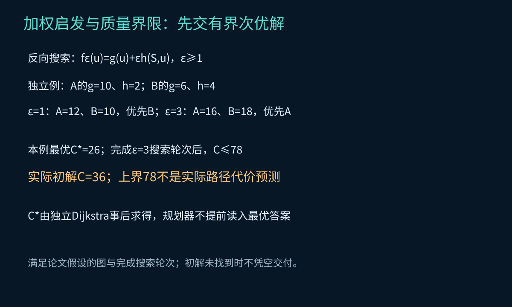
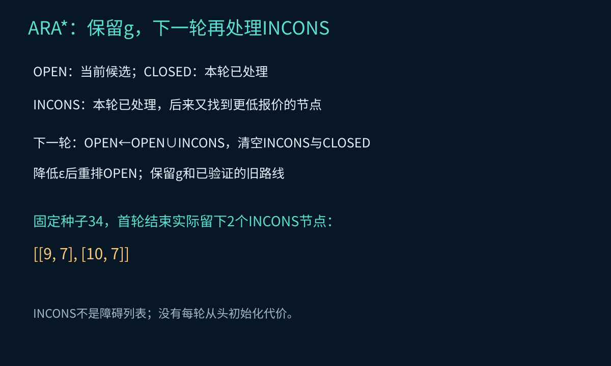
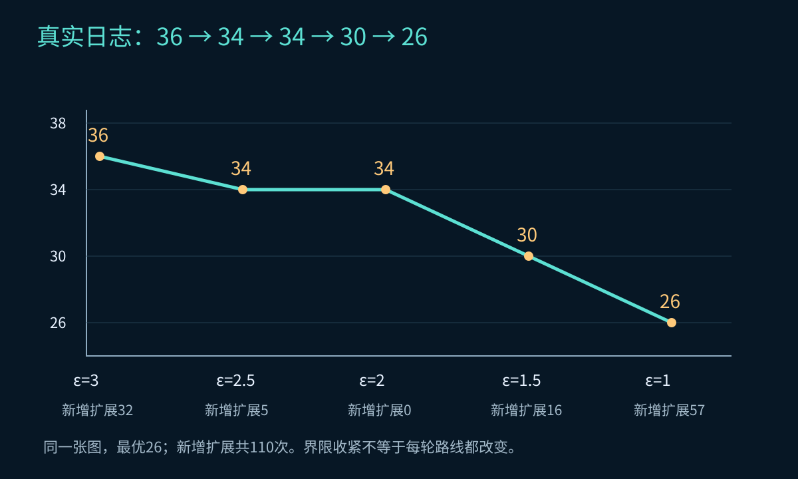

# 第25集：ARA* → AD*——时间不够，先交哪条路线？

## 1. 承接D* Lite：最优答案也可能来得太晚

上一集处理移动当前位置与图代价变化，求当前已知图最短路。本集固定起终点，在复杂搜索中先完成有质量界限的路线，再继续改善；地图变化时还要修复。Anytime不意味着任意短预算内都已有初解。

自写教学实现采用ICAPS 2005中的反向ARA*（Figure 3）与基础AD*（Figures 4—5）；不是官方库或真实机器人。正权四邻接图，边代价为两端软代价最大值且至少1，使用一致曼哈顿启发。静态改善轮次之间图不变；图变化在查询之间一次性安装。

## 2. 加权启发与质量界限

$$f_\epsilon(u)=g(u)+\epsilon h(S,u),\qquad C\leq\epsilon C^*,\quad\epsilon\geq1.$$

反向实现从目标传播g，启发距离指向固定起点。系数大通常更偏向启发方向，但不保证任意图都更快。质量界限约束完成轮次所交付路线在当前离散图中的代价；不约束物理时间或未来障碍碰撞。



*图1：独立候选排序手算与实际图质量上界分开。最优26由独立Dijkstra事后核验，不作为算法输入。*

ε=3时界限是78，实际初解36，不是必须走78；“三倍”也不是“多三米”。

## 3. ARA*怎样复用

保留g、OPEN与INCONS。CLOSED记录本轮已扩展节点；本轮已扩展而后来g又改善的节点进入INCONS，留到下一轮。降低ε前，把INCONS并入OPEN并清空，重排优先级、清空CLOSED，再继续搜索。



*图2：种子34首轮实际留下两个INCONS节点，下一轮并回OPEN；不是障碍列表。*

本实现ARA*主关键字相同后用g作为确定性平局规则。反向ARA*在起点已被发现且满足标量停止条件时即可结束，不一定弹出起点。

## 4. 真实改善与不变的平台期

演示种子按能展示分阶段改善及INCONS的条件选为34，不用它做统计性能推断。系数3、2.5、2、1.5、1对应路线36、34、34、30、26；新增有效扩展32、5、0、16、57，共110。ε从2.5降到2时，无需新增有效扩展便满足新轮次停止条件，路线不变。



*图3：横轴是教学选择的系数阶段，不是时间；纵轴是实际路线代价。*

累计扩展不保证比直接求最优少。Anytime的价值还包括中途可以获得已验证的可用路线。

## 5. AD*：改善与图修复结合

维护目标代价g与后继递推的一步前瞻rhs，更新有向边u→v后先更新源节点u。OPEN/CLOSED/INCONS支持分轮改善与修复。关键字区分两种情况：

$$K(u)=\begin{cases}[rhs(u)+\epsilon h(S,u),rhs(u)],&g(u)>rhs(u),\\[g(u)+h(S,u),g(u)],&g(u)\leq rhs(u).\end{cases}$$

旧低估失效的处理使用未膨胀启发，不能把D* Lite的全部关键字一律乘ε。独立手算h=4、ε=2：g10/rhs6得到[14,6]，g6/rhs10得到[10,6]。

本教学按阶段手动选择ε及地图更新，不实现“显著变化”的自动阈值策略，也不加入移动起点km；后者已在第24集独立讲解。

## 6. 真实封路、重开与无路恢复

下表ARA*阶段共享原图，AD*各图版本按序变化。AD*先求至26，封路线上的(11,4)后旧路线失效；新图最优为28，先修得34，再改善至28。重开后先保留28，降低ε后才回到26。封x=12整列时无路；再打开原可行路线经过的门格后恢复26。

| 阶段 | 算法 | ε | 实际路线代价 | 独立最优 | 新增有效扩展 | 结束INCONS |
|---|---|---|---|---|---|---|
| ara_3 | ARA* | 3 | 36 | 26 | 32 | 2 |
| ara_2.5 | ARA* | 2.5 | 34 | 26 | 5 | 0 |
| ara_2 | ARA* | 2 | 34 | 26 | 0 | 0 |
| ara_1.5 | ARA* | 1.5 | 30 | 26 | 16 | 0 |
| ara_1 | ARA* | 1 | 26 | 26 | 57 | 0 |
| ad_first | AD* | 3 | 34 | 26 | 37 | 2 |
| ad_optimal | AD* | 1 | 26 | 26 | 66 | 0 |
| ad_closure | AD* | 2.5 | 34 | 28 | 54 | 2 |
| ad_repair_optimal | AD* | 1 | 28 | 28 | 45 | 0 |
| ad_reopen | AD* | 2 | 28 | 26 | 0 | 0 |
| ad_reopen_optimal | AD* | 1 | 26 | 26 | 31 | 0 |
| ad_no_path | AD* | 2 | 无路 | 无路 | 109 | 0 |
| ad_gate | AD* | 2.5 | 26 | 26 | 15 | 0 |
| ad_gate_optimal | AD* | 1 | 26 | 26 | 17 | 0 |


*图4：当前图版本、路径可行性和完成轮次的质量界限必须一起核对。*

ARA*与AD*的终止条件、起点处理及撤销事件口径不同，不直接用两者扩展次数做通用速度排名。AD*完成后按c(u,v)+g(v)贪心提取路线，实际路线代价可低于存储g(S)，均独立复算并检查ε界限。

## 7. 三类预算中断

1. 首轮只给5次扩展：未完成，无合格初解，不把最终完整路线冒充预算内结果。
2. 同一图已完成ε3的代价36路线，设置ε1后只给1次扩展：新轮未完成，可保留同图已验证旧路线，但仍只能沿用旧完成界限。
3. 地图封格后只给1次修复扩展：旧路线独立复检穿过障碍，不能继续照走。中断状态继续保存，等待后续完整修复；不发布未完成的新界限。

预算是每次有效扩展之间检查的确定性节点上限，不是毫秒截止、抢占式调度或硬实时承诺；本例停止离散移动不等于真机制动安全验收。

## 8. 复核与适用边界

3种子×30次图变化×3个完成系数阶段=270次AD*查询；包含封路、重开及软代价变化。另20张静态图×5阶段=100次ARA*查询。逐条检查端点、邻接、阻塞、实际代价，并与独立Dijkstra的最优值核对：C≤εC*，ε1时C=C*；新鲜A*也核对最优代价。

有限测试不替代理论证明。计算事件数不等于运行时间；堆、重排、路径提取、感知和执行都有开销。本集没有未来运动预测、连续时间避碰、动力学或真机实验。

## 9. 复现

```bash
python -m pip install -r requirements.txt
python experiment.py
python make_notes.py
```

`grid.py`包含共享图、独立Dijkstra及重跑A*；`experiment.py`实现ARA*、AD*和预算测试；`qa/experiment.json`为完整真实日志，`qa/summary.json`为简表。原论文PDF未随工程重新分发。

## 10. 原始来源

- Likhachev, Gordon & Thrun (2003), ARA*: Anytime A* with Provable Bounds on Sub-Optimality：https://www.cs.cmu.edu/~maxim/files/ara_nips03.pdf
- Likhachev et al. (2005), Anytime Dynamic A*: An Anytime, Replanning Algorithm，Figures 3—5：https://www.cs.cmu.edu/~maxim/files/ad_icaps05.pdf
