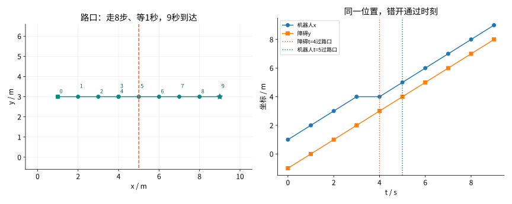
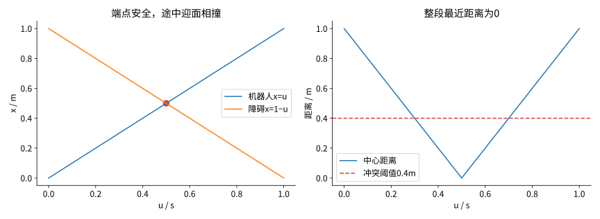
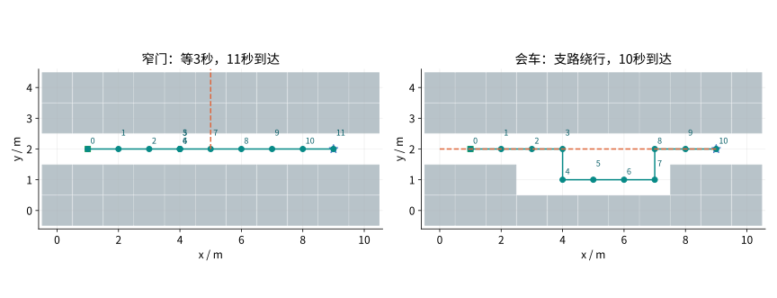
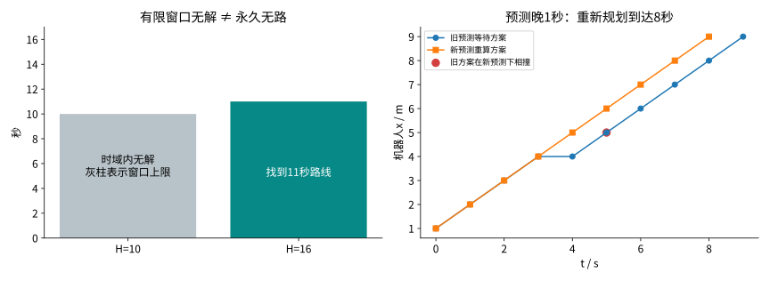

# 第27集：时空A*——路没堵，为什么还是撞上了？

## 1. 当前地图可行，不等于未来不会相遇

本集给定动态障碍的未来轨迹，规划机器人在什么时刻经过什么位置。状态s=(x,y,t)；二维位置＋一维时间，立体图高度代表时间，不是三维飞行。快照增量修复与未来时序避碰是不同的问题。预测来自外部输入，本代码不从传感器推断人的未来。



图1：左为真实路口实验，数字是秒数，重复位置代表等待；右分别为机器人x与障碍y，两条不同含义坐标曲线相交本身不代表碰撞。双方过路口的时间为5秒与4秒。

## 2. 动作、启发值与独立手算

整数栅格每次上下左右走1m、用1s，或原地等1s，动作费用均为1s。关闭表必须包含时间；(4,3,3)与(4,3,4)是两个节点。目标到达后留在原地至有限时域H，所有驻留段也检碰。

`f(s) = g(s) + h(s)`；`h(s) = |x − x_G| + |y − y_G|`。

g为已花秒数。Manhattan下界忽略障碍与等待，不高估。每个状态的g由t唯一决定，所以此实现可以在首次发现时记入seen；不能照搬到不同边权或可变时长问题。最优性仅针对给定动作、预测和有限时域的图。

真实手算：机器人t=3在(4,3)，直接到(5,3,4)与行人相遇，拒绝。此时g=3、h=5、f=8；等至(4,3,4)，g=4、h=5、f=9，再于t=5到路口，整段安全。等待位置也要安全。

## 3. 端点、边交换与整段碰撞

机器人和障碍均为半径0.2m的圆盘，中心距离≤0.4m含接触判碰撞。静态禁区为单位格方块；仅自由格中心和轴向邻边、机器人半径0.2m，此特例下合法静态端点即可保证该轴向段不进入禁区。不适用于任意曲线、对角或更大车身。

整数时刻之间双方各自直线匀速运动。相对位置r(u)=r₀+uv，u∈[0,1]，解析最近点：

`u* = clip(−(r₀ · v)/(v · v), 0, 1)`；`d_min = √((r₀ + u*v) · (r₀ + u*v))`。

v=0时直接算固定距离。每条动作、原地等待和目标驻留均须d_min>0.4m。数值实现用1e−9接触容差。



图2：2×1小图机器人0→1、障碍1→0，端点版报告1秒成功，但t=.5重合，完整版本无可行路线。另有(.5,−1)→(.5,1)横穿夹具，所有端点不同也会半秒相撞。两种漏检均实际运行。

## 4. 等待和绕行的真实结果

横穿：11×7，S=(1,3)、G=(9,3)、H=16，障碍x=5、y=min(t−1,8)。忽略动态的8秒基线碰撞；时空方案8步＋1秒等待，9秒到达，最小中心距0.707107m。

窄门：11×5仅y=2可通行。障碍(5,2)停至t=6，之后沿y每秒移动1m至y=5停下。时空方案8步＋3秒等待，11秒到达。动态障碍是独立预约轨迹，可走机器人静态禁区，不受机器人栅格约束。

会车：主通道y=2，开放x=3…7、y=1支路。障碍自(9,2)每秒向左1m到x=0停下。机器人绕支路10步、0秒原地等，10秒到达，最小中心距1m。



图3：两种真实时序路径的位置投影，标注为秒数，重复位置等待见原始JSON或网页时间滑块。橙虚线是预测位置集合，不代表永久封锁。

## 5. 目标、时域与预测更新

目标不是自动消失点。独立夹具里t=2障碍占目标，t=1到达后留下不合法；规划器和独立对照都选择t=3到达。到H的驻留安全不意味着H之后安全。

同一窄门H=10时完整搜索返回当前窗口无解；H=16时找到11秒路线。“时域内无解”“永久无路”和“预算未完成”不可混用。状态上界为自由位置数×(H+1)，本代码没有墙钟截止或真机制动。

将横穿预测改成y=min(t−2,8)，即晚1秒过路口，旧9秒等待方案在新预测下t=5相撞。按新预测重算，得到8秒直行方案。这是出发前修改预测，不是边行驶边感知、重算、执行的实验。



图4：灰柱仅表示H=10窗口上限，不是到达代价。右图比较两份预测的方案，旧方案在新预测下失效，输入预测本身不保证正确。

## 6. 同模型的有条件对照

|场景|到达s|移动步|等待s|最小中心距m|展开状态|候选转移检查|独立最早到达|
|---|---:|---:|---:|---:|---:|---:|---:|
|横穿|9|8|1|0.707107|10|45|9|
|窄门|11|8|3|0.707107|19|90|11|
|会车|10|10|0|1.0|16|75|10|
|迎面交换|无解/—|无解/—|无解/—|无解/—|1|5|无解/—|
|窄门H=10|无解/—|无解/—|无解/—|无解/—|58|245|无解/—|
|预测晚1秒|8|8|0|0.707107|9|40|8|

空间基线仍使用同一有限时空搜索框架，但忽略动态检碰，是隔离动态约束影响的对照，不是优化纯二维A*的性能基准。端点版只查每段两端，保留其假成功并用完整检碰验收。展开数不是毫秒；候选转移检查含越界和静态拒绝，驻留复检另计。一次本机耗时不能证明速度排名、固定频率或硬实时。

## 7. 独立验收与边界

种子2705，120次7×5随机图查询，1—3条随机轴向障碍轨迹，H∈{7,9,12,16}。独立逐时间层动态规划等价单位代价Dijkstra，逐次核对最早到达或无解；另用相对距离二次不等式根区间法复检完整路线、动作与驻留。全部通过。固定夹具覆盖交换边、途中横穿、目标驻留、短时域与预测修订。有限验证不替代理论证明。

这是单机器人面对给定预约轨迹的有限时空A*，不是完整多智能体联合/优先级规划；没有实现HCA*、WHCA*、SIPP、运动学转弯、加减速、感知延迟、预测误差或真机。给定模型内最早到达，不等于现实中最快或最安全。没有硬实时保证。

## 8. 复现与原始来源

```bash
python experiment.py
```

只需Python3.11+标准库。qa/experiment.json保留输入、逐秒路径、展开事件、假成功反例、目标夹具和120次对照。网页为日志回放，改参数需重新运行Python。

- David Silver，Cooperative Pathfinding，AIIDE 2005，时空搜索、等待与预约表。这里只采用单次时空搜索思想，不复刻完整协作算法：https://ocs.aaai.org/Papers/AIIDE/2005/AIIDE05-020.pdf 。AAAI迁移版本：https://ojs.aaai.org/index.php/AIIDE/article/download/18726/18503/22369 。
- Mike Phillips & Maxim Likhachev，SIPP: Safe Interval Path Planning for Dynamic Environments，ICRA 2011，时间维度与下一集衔接核对，本集不实现SIPP：https://www.cs.cmu.edu/~maxim/files/sipp_icra11.pdf 。

下一集28：SIPP——合并连续安全时刻，减少显式时间节点。
