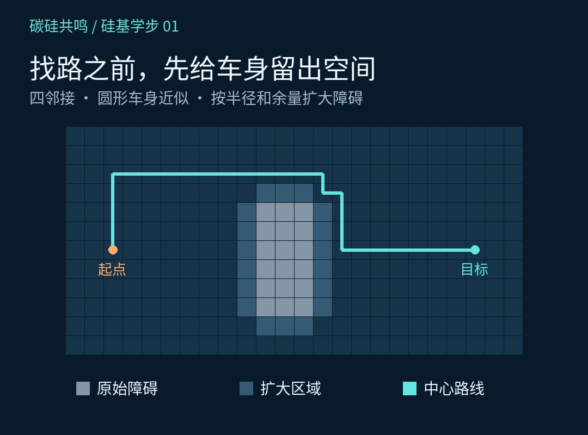
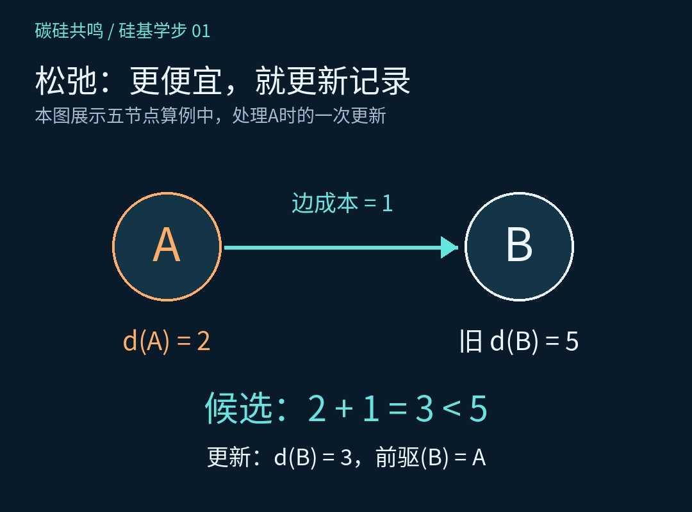
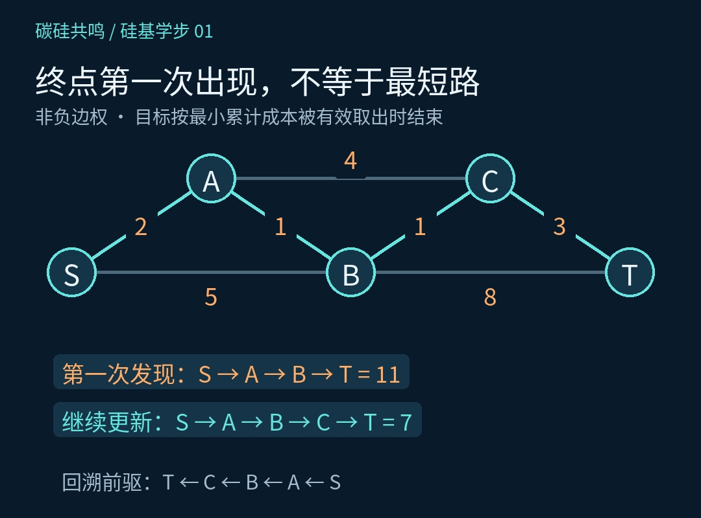
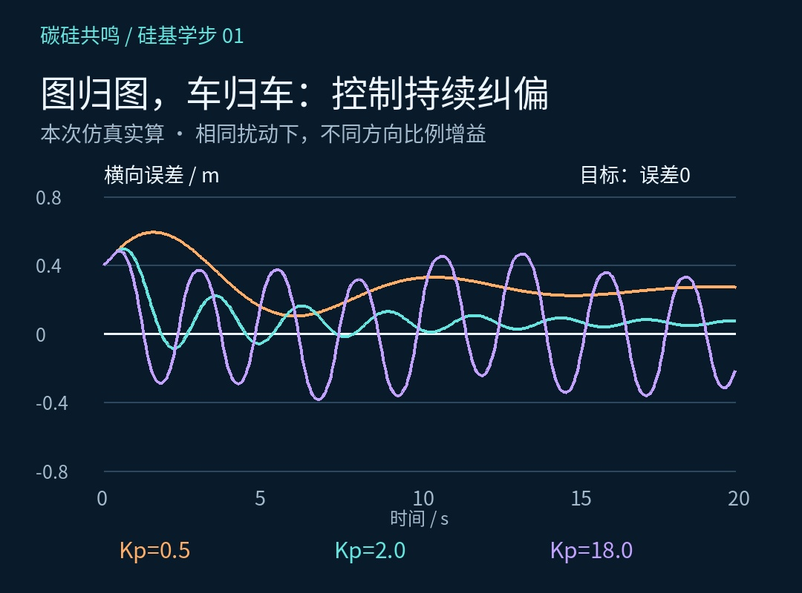

# 两点之间直线最短，机器人怎么先撞上了椅子？

老板今天只提了一个需求：到桌子那边去。

硅宝一听：这还不简单？两点之间，直线最短。然后，它就撞上了椅子。

椅子表示：你数学不错，但你礼貌吗？

这是《硅基学步》第1课里的一个小翻车。硅宝是碳硅共鸣的001号员工，正在学习规划与控制。今天先解决一件具体的事：小车怎样自己找一条绕开椅子的路，再沿着这条路走过去。

## 01｜找路之前，先给车屁股留个位置

人看一眼房间，就知道该从哪边绕。算法需要先拿到一张能计算的地图。

这个实验把房间划成格子：可通行的位置是节点，相邻节点之间允许移动，就连一条边。先只准上下左右走，椅子占据的格子不能走。

还有一个容易漏掉的问题：小车有宽度。车中心能通过，不代表整个车身能通过。机器人也不能只顾头，不顾腚。

因此，本期把车身简化成圆形，按车身半径加余量扩大障碍区域，再给车中心找路。圆形近似和余量是本次模型的设定；换成别的车形或运动方式，还要重新检查。

*图1：灰色为原始障碍，周围蓝灰色为扩大区域；路线需要让整个车身留出空间。*

## 02｜算法说的“最短”，得先把账算清楚

如果每走一格都算1分，少走几步，通常就少花几分。但如果某片地面不好走，进入那里的成本改成3分，格子数更少的路线，就未必更划算。

像买东西：页面便宜5块，结账运费8块。只盯着一个数字，很容易高兴得太早。

所以，这里说的最短路径，指总成本最低的路径。成本可以表示距离，也可以按任务建模为时间、能耗等指标；本期先用简单分数，把账算明白。

## 03｜Dijkstra的核心：先处理当前最便宜的

给每个节点记一个数d：从起点到这里，目前找到的最低累计成本。起点记0，其他节点暂记∞。无穷大只是“还没有找到路线”的标记。

接着反复做三件事：在尚未确定的节点里，选累计成本最小的；检查它能到达的邻居；如果经过它能得到更低成本，就更新邻居的记录，并记下前驱。

核心计算只有一句：候选成本＝d(u)＋w(u,v)。如果候选成本小于d(v)，就把d(v)更新为候选成本，前驱设为u。

这一步叫“松弛”。听着像算法准备躺一会儿，实际是在替邻居重新算账。注意：本期Dijkstra根据已经累计的成本选择节点，距离终点还有多远，不直接参与这个选择。

为什么选出的节点可以算定？条件是边权非负。当前节点已经是所有待处理节点中成本最低的，再通过其他尚未确定的节点绕回来，也不能靠后面的非负成本把总账压得更低。

*图2：经过A到B的候选成本为2＋1＝3，比原记录5低，更新成本和前驱。*

## 04｜终点第一次出现，先别急着下班

来看视频里的五个路口。起点S直接到A花2分，到B花5分。先处理A，经A到B只需2＋1＝3分，于是B从5改成3；经A到C是2＋4＝6分。

接着处理B，因为它的3比C的6小。经B到C需要3＋1＝4分，C从6改成4；经B到终点T需要3＋8＝11分。

终点出现了！硅宝已经准备提交任务，申请下班。可C还只有4分，没检查。继续处理C，经C到T是4＋3＝7分，终点记录从11改成7。

差点为了提前下班，多走4分冤枉路。

因此，第一次发现终点不等于找到最短路径。对于这里的非负边权Dijkstra，目标以当前最小累计成本被有效取出、确定下来时，才可以结束。实际使用优先队列时，还要跳过过期条目。

最后沿前驱倒着找：T←C←B←A←S，再反转得到S→A→B→C→T。总成本2＋1＋1＋3＝7。终点上的数字，才变成了小车可以参考的一串位置。

*图3：同一个终点，第一次发现成本11，继续松弛后得到成本7。最短路线不一定经过最少的边。*

## 05｜图上的线很听话，车可不一定

路线找到了，硅宝刚要报喜，小车又走偏了。图归图，车归车。

规划回答“走哪条路”；控制则根据实际位置、朝向和目标，持续修正运动。视频主动加入运动偏差，再观察反馈纠偏的效果。

本期用一个简化的方向比例控制：先求目标方向与车头方向之差，把误差处理到正负180度范围内，再令角速度ω＝Kp×方向误差，并限制转速。方向差得太多时，先减速转向。

修正太慢可能跟不上，修正过猛也可能在特定速度和控制周期下左右摆动。原本送货，开着开着成了扭秧歌。图中轨迹来自本次仿真，不能把其中一组参数当成所有机器人的通用答案。

*图4：本次仿真的目标轨迹与实际响应。先看懂反馈过程，再进一步研究模型、参数和稳定性。*

## 06｜跑通一次，还得换个工况再考

把椅子挪动，路线应该重新算；把车身调大，障碍的扩大范围也要重算；把局部地面成本提高，算法可能选择格子数更多、总成本却更低的路。

最后，把通道彻底堵住。正确结果就是没有找到可行路线。不能为了完成任务，现场画一条穿墙路线。硅宝还没解锁这个技能。

再补一个常见问题：Dijkstra是不是BFS？所有边成本相同时，BFS也能按层找到最短路径；成本不同时，就不能只数层数，需要按累计成本比较。

折腾完这一圈，椅子保住了，硅宝的试用期也保住了。老板却又问：终点明明在右边，你怎么还搜了这么多其他地方？

硅宝：工作认真，顺便熟悉一下周边环境。

下一课，就给这位认真过头的同事加一点方向感：在已经花掉的成本之外，再估计离终点还要花多少。这就是我们接下来要认识的A*。

## 亲手做一组对照

[打开本节交互实验室](#/lesson/01/lab)。所有算法在浏览器中实际运行；三维区域支持左键旋转、右键平移与滚轮缩放。

实验参数和预算口径以实验界面说明为准。机械臂的真实姿态在三维世界展示，搜索变量仍是两个关节角；三维空间场景则以(x,y,z)为状态。
