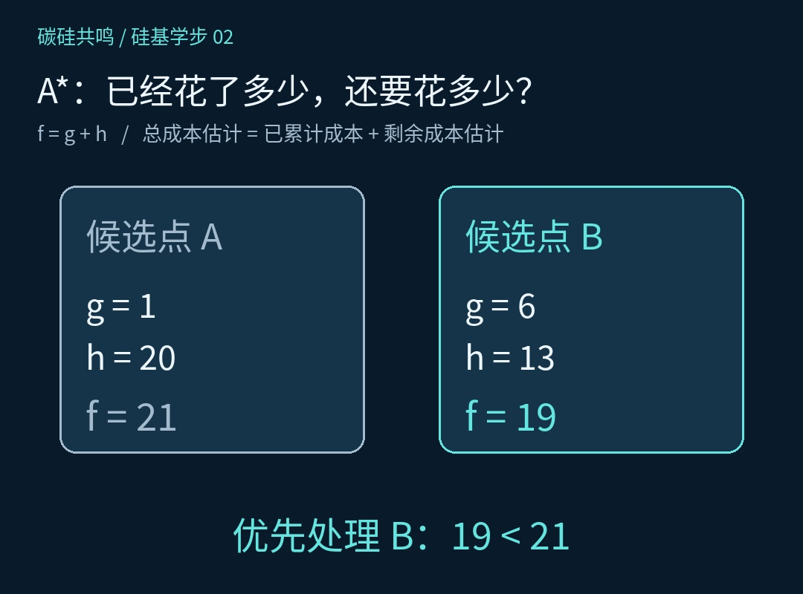
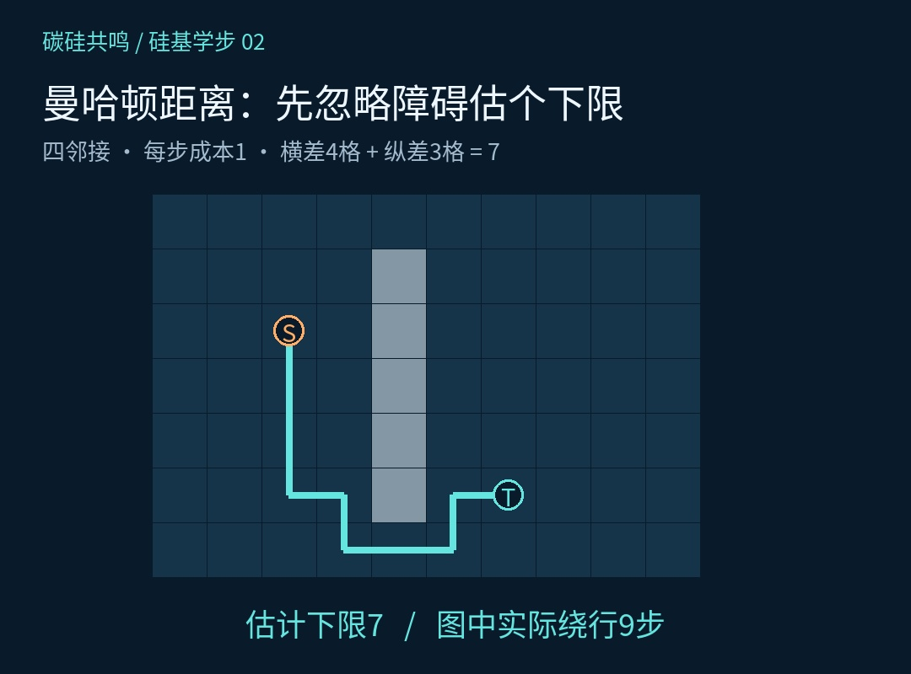
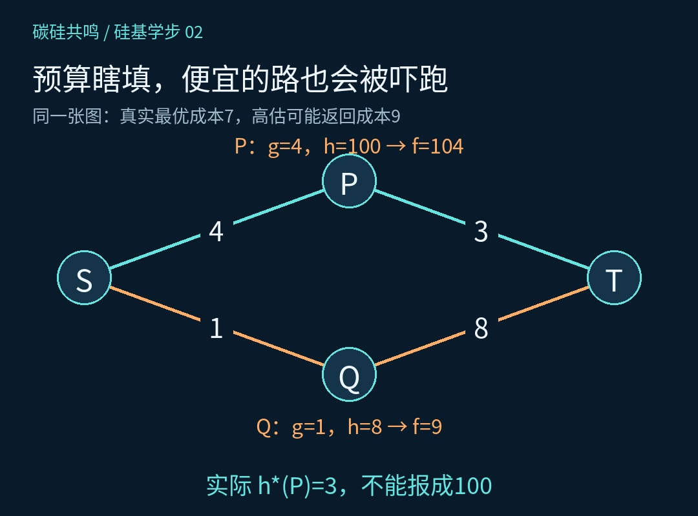
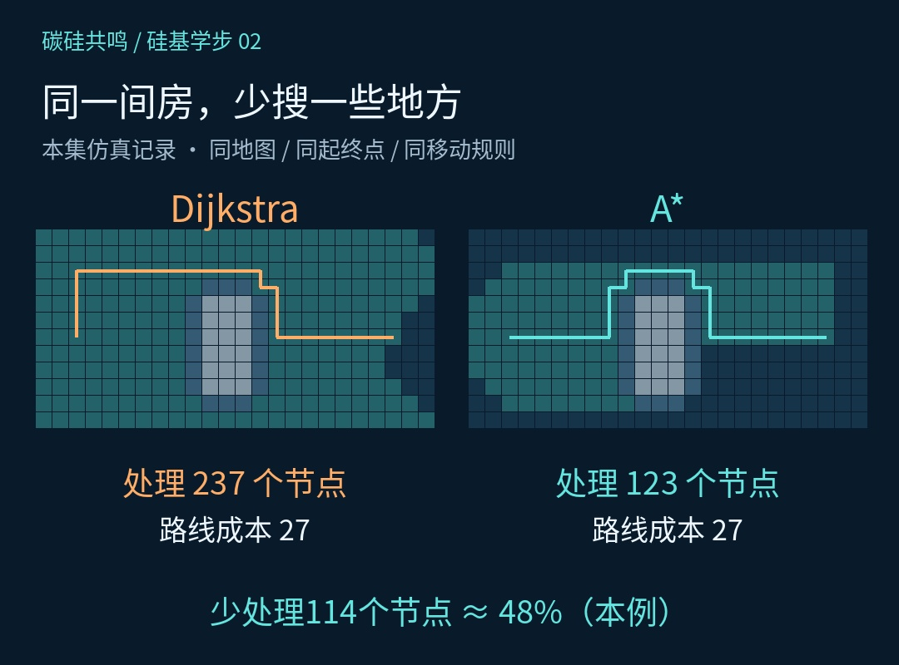

# 终点就在右边，机器人为什么还往左搜？A星来算这笔账

上一集，硅宝终于绕开了椅子。椅子保住了，试用期也保住了。

老板看了一眼搜索过程，又有意见：“终点明明在右边，你怎么把其他地方也搜了一遍？”

硅宝：“工作认真，顺便熟悉一下周边环境。”

老板：“你是去桌子那边，不是去考察整个园区。”

这是《硅基学步》第2课。上一集用Dijkstra把路找对，这一集给搜索添一点方向感：A*（读作A星）。

## 一、只算已经花的钱，还不够

Dijkstra每次从候选队列里选出累计成本最小的节点处理。它并不知道终点在哪个方向更值得先探索，因此有时会搜索较大一片区域。

把从起点走到某个节点、目前找到的最低累计成本叫作g。再加一笔账：从这个节点到终点，估计还需要多少成本，叫作h。

A*用两者之和安排搜索顺序：f = g + h。g是走过来的账，h是剩下的估计，f是经过这个节点到目标的总成本估计。

比如候选点A：g=1、h=20，合计21；候选点B：g=6、h=13，合计19。A*优先处理B。已经花得多一点，整趟行程却可能更划算。

19仍是估计，不能提前写进验收报告。中间遇到障碍，还可能绕路。只盯着h、谁看起来离目标近就搜谁，属于贪心最佳优先搜索；A*还会认真计算已经花掉的g。

*图1：比较整趟行程的估计，不能只看已经花掉的成本，也不能只看离终点多近。*

## 二、这个“估计”，到底怎么来？

本期沿用一个明确的简化条件：小车中心在网格上移动，只允许上、下、左、右走，每步成本都是1。车身需要的空间先通过扩大障碍物来预留。

此时可以使用曼哈顿距离：h = |x−x目标| + |y−y目标|。横向差4格、纵向差3格，估计就是7。

这次估计暂时忽略障碍：没有椅子时至少需要7步，加上椅子后可能走得更多。因此它是一个乐观的下限。算估计时可以暂时不考虑椅子，开车时可不能这么乐观。上一集已经替大家试过了。

如果允许斜着走，或者每一步的成本变了，就得重新检查估计公式。比如斜向一步成本为√2时，直接套用上述曼哈顿距离可能高估，原来的保证就不再自动成立。

*图2：四邻接、每步成本1时，横差4格加纵差3格，得到忽略障碍的下限7；图中实际绕行成本为9。*

## 三、方向感装上了，账本不能扔

A*的主流程并不神秘：起点g记为0，计算h与f，放进候选队列；随后不断取出当前f最小的有效记录。

如果还没到目标，就检查可走的邻居。经过当前节点得到的新g更小，就更新邻居的g和前驱，重新计算f，并把更新的信息加入队列。最后沿着前驱，倒着找回路线。

这个“发现更便宜的走法就更新”，就是上一集讲的松弛。不能装上一个新导航，就开始随手报销。

停止条件也要守规矩。本期曼哈顿启发式满足一致性，配合正确的队列与更新实现，应在目标作为最小f的有效节点被取出时结束。第一次把目标加入候选队列，还不能庆祝下班。

如果采用不一致的启发式，实现可能需要重新打开已经处理的节点。不能把这一集的简化实现原封不动套到所有情况。

## 四、把预算写成100，算法真会被吓跑

看一个小算例：S到P花4，P到T花3，总成本7；S到Q花1，Q到T花8，总成本9。真正便宜的是经过P的路线。

P到终点明明只剩3，却把h(P)填成100；同时令h(Q)=8、h(T)=0。于是P的f变成104，Q的f是9。算法可能先取出Q，再取出目标T，返回成本9的路线，错过成本7的路线。

不是路突然涨价，是预算瞎填了。要保留最优路线的保证，估计不能高于真实的最低剩余成本，这叫可采纳性。

本期使用的曼哈顿距离还满足更强的一致性：沿一条边走一步，h的下降不能超过这一步的成本，写成h(n)≤c(n,n′)+h(n′)，且目标的h为0。这让本期使用关闭集合的图搜索能在正确实现下保住最优性。

*图3：把便宜路线的剩余成本严重高估，可能让A*先返回更贵的路线。估计会影响结果，不只是影响速度。*

## 五、同一张地图，跑一遍再说

本集成片使用同一张房间地图、起终点、障碍膨胀范围和四邻接规则分别运行两种算法。程序记录的结果是：Dijkstra处理237个节点，A*处理123个节点，两条路线的成本都是27。

这次试算中，A*少处理114个节点，约减少48%。这里统计的是有效取出并处理的不同节点，包含目标节点；同分时按坐标等固定规则排序。

这些数字只属于这张地图和这套实现。换地图、换启发式、换同分排序，处理节点数都可能变。节点数减少48%，也不能直接说程序提速48%：计算启发式和维护队列同样有开销。

还可以做两个小实验：先把所有h都设成0，看看A*怎样退回按g排序的Dijkstra；再把椅子换成一道缺口朝向相反的墙，观察它是否愿意暂时远离终点。

方向感用来安排先搜哪里，并没有禁止往别处走。有时候先往左绕，才能到右边。这次是路径规划结论，大家先别急着拿去开人生讲座。

*图4：本集真实仿真记录，两种算法的路线成本同为27，A*处理的节点更少；不代表任何地图上都能得到同样比例。*

## 六、路找到了，方向盘同意了吗？

硅宝刚准备交差，又看了一眼地图上的路线：格子里的线拐弯挺痛快，带着朝向的车身真能这么转吗？

下一步要解决的，就是把一条能连通的线，变成机器人能够执行的运动：考虑车身、转弯、速度和时间，再让控制器去跟踪。

路是最短的。方向盘的意见，好像还没征求。

资料核对：UC Berkeley CS188《Informed Search》，https://inst.eecs.berkeley.edu/~cs188/textbook/search/informed.html 。文中数值来自本集配套仿真，教学网格不等同于真实机器人完整规划系统。

## 亲手做一组对照

[打开本节交互实验室](#/lesson/02/lab)。所有算法在浏览器中实际运行；三维区域支持左键旋转、右键平移与滚轮缩放。

实验参数和预算口径以实验界面说明为准。机械臂的真实姿态在三维世界展示，搜索变量仍是两个关节角；三维空间场景则以(x,y,z)为状态。
