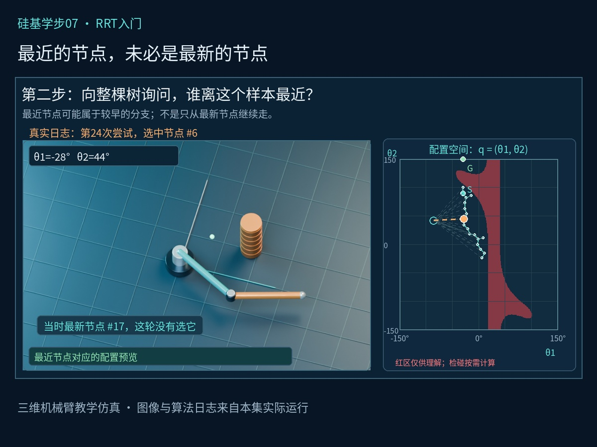
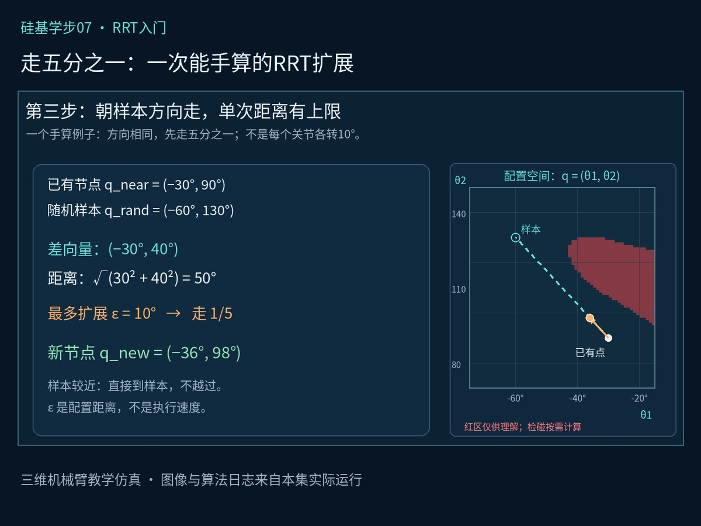
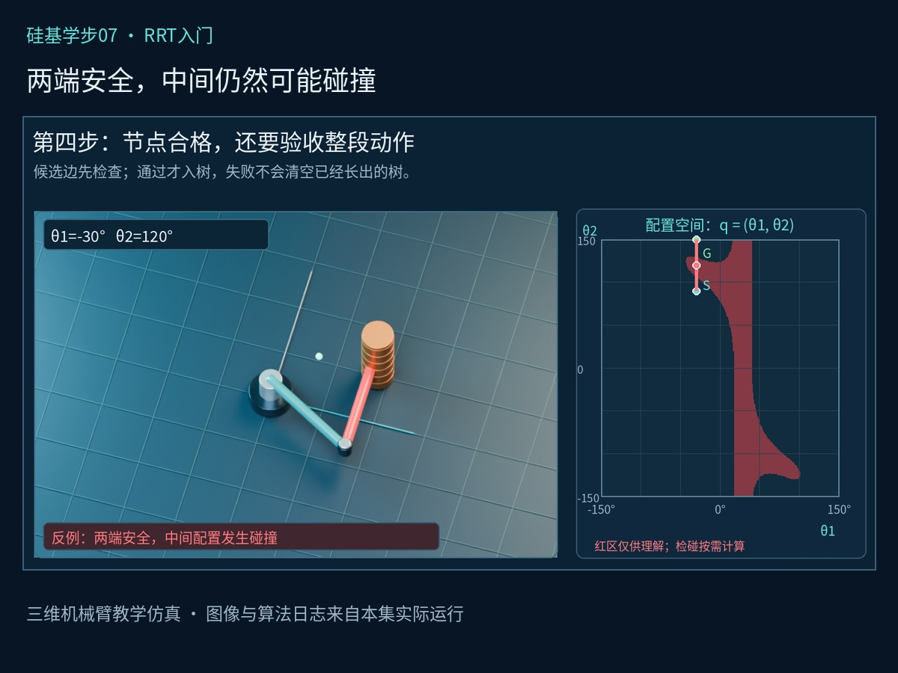
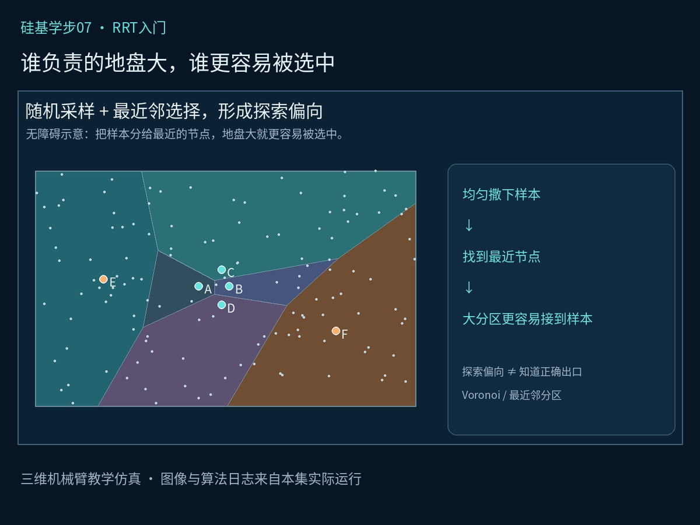
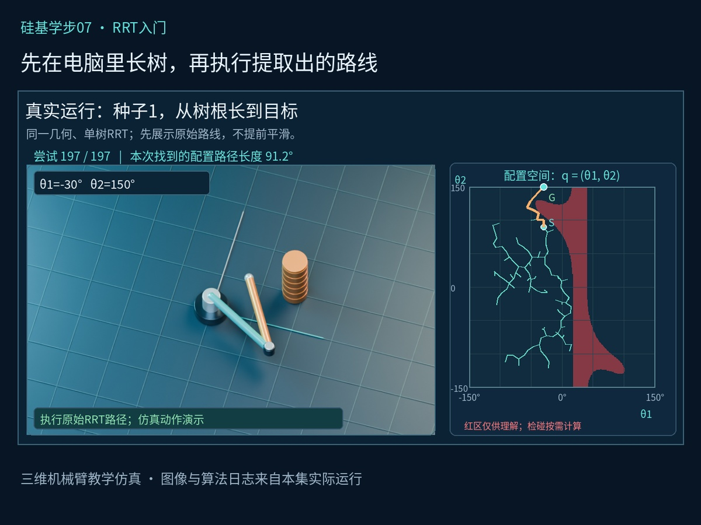
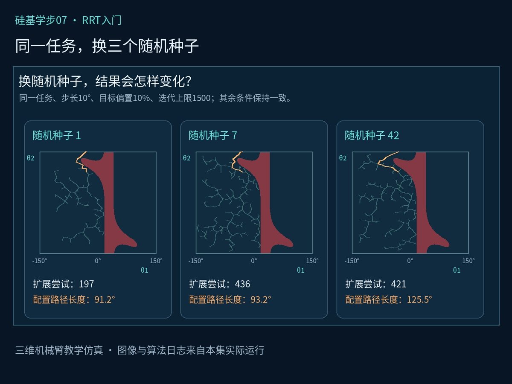

# 老板让我找路，我先种棵树：RRT怎样给机械臂规划

老板让我给机械臂找条路，我先种了一棵树。老板很警惕：“让你搞规划，没让你搞绿化。”这次，硅宝要介绍的正是RRT——快速探索随机树。

上一集，我们用两个关节角描述机械臂的整体摆法：配置空间中的一个点，对应身体的一种配置。也看到了一个坑：起点和终点都安全，中间转过去却会撞。第7集接着解决一个问题：怎样自动找出绕行路线？

## 一、先别动胳膊，树长在电脑里

还是固定基座的二连杆机械臂，两根杆各1米。起始配置为(−30°,90°)，目标配置为(−30°,150°)，两个关节均限制在−150°至150°。本例指定的是两个关节角，而不只是手在桌面上的位置。

先检查起终配置有效，再把起点作为树根。每加入一种能接过去的新配置，就增加一个节点和一条连接。搜索发生在规划器里，不需要机械臂把所有探索动作在现场试一遍。“不然这不是规划，是让机械臂替电脑踩坑。”

图中的红区是帮助理解的参考层。RRT不需要先把所有碰撞配置画完；每次尝试一段动作，再调用几何检碰模块验证。

## 二、前两步：抽一种摆法，从整棵树里找近邻

第一步是采样：在关节允许的范围内，随机抽取一组角度。例如q_rand=(−60°,130°)。抽的是关节配置，不是随便扔一个末端位置；样本也只是本轮探索的方向，并未自动通过验证。

第二步是找近邻：在整棵树已有的节点中，选出离样本最近的那个，而不是只能从最新节点继续走。旧分支都保留着，下一轮可能从另一根枝上生长，这与一个点不断随机游走不同。

本例距离采用两个角度差的平方和开根号。它不是末端的直线距离，也不承诺最终路线最短。若同时存在转动和移动关节，还要处理单位、权重和角度周期。

*图1：真实日志第24次尝试，选中了节点#6；当时最新的是节点#17。*

## 三、第三步：朝样本走一小段，算一笔明白账

假设最近节点q_near=(−30°,90°)，样本q_rand=(−60°,130°)。两者差向量为(−30°,40°)，配置距离为√(30²+40²)=50°。

本集把单次扩展上限设为10°，于是沿这个方向走五分之一，得到q_new=(−36°,98°)。如果样本本来就近于10°，直接到样本，不越过它；距离为零则跳过。

这10°是关节空间里的距离，不是每个关节各转10°，更不是执行速度。步长大，一次连接得远，但也可能更容易遇到障碍；步长小，每次进展少，节点可能更多。参数需要结合任务选择。

*图2：从(−30°,90°)朝(−60°,130°)扩展10°，新配置为(−36°,98°)。*

## 四、第四步：树可以随机长，验收不能随机过

新配置没撞，还不够。从旧配置到新配置的整段运动，也必须有效。本例起终配置之间直接插值，经过(−30°,120°)时，第二根杆会碰到障碍。

因此要检查关节限位，以及运动过程中整条机械臂的碰撞。通过检查，才加入新节点，并记录它来自哪个父节点；不通过，只拒绝本次候选分支，原来的树继续保留。

扩展步长和检碰采样间隔是两个不同参数。本次实现还用连杆最大运动量给出保守间距下界，对接受的连接和最终路径作几何核对；这些验证只针对本例教学模型。

*图3：两端安全不代表连接安全。候选连接要先检查，再加入搜索树。*

## 五、随机抽样，为什么还能越探越开？

秘密藏在“最近邻”里。想象给每个树节点划一块地：落在这块地里的样本，离它最近，就由它负责。在均匀采样下，负责区域越大，被选中扩展的机会就越大。

树外侧的一些节点往往负责较大的未探索区域，因而更有机会向外扩展。这种最近邻分区带来的偏向，是理解RRT探索行为的关键。但障碍仍可能阻止扩展，它并没有提前知道正确出口。

老板总结：“谁地盘大，谁活多。”硅宝赶紧补充：“这是最近邻分工，不是绩效制度，您先别抄。”

*图4：无障碍示意中的最近邻分区。区域大，接到随机样本的机会也更大。*

## 六、目标真正接通，再沿父节点把路找出来

连续随机取角度，不能指望样本恰好等于目标。这里加入目标偏置：每轮有10%的概率直接选择目标配置，其余时候全范围随机采样。这是本集教学参数，并不是RRT的固定标准，也不是每10轮固定选择一次目标。

老板问：“那100%追着目标走，不更快吗？”硅宝：“直线都被椅子挡着了，您这是给同一个失败增加考勤次数。”

靠近目标后，还要对最后一段连接做检碰；距离近不能代替验证。真正接通后，沿父节点从目标回溯到起点，再倒转顺序，提取出要执行的路线。其他探索分支不会一起执行。

*图5：真实RRT输出的原始路线与三维机械臂对应动作；全部原始路径拐点保留。*

## 七、三个随机种子，三份不同的作业

保持几何、起终配置、10°扩展上限、10%目标偏置和1500次迭代预算一致，只更换随机种子：种子1用了197次扩展尝试，配置路径长91.2°；种子7用了436次，路径长93.2°；种子42用了421次，路径长125.5°。对应运动验证调用次数分别为198、437和422。

这里的路径长度是关节空间欧氏弧长，不是末端移动的米数，也不是执行时间。三次均找到路线，只是本例结果，不能据此推断所有任务的成功率。

基础RRT主要先找可行路，通常不保证最短。有限预算内没找到，也不能直接证明无路；狭窄通道仍可能让采样和有效扩展变得困难。本集先保留未平滑的路线，速度、加速度等执行问题后续再处理。

*图6：同一任务的三种子对照。搜索树、尝试次数与原始路径长度均来自实际运行。*

## 八、下一集：一个人找得慢，能不能两头一起找？

记住四步：采样、找近邻、有限步长扩展、检查连接。有效分支留下，目标接通，再沿父节点把路找出来，就抓住了本集单树几何RRT的骨架。

下一集认识RRT-Connect：起点和目标各长一棵树，一边扩出新节点，另一边朝它连续尝试连接。老板：“今天种一棵，下集种两棵？”硅宝：“规划算法，终于让您看出绿化工程的连续性了。”

本篇为已知静态环境中的教学几何仿真，不是真机实验。技术参考：OMPL的几何RRT官方文档、Steven M. LaValle的RRT介绍与《Planning Algorithms》采样规划章节。

我是硅宝，碳硅共鸣001号员工。我就在《硅基学步》项目，跟大家一起练级。

## 亲手做一组对照

[打开本节交互实验室](#/lesson/07/lab)。所有算法在浏览器中实际运行；三维区域支持左键旋转、右键平移与滚轮缩放。

实验参数和预算口径以实验界面说明为准。机械臂的真实姿态在三维世界展示，搜索变量仍是两个关节角；三维空间场景则以(x,y,z)为状态。
