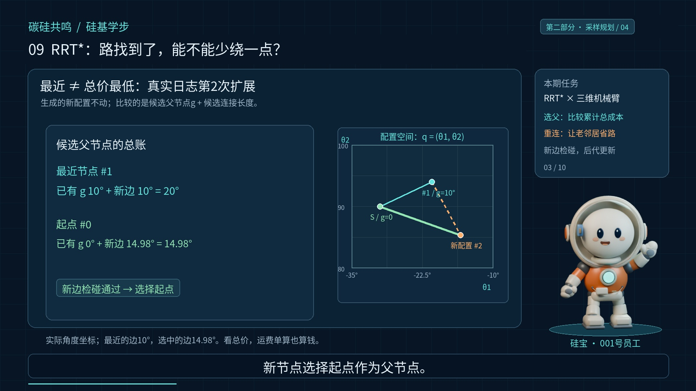
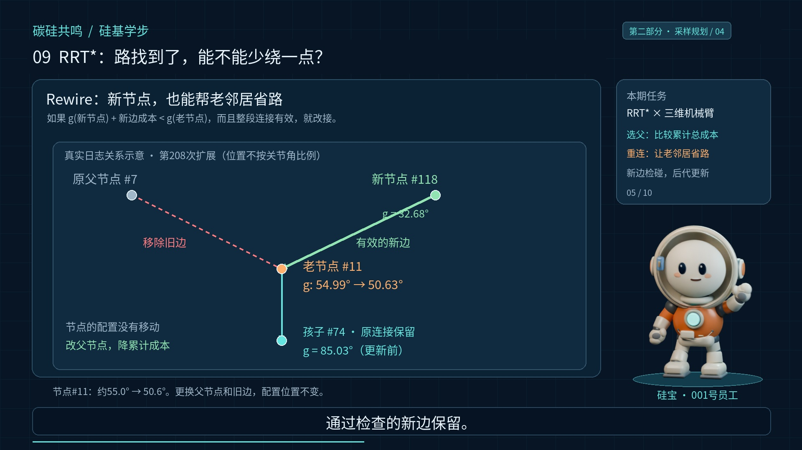
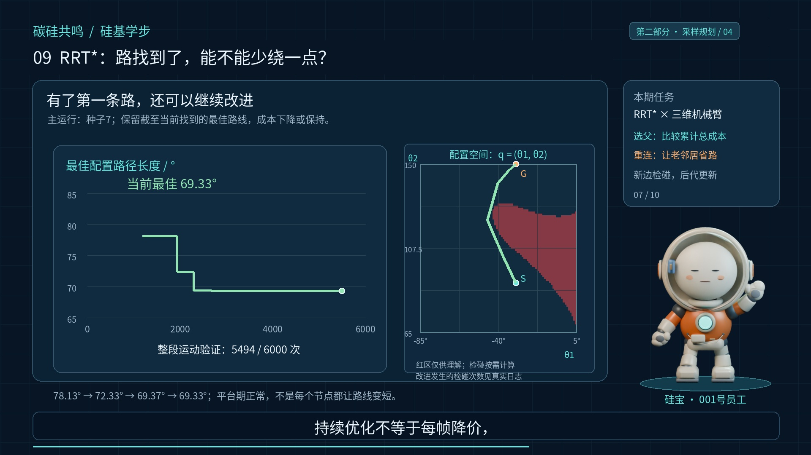
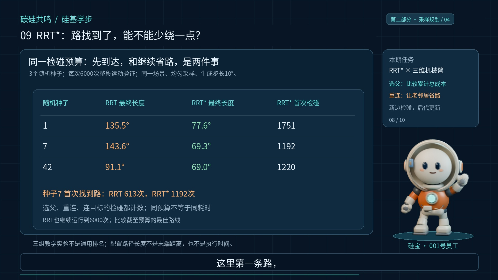
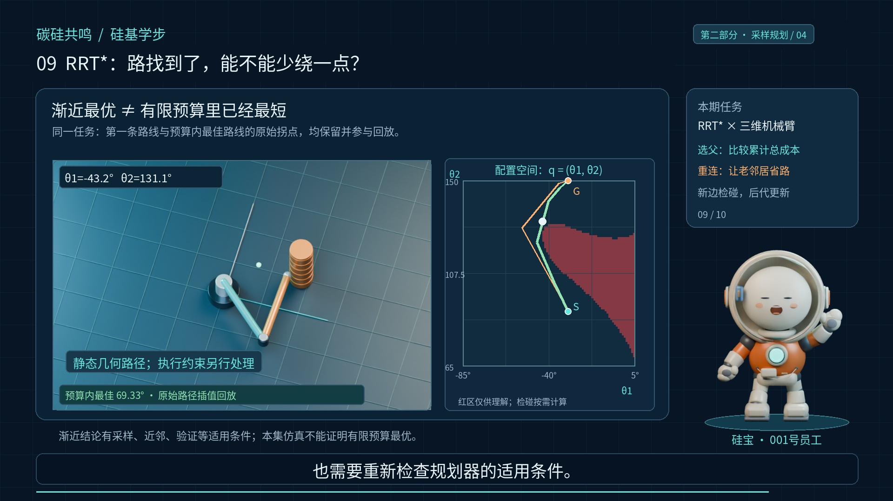

# RRT\*：路找到了，能不能少绕一点？

## 老板：你怎么还环游公司？

上一集，两棵树终于接上了头。老板看完路线，点点头，接着又皱起了眉。我让你过去拿个东西，你怎么还顺便环游公司？我说，上一集解决能不能到，这一集开始审核差旅费。大家好，我是硅宝。今天认识RRT\*，重点讲两件事，给新节点选更便宜的父节点，再让附近老节点重新连接。让树不光会长，还会重新算账。

## 先把成本账本立起来

还是前几集的三维二连杆机械臂，同样的起点、目标和圆柱障碍。这次从基础RRT的单树讲起，RRT\*不是给上一集的双树直接贴颗星。先给每个节点记一个数，记作g，表示从起点沿当前树走到这里，累计花了多少成本。起点的成本是零，孩子的成本等于父节点的成本，加上父子之间那条边的成本。

本集仍然用关节空间欧氏路径长度，单位按角度展示，不是手移动了多少米，也不是电费，更不是运行秒数。老板说，那我让你最省电，你也按距离交作业？硅宝说，优化目标得先说清，不能拿差旅费报销电费。

## 最近的父节点，未必最划算

采样、找最近节点、朝样本方向生成一个新配置，这部分还是熟悉的RRT。变化发生在准备接入树的时候。新配置先不急着认父节点，看看附近还有谁，接过来之后，从起点到自己的总成本更低。比较的是候选父节点已有的g，加上候选连接的长度，不是只比最后这一小段。看本次真实日志的第二次扩展。

最近节点离新配置十度，它自己的累计成本也是十度，合计二十度。起点虽然离新配置更远，大约十五度，但起点的成本是零，接过来只要大约十五度。通过整段检碰后，新节点选择起点作为父节点。新节点的位置没有变，改的是接入方式。老板感慨，原来离得近，不代表报价低。硅宝说，终于开始看总价了，运费单算也算钱。


*最近的父节点，未必最划算*

## 便宜的连接，也要先验收

这里有两个条件，一个是更便宜，另一个是连接有效。便宜但穿过障碍的候选边，不能选。我们对候选连接整段检碰，而不是只检查新节点的端点。候选可以按总成本排序，从便宜的开始检查，找到有效的较低成本连接，再确定父节点。再分清两个参数。

本例朝样本生成新配置时，最多走十度；找附近候选时，邻域半径的上限设成三十五度，并按节点数规则控制。因此，重新选中的连接，可能比生成新配置的那一步更长，但依然要整段验收。这是本次教学参数，不是RRT\*的统一标准。老板问，我直接认全公司最便宜的那个呢？

硅宝说，还得看连接范围和通不通路，不能隔着墙空降父节点。

## 新节点，还能帮老邻居省路

选好父节点，只完成一半。新节点加入以后，还要回头看看附近的老节点。如果老节点经过自己，能以更低成本从起点到达，而且新连接安全，就把老节点改接过来。这一步叫rewire，重新连接。判断式还是同一本账，新节点的g，加上到老节点的边成本，小于老节点原来的g。

注意方向，刚才是别人当新节点的父节点，现在是新节点有机会当老邻居的父节点。看实际日志第两百零八次扩展。一个老节点原来累计成本约五十五度，改接到新节点后，降到约五十点六度。被替换的旧边移除，通过检查的新边保留。节点的位置没有搬家，关系和累计成本变了。老板说，这不就是换个上游供应商？

硅宝说，只要整条供应链的账，也一起改。


*新节点，还能帮老邻居省路*

## 父节点改了，后代的账也得改

这句话正好说中一个容易漏的细节。老节点原来带着孩子和更深的后代。它自己从起点过来的成本下降，孩子到它的连接没变，但孩子的累计成本也应该下降。同一条枝下面的后代，都要继续向下更新。画面里这个孩子，累计成本从约八十五度，更新到约八十点七度。

不能只把父节点指针换掉，账本还留着旧数字，否则下一次选父和重连，就会按假账决策。还要保持树结构，别把祖先接到自己的后代下面，绕成一个圈。老板总结，换上游，还得同步改台账。硅宝说，算法都知道更新账本，您上次改需求，怎么只改了群公告？


*父节点改了，后代的账也得改*

## 第一条路找到以后，继续改进

现在让这次RRT\*继续运行。本次主演示使用随机种子七。在第一千一百九十二次运动验证之后，找到第一条路线，配置路径长度约七十八点一度。注意，这之前，它已经在给搜索树选父和重新连接，不是找到路以后才启动优化。

继续采样，继续验收，继续更新，已找到的最佳路线先降到约七十二点三度，再降到约六十九点四度，随后到约六十九点三度。屏幕上保留的是截至当前找到的最好路线，所以这条最佳成本曲线只会下降或保持，不会因为下一次随机采样失败就反弹。也不是每加一个节点都一定更好，平台期很正常。老板问，怎么半天没降？

硅宝说，持续优化不等于每帧降价，又不是直播间倒计时。


*第一条路找到以后，继续改进*

## 用同一预算，比较本次结果

再和基础RRT对照。场景、起终配置、均匀采样规则，以及生成新配置的十度步长一致。各用六千次整段运动验证预算，随机种子取一、七、四十二。选父、重连、连接目标的检查，都计入预算。同种子不等于相同采样次数，因为算法消耗检碰预算的方式不同。

种子七，基础RRT在第六百一十三次检查时找到路线，RRT\*在第一千一百九十二次才找到。这里第一条路，RRT\*反而来得更晚。但预算用完后，两者最佳配置路径长度，分别约一百四十三点六度，和六十九点三度。这三组实验中，RRT\*最后的路径都更短，不过这只是本例结果，不是对所有任务的排名。

检碰次数也不是墙上时钟，不能把同样六千次检查，直接说成相同计算时间。老板点头，省路也有搜索成本。硅宝说，今天终于同时看见了里程和工时，虽然咱们还没给机械臂填加班单。


*用同一预算，比较本次结果*

## 星号不是有限时间的最短保证

RRT\*的理论关键词，是渐近最优。在适当的采样、近邻规则、碰撞验证和问题条件下，随着采样不断增加，解的成本趋向最优。它不代表给定六千次预算，就已经拿到了最短路线。这里的曲线和三组仿真，也不能代替理论证明。本集保留原始规划路线，所有原始拐点都参与三维回放，没有把平滑后的路当成RRT\*原始输出。

我们处理的仍然是已知静态环境中的几何路径。速度、加速度、动力学和实际执行约束，要在后续流程里单独处理。更换成本函数、状态空间或约束，也需要重新检查规划器的适用条件。老板说，星号这么多条件，像促销海报的小字。硅宝说，小字先读清，路线才不会买家秀。


*星号不是有限时间的最短保证*

## 下一集：采样能不能更有针对性？

今天记住两笔账。选父节点，比较父节点成本加连接成本；重新连接，比较经过新节点是否让老邻居更便宜。所有新边都要有效，后代的成本也要更新，找到第一条路后还能继续改进。老板又来了新问题，路线都已经有了，你还在全图到处撒点，能不能少做点无效工作？

下一集认识Informed RRT\*，看看怎样把采样集中到有机会改进当前路线的区域。不是给树多挂几个星星，就让算力自动打折。我是硅宝，碳硅共鸣零零一号员工。我就在《硅基学步》项目，跟大家一起练级。

## 用代码把两笔账写清楚

```python
g_new = g[parent] + distance(parent, q_new)
# choose parent: minimize g[parent] + edge_cost, subject to collision-free edge
# rewire: if g_new + distance(q_new, q_old) < g[q_old], change parent
# propagate the cost change to every descendant; keep the tree acyclic
```

本节视频实验按每次6000次整段运动验证预算比较；网站交互实验可调采样迭代预算，同时分别显示验证次数。两种预算口径不同，不能把网站动画当作视频中的逐帧实验重放。

## 技术参考

- [Karaman与Frazzoli：Sampling-based Algorithms for Optimal Motion Planning](https://arxiv.org/abs/1105.1186)
- [Revisiting the Asymptotic Optimality of RRT\*](https://arxiv.org/abs/1909.09688)
- [OMPL RRTstar 实现](https://ompl.kavrakilab.org/RRTstar_8cpp_source.html)

## 亲手做一组对照

[打开本节交互实验室](#/lesson/09/lab)。所有算法在浏览器中实际运行；三维区域支持左键旋转、右键平移与滚轮缩放。

实验参数和预算口径以实验界面说明为准。机械臂的真实姿态在三维世界展示，搜索变量仍是两个关节角；三维空间场景则以(x,y,z)为状态。
