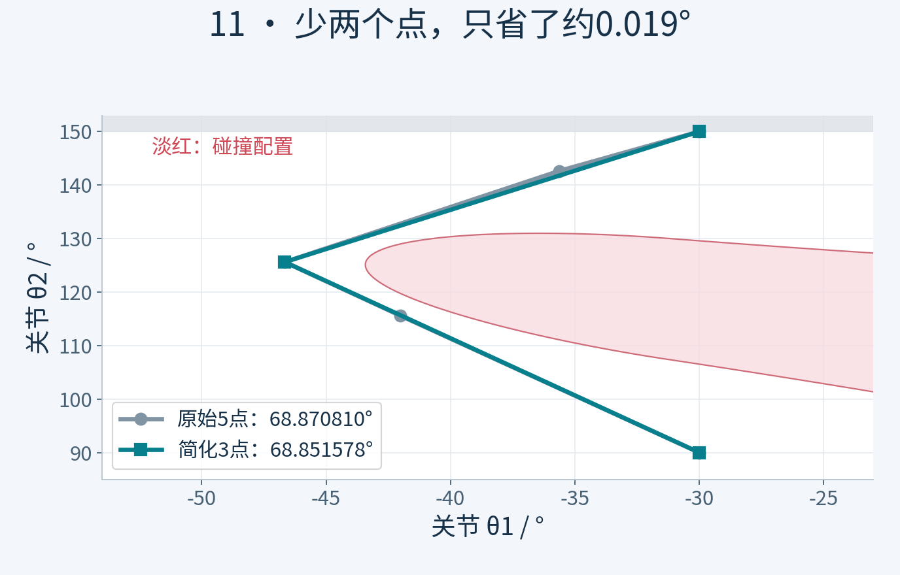
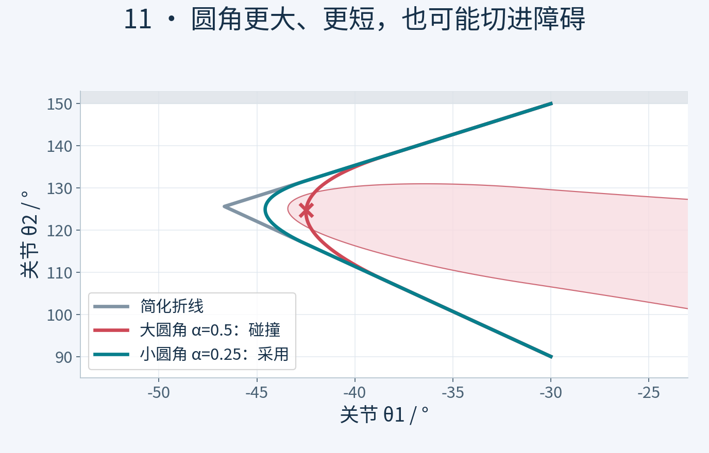
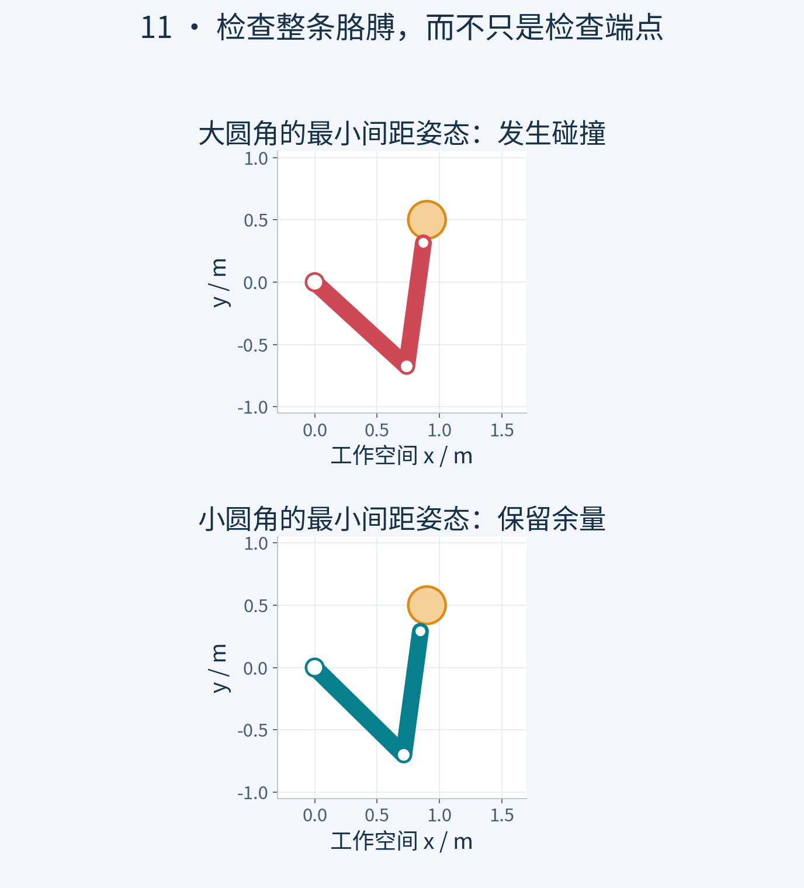
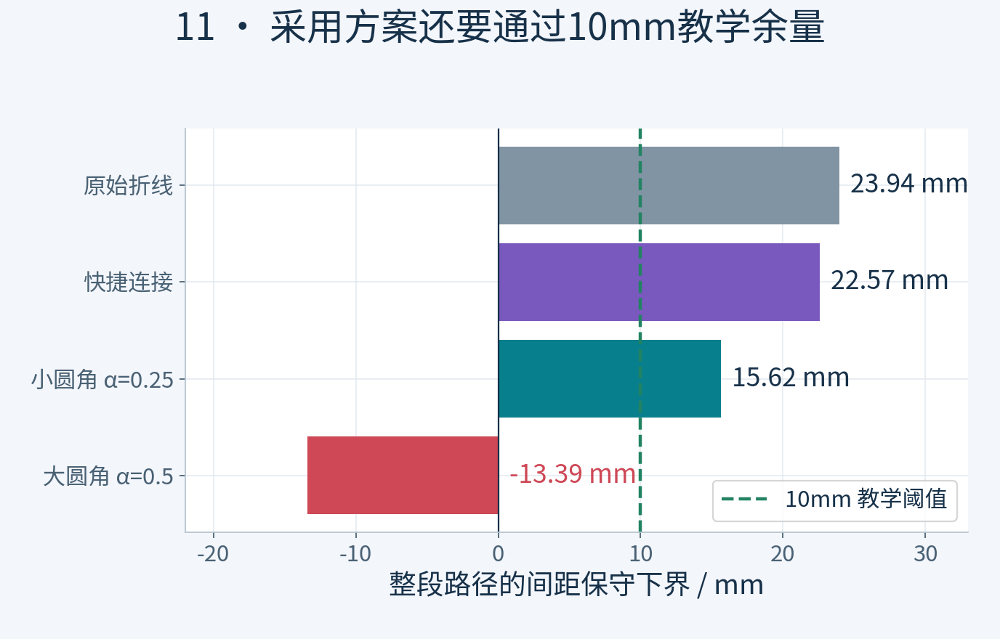

# 路径后处理：删点、圆角与碰撞复检

## 粒子出厂和第一句任务

老板问，路线找到了，这几个弯，直接抹掉不就行了？我翻了个跟头。出场可以顺滑，路线还真不能随便抹。

## 从上一集的真实路线出发

上一集，Informed RRT星把搜索重点收进了椭圆，最后留下这条路线。老板又来验收，路是找到了，可怎么还拐来拐去？我说，树上摘下来的，带点枝杈很正常。老板说，我要交付路线，没让你交盆栽。好，今天就做最后一道工序，删掉能删的绕路，修一修拐角，再重新检查整条路线。先别急着让电机开工。我们交的，还是一条几何路径。

*图1｜灰色原始5点路径与青色3点简化路径几乎重合；两点被删除，但长度只从68.870810°减至68.851578°。淡红区域为碰撞配置。*

## 删点之前先查新连接

第一招，抄近路。挑出路线上的两个配置，试着直接连起来。新连接如果通过检查，中间那一串点才有机会删掉。这里的直接连接，是两个关节角之间做插值，可不是让机械臂的手沿着一条空间直线飞过去。老板说，那起点直接接终点，最省事。我也想。可看，起点安全，终点也安全，走到中间，连杆穿进圆柱了。安全的两头，夹着一段事故现场。所以检查对象必须是整段运动。退回来，再试其他连接。按本次从远到近的尝试顺序，五个点能保留成三个。但长度只是从六十八点八七度，变成六十八点八五度。点少了两个，路只短了一点点。老板说，包装盒瘦了，运费没怎么降。对，点数少和路线短，得分开记账。

## 圆角让画面好看也可能切进障碍

三个点留下一个明显的折角。第二招，把尖角换成一小段圆滑的过渡。你可以把它想成，拐弯时不走到墙角再猛转，而是提前一点开始转。画面确实顺眼了。我正准备签字，检查器先亮了红灯。过渡改得太大，曲线向里切，机械臂又碰到了圆柱。看起来更圆，长度也更短，居然仍然不合格。老板说，你这是给事故磨了个圆角？这句有点扎心，但没说错。原路线通过的检查，不能自动盖到新曲线上。这里是我们故意没有先加碰撞约束的圆角候选，用来演示失败；不是说所有平滑算法都会这样撞。

*图2｜α=0.5的大圆角更短，却切入淡红色碰撞区；α=0.25的小圆角保留较多原路线，才通过本例几何复检。叉号标出大圆角候选的临界配置。*

## 缩小圆角保留安全余量

那就把修改范围收回来。这次从两条边各取靠近拐角的一小段，再接过渡曲线，起点和终点都不动。重新检查，这个候选通过了。它在当前教学模型里的最小间隙大约十五点七毫米，比刚才那条直来直去的简化路线更贴近障碍。我们这次给演示设了一厘米的验收余量，它还有余量，才保留。这个数是本集的演示条件，不是所有机器人的通用安全标准。老板说，弯也不是越圆越好？对，能改多少，要看周围给不给空间。过不了，就缩小修改，或者退回上一个通过检查的版本。

## 复检检查的是运动中间

第三道工序，整条路线复检。先看起点和终点有没有被改掉，再看关节有没有超出范围，最后沿所有直线和曲线检查整条胳膊。不是只看手，也不是只看留下来的三个点。路径采样点只是给检查器看的路标，不能把路标之间的空间当成免检区。我们加密检查，并按这台模型的运动距离上界，为相邻检查点之间留出保守扣量，余量不足也不放行。画面上少放几个检查点，是为了让你看清；实际计算更密。老板问，模型里通过了，搬到真机就能用？还不行。连杆尺寸、工具、障碍和安装误差都得对得上，真实任务还要检查自己的约束。今天这份几何验收，也没有替电机检查速度、加速度和力矩。

*图3｜将两条曲线各自最小间距处的配置，映射回实际连杆姿态。示意采用同一平面二连杆模型；整段通过结论来自加密检查与间隙保守界，而不是这两张姿态截图。*

## 同一条件下对照三条结果

现在把账放在一起。原路线，六十八点八七度。删点后，六十八点八五度。最后保留的小圆角路线，六十七点三九度，比原来短了大约百分之二点一五。省得不夸张，是真实结果。还有一个代价，离障碍的余量也变小了。那条六十五点九三度的大圆角候选虽然更短，但撞了，直接淘汰。这里的度数，算的是关节空间里的路线长度，不是手走了多少米，更不是省了多少时间。三条回放可以按同样的进度同步比较，谁先放完，都不能拿来证明谁跑得更快。

*图4｜缩短路线会消耗障碍余量。采用的小圆角下界为15.62mm，仍高于10mm教学阈值；大圆角下界为负，必须拒绝。此阈值只用于本集教学模型。*

## 交付路径还没有交付时间表

老板伸手，要交付。我这次不只递一张漂亮截图。保留下来的路径、起终配置、关节范围、模型版本和复检记录，都得一起交。失败候选也留着记录，免得下次又把同一个坑抹圆一遍。不过老板还有最后一个问题：现在能端稳那杯水了吗？我把交付单翻过来。今天决定的是，从哪些姿态经过；什么时候到达、转得多快、怎么加速，还没有填。把同一条路线放快一点，或者让动画缓入缓出，不能代替这些计算。上一集提前说到速度和加速度，今天先把前面的路径收拾好，再把这件事交给下一部分。老板说，也就是路修好了，行车安排还得另做。对，这次终于没有顺手给电机开空头支票。

## 第二部分收官

到这里，《硅基学步》第二部分收官。从配置空间里表示一整条胳膊，到RRT先找一条路，RRT Connect让两边一起找，RRT星继续改路，Informed RRT星把采样收进有希望的区域，最后再简化、修整和复检。今天记住一句，路线改过，检查重做。下次看到更短、更圆的路线，也别急着签字，先问一句，中间查了吗？我是硅宝，碳硅共鸣零零一号员工。我就在《硅基学步》项目，跟大家一起练级。下一部分，我们给路线排时间表。

## 动手实验与数值核验

本节网页实验可调整参数并导出结果；原始Python与核验报告位于 `experiments/original/11`。模型为教学用平面二连杆，不将几何或运动学验收宣传为真机安全、力矩、载荷、闭环跟踪或液体稳定性证明。

## 数字复算

| 方案 | 长度 / ° | 间距保守下界 / mm |
|---|---:|---:|
| 原始五点 | 68.870810 | 23.94485 |
| 三点快捷连接 | 68.851578 | 22.56748 |
| 圆角α=0.5（碰撞） | 65.927836 | −13.39164 |
| 圆角α=0.25（采用） | 67.389707 | 15.62062 |
| 直连（碰撞） | 60.000000 | −199.475 |

`L=B+α(A−B)`，`R=B+α(C−B)`，圆角 `q(u)=(1−u)²L+2u(1−u)B+u²R`。20001点/基元采样加间隙位移保守界；切向连续不等于曲率连续。
