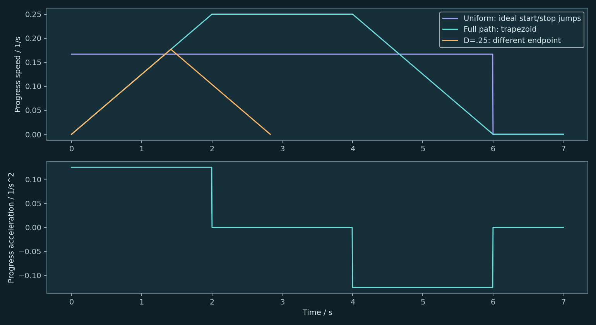

# 时间参数化：给路径排时刻表

## 路线有了，时间表呢

老板，上一部分的路线已经通过几何复检，今天咱们给它排时间表。老板说，路都找好了，怎么还不开工？我说，您给了导航，还没给行车时刻表。老板伸手就想把动画调成两倍速。我赶紧拦住，播放器能调倍速，电机可不能靠这个上班。今天就沿着同一条路线，把起步、途中和停车一起安排明白。

## 一条路径，多种时间安排

先看这条路，它规定机械臂经过哪些姿态。把路线从头到尾标成零到百分之百，百分之三十，就对应路线上的一个配置。现在加一只钟，规定第一秒到哪里、第二秒到哪里，路径就有了时间安排。机械臂的姿态随时间怎么变，叫轨迹。同一条路径，可以慢慢走，也可以先加速再减速。经过的地方相同，运动过程可不一样。

## 全程匀速，也有起停问题

老板说，那全程匀速，六秒走完，够简单吧？中间确实简单。可把开始和结束也画出来，问题就露头了。起步前是零，刚开始就跳到固定速度；终点一到，又立刻跳回零。理想曲线上的竖直跳变，意味着瞬间改变速度，有限的加速度做不到。慢一点匀速，也没有自动解决这个跳变。老板说，合着路上挺文明，出门和到家都急刹？所以，两头必须留出加速和减速的过程。

## 把起步和停车也排进去

咱们先用一个简单办法，先以固定的进度加速度提速，到达设定上限后保持，快到终点再减速，最后速度回到零。把速度对时间画出来，先上坡，再平，再下坡，看起来像一个梯形，这就是梯形速度规划。位置曲线是逐渐变陡，再逐渐变缓。这里说的速度，是沿这条路径推进的快慢，不是末端的米每秒，也不直接等于某个关节的角速度。

## 这六秒到底怎样算

来排一份能复算的时间表。假设起终进度速度都是零，上限是每秒走完整条路线的百分之二十五。用两秒从零加到这个上限，再用两秒减回零。速度曲线下面的面积，就是走过的进度。前面三角形走了百分之二十五，后面也走了百分之二十五，还剩一半。中间按每秒百分之二十五走两秒，正好补齐。两秒加速，两秒保持，两秒减速，总共六秒。看这只钟，动画里的姿态就按计算出的进度取，走到终点时，进度是一百，速度是零。不是先剪出六秒，再往上贴一张好看的图。

## 路太短，梯形就放不下

老板又改需求，今天只走这条路线的前四分之一，还是从静止出发、静止结束。刚才那套加减速，两头加起来就要走一半，显然塞不进去了。保持同样的进度加速度，就得提前开始减速，匀速那一段消失，速度图变成三角形。计算下来，峰值大约是每秒百分之十七点七，总共约两点八三秒。速度上限是天花板，不是每次必须摸到的打卡点。

## 同一条路，换一份时间表

把六秒匀速参考和六秒梯形方案放在一起。它们起终点相同，经过的几何路线也相同；梯形方案在中间会走得更快，两头留给起停。总时间一样，并不代表每一秒的姿态一样。至于那条短路线，它换了终点，不能拿两点八三秒去宣传比整条路线更快。咱们比什么，就把条件先说清楚。

## 进度表还要接受关节验收

老板问，这回能直接交给真机了吗？我把表格翻过来，还有每个关节的速度和加速度要检查。进度的速度合适，不代表拐弯时每个关节都合适。真实电机还涉及力矩、负载和控制误差。今天完成的是一份运动学时间安排。梯形方案的加速度还有突变，下一集咱们继续处理时间曲线的平顺性；路径本身不够光顺，也得一起检查。

## 动手实验与数值核验

本节网页实验可调整参数并导出结果；原始Python与核验报告位于 `experiments/original/12`。模型为教学用平面二连杆，不将几何或运动学验收宣传为真机安全、力矩、载荷、闭环跟踪或液体稳定性证明。

## 可复算的时间表

`ta=vmax/amax=2s`；`D=1`时总时长6s，加速、保持、减速各2s。

短任务 `D=0.25`：`vpeak=sqrt(D·amax)=0.1767767/s`，`T=2sqrt(D/amax)=2.8284271s`，中间无匀速段。终点变了，不能称为整条路径提速。

## 本集数值图解

