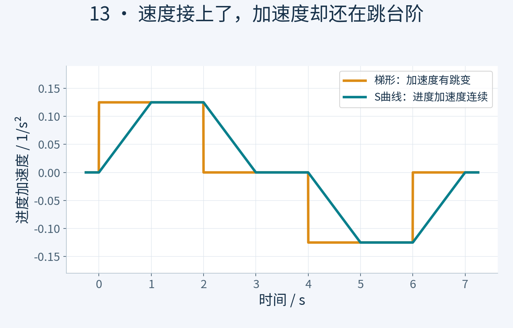
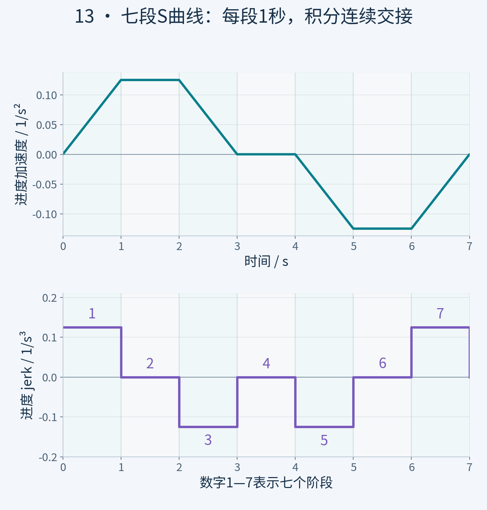
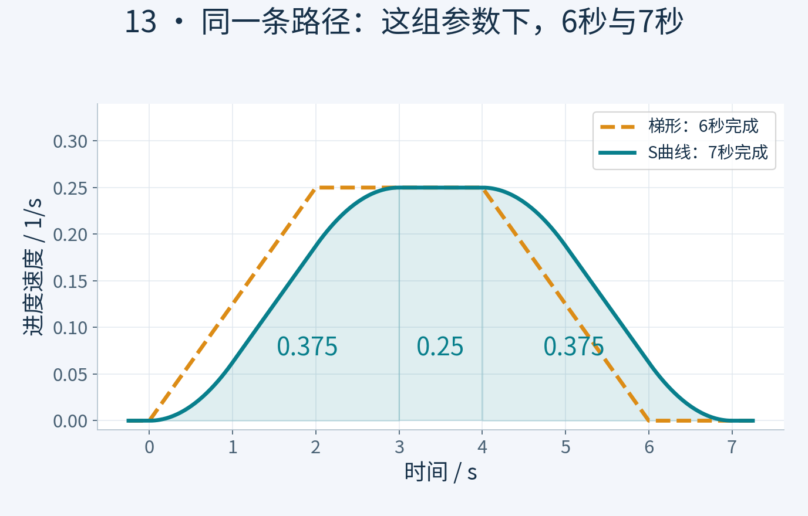
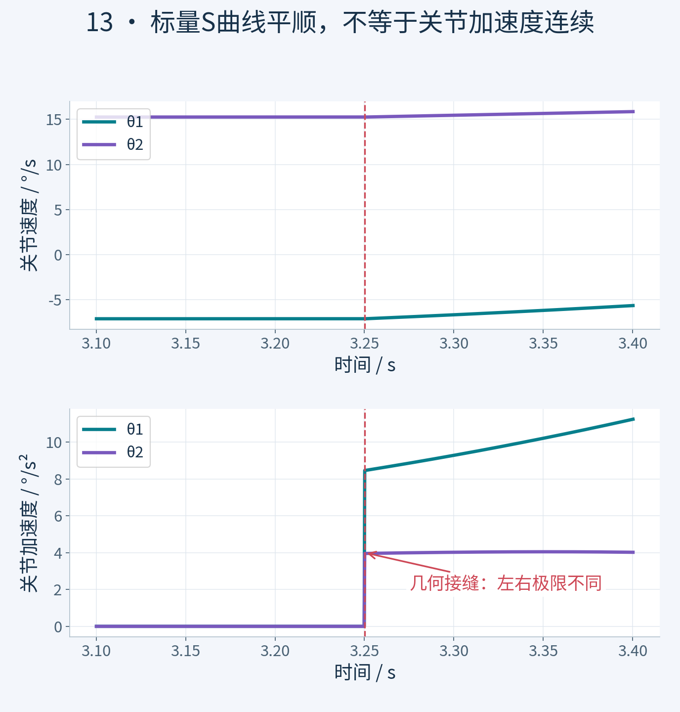

# S曲线：让加速度也有过渡

## 慢起慢停，还差哪一步

老板，上集的机械臂学会慢起慢停了。老板问，那我的咖啡能端稳了吗？我把验收单挡在杯子前面，先别倒，咱们只排了运动学时间表，还没验证端水。今天先查一个问题，速度不跳了，加速度怎么还突然换挡？沿着同一条路线，咱们把梯形速度升级成一份加速度连续的时间表。

## 速度连续，不等于加速度连续

看上集的六秒方案，两秒加速，两秒保持，两秒减速。速度图连得上，可加速度图像台阶。起步时从零跳到正值，进入匀速时又突然归零。老板说，就像车没突然变速，脚下却猛踩了一脚油门？对，突变的加速度可能激发真实机构的振动。不过这段画面只展示计算出的运动学，不是测出来的机械抖动，咱们不往动画上硬加震屏。

*图1｜同样的进度加速度上限，梯形方案有台阶跳变，S曲线用斜坡过渡。这里画的是计算得到的进度加速度，不是测量到的机械振动。*

## 再管住加速度变化的快慢

想让加速度慢慢上来，还得管住它变化的快慢，这个量叫加加速度。速度说位置变多快，加速度说速度变多快，加加速度再往前问一步，加速度变多快。这里统一讨论路径进度，单位分别是每秒、每平方秒、每立方秒，还不是每个关节各自的限制。

## 让加速度走斜坡

先让加速度从零沿斜坡升起来，达到上限后保持，再沿斜坡回到零。加速度下面的面积，就是增加的速度。速度图的起步和收尾因此变圆滑，看起来像一个横过来的字母艾斯，这就是常说的S曲线。随后匀速，再对称地减速，最后速度和加速度都回到零。经典的完整例子有七段，短行程时某些段可以消失，不是每次都要凑齐七段。

*图2｜本例七段各1秒，jerk依次为＋0.125、0、−0.125、0、−0.125、0、＋0.125 /s³。进度加速度连续，jerk本身仍分段跳变；短行程可能不需要完整七段。*

## 同一条路，六秒变七秒

咱们算一份完整例子。保留上集的进度速度和加速度上限，分别是每秒百分之二十五、每平方秒百分之十二点五。再加一个加加速度上限，每立方秒百分之十二点五。加速度用一秒升起来，保持一秒，再用一秒退回零，三秒到达最高速度。随后匀速一秒，再对称减速三秒，总共七秒。速度图下面的面积，前面百分之三十七点五，中间百分之二十五，后面百分之三十七点五，正好走完整条路。

*图3｜S曲线速度图下的三块面积为0.375、0.25、0.375，总进度仍为1。这组参数下从6秒变7秒，不代表所有S曲线都固定慢1秒。*

## 多用一秒，换来了什么

把两份时间表并排放，起终点和几何路径相同，速度上限和加速度上限也相同。梯形方案六秒结束，这份艾斯方案七秒结束。新增了加加速度限制，时间多了一秒，换来的是进度加速度不再跳变。可别说所有S曲线都固定慢一秒，这只是本组参数的结果。七段之间，加加速度本身仍会切换，它并不是所有阶导数都连续。

## 时间表变顺，路也得顺

老板说，那只要换成S曲线，任何路线都稳了？我把图翻到路径那一页。时间表安排怎么走，路径决定往哪走。路上如果有尖角，带着非零速度直接拐过去，运动方向还是突然变。上集沿用的路径已经接顺了切线，可连接处的曲率仍可能跳变，这也可能传到关节加速度。要整体平顺，还得让几何路径足够光顺，或者在相应位置降速、停车。只修时间表，不能自动修路。

*图4｜放大本例第一个几何接缝：上图两关节速度接得上，下图加速度的左右极限却不同。标量S曲线不能自动消除路径曲率跳变，也不能据此保证关节jerk有限。*

## 动手实验与数值核验

本节网页实验可调整参数并导出结果；原始Python与核验报告位于 `experiments/original/13`。模型为教学用平面二连杆，不将几何或运动学验收宣传为真机安全、力矩、载荷、闭环跟踪或液体稳定性证明。

## 七段积分公式

每段1秒，jerk依次为 `[+0.125,0,−0.125,0,−0.125,0,+0.125] /s³`。从上段终态积分：

`a=a0+jτ`，`v=v0+a0τ+jτ²/2`，`s=s0+v0τ+a0τ²/2+jτ³/6`。

s、v、a连续，jerk分段常数、有有限跳变，不是jerk连续。几何接缝约在s=0.4375375和0.6712679，曲率仍跳变。
