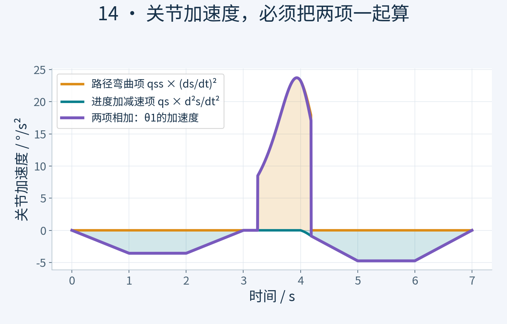
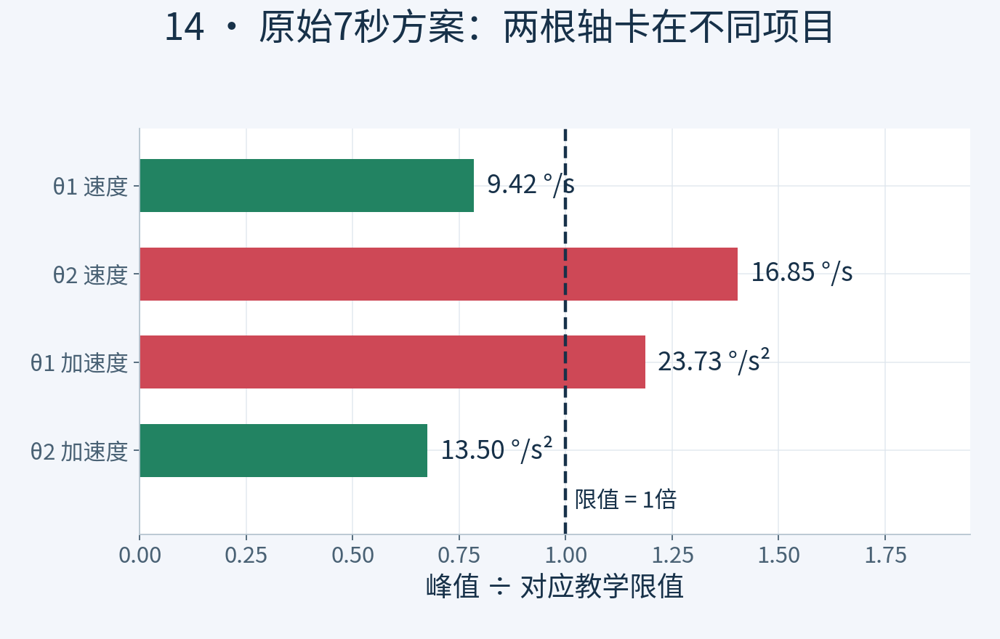
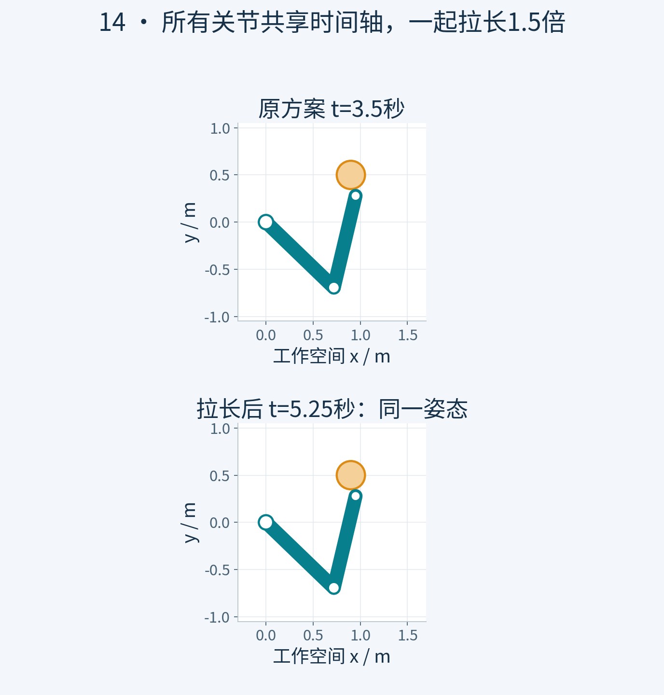
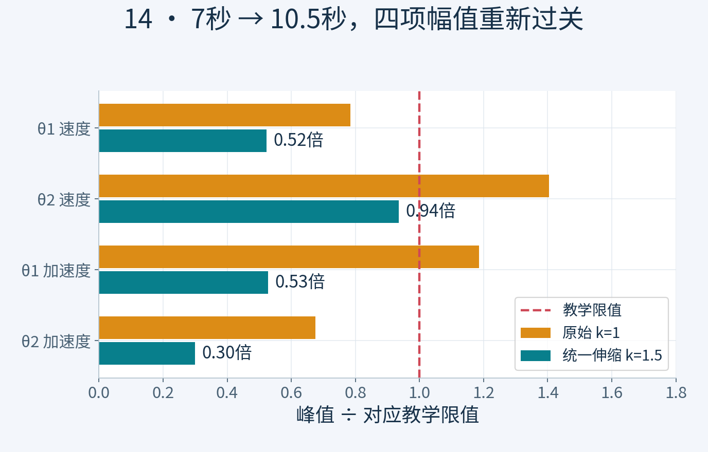
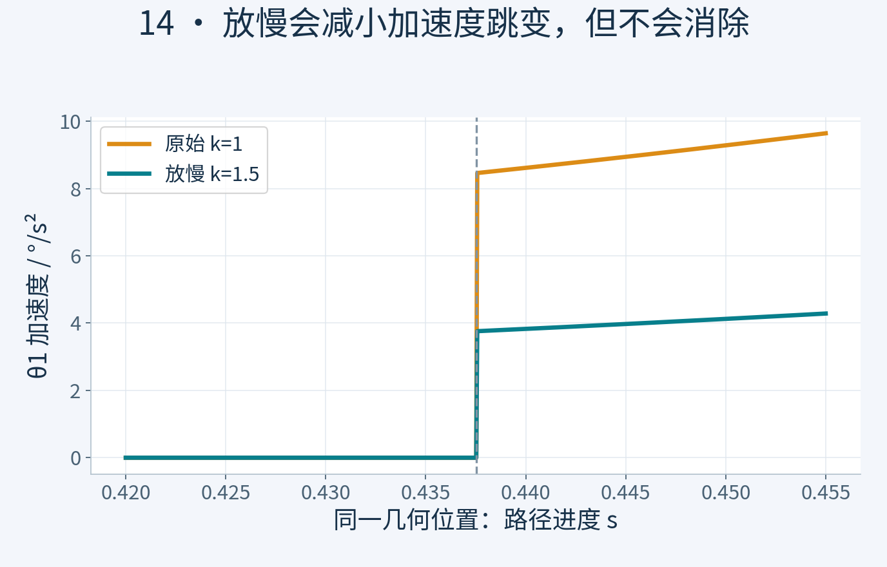

# 关节约束验收与统一时间伸缩

## 时间表顺了，关节却超限

老板，上集的S曲线已经排好了，七秒走完整条路。老板把空杯往前推，问，这回能开工了吧？我先把每个关节的曲线调出来，一查，关节二超速了，关节一的加速度也超了。进度表看着挺顺，怎么胳膊还不同意？今天咱们沿用同一条路径，找出超限，再改时间表，最后重新验收。

## 同一进度，各关节分工不同

上集每秒百分之二十五，说的是沿整条路径推进的快慢，不是每个关节每秒转多少度。看这台二连杆教学机械臂，底座这里是关节一，肘部这里是关节二。同一个进度，要把它俩安排成对应的角度。路径往前走一点，有时第一个关节忙，有时第二个关节忙。它们共享一只钟，可不是各自随便跑，到终点再集合。

## 把进度换成关节运动

先看速度。某个关节沿路径转得越快，同样的进度速度，就会换成越大的关节角速度。再看加速度，它不光受进度加减速影响，还受路径自身弯曲程度影响。屏幕上两项要一起算，漏掉曲率这一项，拐弯时就可能算少了。咱们从同一份路径和时间表计算角度、速度、加速度，图和机械臂使用同一个仿真时刻。

*图1｜θ1的加速度由两项相加得到。橙色是qss·sdot²，青色是qs·sddot，紫色是总和；漏掉路径弯曲项，会低估某些拐弯位置的关节加速度。*

## 给教学模型设一组限值

先说明验收条件。本例给两个关节都设置每秒十二度的速度限值，以及每平方秒二十度的加速度限值。这是教学设定，不是某台真实机器人的厂家参数，实机要查自己的配置。正转反转都要检查，所以看的是绝对值。图里的红色虚线，就是正负两侧的限值。

## 两个关节，卡在不同地方

把上集七秒方案完整跑一遍。关节一的峰值速度约九点四二度每秒，没有超速；可峰值加速度约二十三点七三，超过二十。关节二正好反过来，峰值加速度约十三点五，没有超过二十；峰值速度却约十六点八五，超过十二。老板说，一个嫌加得猛，一个嫌转得快？对，不能只看一张进度曲线，就替所有关节签字。

*图2｜把每项峰值除以对应教学限值，1倍虚线即为边界。θ2速度和θ1加速度越线，另两项通过；原始数值来自逐段极值与接缝单侧复核。*

## 先整体放慢，再重新检查

先用一个简单、能复算的办法，把整份时间表延长到原来的一点五倍，七秒变成十点五秒。几何路径不改，两关节仍然共享这份时间表。时间拉长一点五倍，同一进度处的关节速度除以一点五，加速度除以一点五的平方。不是把所有数值都除以一点五，也不是分别把超限关节截断，那样可能破坏两关节的配合，偏离原路线。

*图3｜原方案3.5秒与放慢后的5.25秒具有同一关节配置：qnew(1.5t)=qold(t)。所有轴共享时间伸缩，几何路径和轴间配合保持一致。*

## 同一条路，十点五秒再验收

重新计算后，关节一的峰值速度约六点二八，加速度约十点五四；关节二的峰值速度约十一点二三，加速度约六。都进入本例设定的幅值范围。并排看，原方案七秒到达，调整后十点五秒到达，走过的地方相同，每一秒的姿态不同。整体放慢比较保守，工程上还可以根据不同路段和关节约束重新分配时间，咱们这次没有宣称求出了最快方案。

*图4｜时间乘1.5，速度除以1.5，加速度除以2.25。四项幅值均回到1倍教学限值内；通过范围限于本例速度与分段加速度幅值，并非时间最优或真机放行结论。*

## 幅值合格，还不等于真机放行

老板拿笔准备签字，我又翻开上一集留下的那一栏。原路径连接处的曲率仍可能跳变。这次把分段加速度和接缝两侧的幅值一起检查了，可整体放慢，并没有消掉这个跳变。关节加加速度、力矩、负载、控制跟踪和端水稳定性，也不在本次通过项里。所以这张单上写的是，教学模型的关节速度与分段加速度幅值检查通过，不是真机运行许可证。

*图5｜在同一几何进度对照，放慢后的加速度跳变变小，却没有消失。跳变瞬间的经典加速度未定义，验收检查两侧极限；这不等于全程加速度连续。*

## 动手实验与数值核验

本节网页实验可调整参数并导出结果；原始Python与核验报告位于 `experiments/original/14`。模型为教学用平面二连杆，不将几何或运动学验收宣传为真机安全、力矩、载荷、闭环跟踪或液体稳定性证明。

## 逐关节验收表

`qdot=qs·sdot`，`qddot=qss·sdot²+qs·sddot`。

| 关节 | 7s速度峰值 °/s | 7s加速度峰值 °/s² | 10.5s速度峰值 °/s | 10.5s加速度峰值 °/s² |
|---|---:|---:|---:|---:|
| θ1 | 9.420735 | 23.725217 | 6.280490 | 10.544541 |
| θ2 | 16.847427 | 13.497848 | 11.231618 | 5.999044 |

教学限值12°/s与20°/s²。统一伸缩k=1.5时，速度除以k，加速度除以k²；按原始数值峰值至少约需1.403952，但本例不求时间最优。接缝加速度经典值未定义，检查两侧极限；放慢不会消除跳变。
