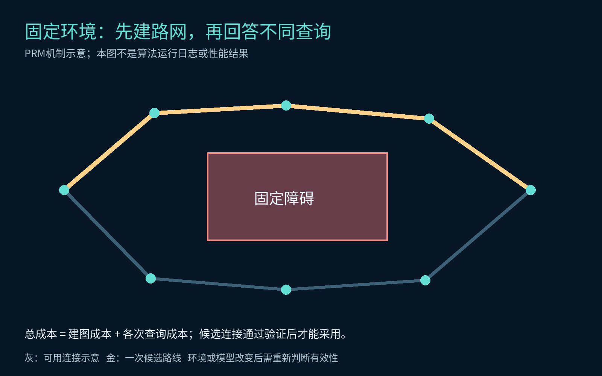
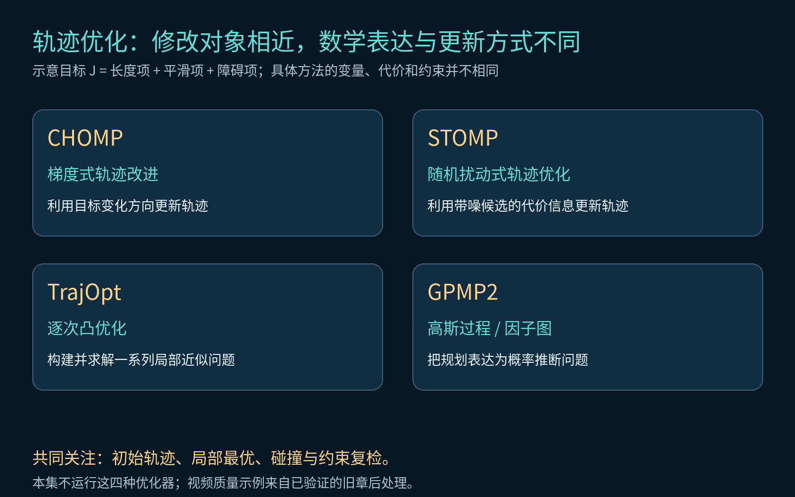
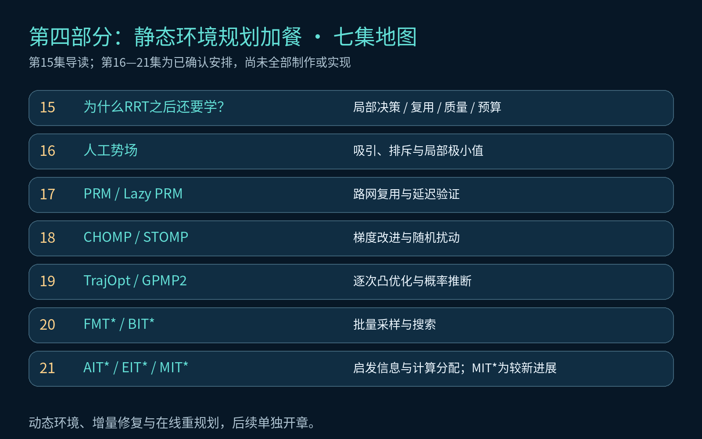

# RRT已经会找路了，为什么还要学别的算法？

《硅基学步》第15集，第四部分导读。硅宝已经能让机械臂绕障、处理路径形状、安排时间并检查关节约束。老板却又递来四张需求卡：能否直接根据周围环境决定方向？重复任务能否复用计算？轨迹能否更平滑、离障碍更远？有限预算下能否少做无效工作？

本部分只研究**静态环境中的规划与优化**。动态障碍、地图变化、增量修复和在线重规划另设专题。本集建立问题地图，不把未运行的算法示意包装成实验结果。

## 1. 前十四集，已经搭好了什么？

我们已经认识Dijkstra、A*及移动平台的全局与局部配合，随后进入机械臂配置空间，学习RRT、RRT-Connect、RRT*和Informed RRT*。路径找到之后，继续进行删点、圆角与整段碰撞复检，再通过时间参数化安排起停，检查关节速度与分段加速度幅值。

*图1：前面解决的是一条相互衔接的链路。换一种规划方法，仍需明确后续处理和验收职责。几何可行、轨迹幅值通过与真机安全是不同层面的结论。*

因此，继续学习的原因是任务要求更加多样。已有方法仍然有价值，新方法帮助我们理解其他空间表示、求解机制与计算分配方式。

## 2. 第一张卡：能否借着周围的“力”走？

人工势场用一个直观的表达组织运动：目标产生吸引作用，障碍产生排斥作用，机器人沿合成方向移动。典型示意写作：

`U(q) = U_att(q) + U_rep(q)`，`F(q) = -∇U(q)`。

这里的“力”是规划或运动生成规则中的数学量，不表示画面中的机器人已经进行了真实力矩控制。

*图2：局部规则、计算复用、轨迹质量和计算预算是四个观察角度，彼此可以组合，并非互斥的算法分类。*

目标与障碍的作用可能相互抵消，产生非目标处的局部极小值。自由空间中存在通路，并不代表局部规则必然找到它。第16集将正式运行势场实验，展示成功与停滞条件。本集视频中的力箭头只是机制示意。

## 3. 第二张卡：同一个工作台，为什么每次都重新探索？

PRM将构建路网与回答查询分开。先在自由配置空间中采样，使用局部连接器验证边，构成稀疏图。随后把某次任务的起点、终点接入，再运行图搜索寻找通路。

在环境和机器人模型保持有效的前提下，一张路网可以服务多次查询。其总成本应拆开统计：

`总成本 = 建图成本 + 第1次查询成本 + … + 第N次查询成本`。

*图3：示意路网中的灰线为可用连接，金线为一次查询所选路线。图中没有实际运行PRM，也没有宣称一次建图后所有查询都成功。*

Lazy PRM进一步推迟部分碰撞验证，先在候选图中寻找路线，再检查需要使用的状态或边。未验证连接不能当作已通过安全检查。

PRM也有建图、连接和维护成本。只做一次简单任务时，这些投入未必划算；环境或模型改变后，缓存的有效性必须重新判断。第17集再用可复算实验展开。

## 4. 第三张卡：能走之外，还希望怎样走？

路径质量可以包含长度、平滑度、安全间距、关节运动量等要求。概念上可以把轨迹写为变量`ξ`，定义多项目标：

`最小化 J(ξ) = w₁·长度代价 + w₂·平滑代价 + w₃·障碍代价`。

同时满足起终状态、关节限制和碰撞约束。具体方法使用的变量、成本和约束不同，上式只用于解释建模思路。

CHOMP采用梯度式轨迹改进；STOMP用随机扰动轨迹的信息更新解。TrajOpt展示逐次凸优化的路线，GPMP2展示高斯过程与因子图上的概率推断表达。它们将在第18、19集展开。

*图4：从初始轨迹到改进轨迹，必须交代求解方法和目标。视频此处展示的是前面已核验的折线与快捷连接，不能当成CHOMP、STOMP、TrajOpt或GPMP2的运行结果。*

局部优化可能受到初始轨迹、障碍拓扑、权重和局部极小值影响。成本下降后，仍要检查碰撞和约束。平滑度指标改善，也不自动证明全程关节jerk有限、力矩合格或真实机器人跟踪稳定。

## 5. 第四张卡：有限预算下，计算该花在哪里？

从RRT*到Informed RRT*，我们已经看到“把样本放在哪”会影响改进过程。继续往前，还可以问：先搜索哪个候选？先验证哪条边？哪些昂贵连接值得现在计算？

FMT*与BIT*展示批量采样和搜索的联系；AIT*、EIT*进一步使用问题相关的启发信息，其中EIT*考虑验证路径所需的计算工作。MIT*作为较新进展，引出初始解出现前的估计informed sets与自适应采样思路。第20、21集将逐步讲解。

*图5：第15集建立问题地图，第16—21集进入代表方法。顺序服务于理解，不表示所有算法按一条直线互相替代；MIT*按较新研究介绍。*

RRT*在相应假设下具有渐近最优性质，但样本趋于无穷的理论结论，不等于有限预算下已经找到最优解。新方法的效果也取决于场景、目标函数、实现、硬件和碰撞验证成本。

## 6. 本集可运行实验：先把对比口径跑明白

页面实验复用已实现的RRT系列，支持三维机械臂与三维位置空间、随机种子、迭代预算、障碍尺寸及算法对比。本集没有将后续新算法的示意图接成虚假的实时求解器。

建议先固定机械臂场景、障碍半径0.15米、种子7、扩展步长10度及近邻上限35度：

1. 比较RRT与RRT-Connect，观察首条可行路径和运动验证次数。
2. 比较RRT*与Informed RRT*，观察预算增加时最佳路径成本的变化。
3. 改变随机种子，保留失败结果，不只展示最好的一次。

本实验的预算按采样迭代计，检碰次数另报，**不等于相同CPU时间或相同检碰预算**。不同方法的每轮工作不同；播放倍速更不等于算法求解速度。

配套`experiments/original/15/run-comparison.ts`固定三组种子和四种算法，保存结果与整段路径复检。比较轨迹优化时还需统一或明确初始轨迹、目标函数与终止条件；PRM则应拆分建图和查询开销。

## 7. 第四部分安排

| 集数 | 核心问题 | 主要方法 |
|---|---|---|
| 15 | 为什么继续补充规划工具箱？ | 本集导读 |
| 16 | 能否根据吸引与排斥直接生成运动？ | 人工势场 |
| 17 | 固定环境怎样复用计算？ | PRM、Lazy PRM |
| 18 | 怎样直接改进整条轨迹？ | CHOMP、STOMP |
| 19 | 优化问题还能怎样表达和求解？ | TrajOpt、GPMP2 |
| 20 | 怎样把采样与搜索结合？ | FMT*、BIT* |
| 21 | 怎样更有效地分配搜索与验证？ | AIT*、EIT*、MIT* |

后续章节尚未制作，表格是已确认的课程安排，不代表这些方法已经全部实现。

## 参考资料

- Khatib，人工势场经典论文：[Real-Time Obstacle Avoidance，1986](https://khatib.stanford.edu/publications/pdfs/Khatib_1986_IJRR.pdf)。
- Kavraki等：[PRM，1996](https://www.kavrakilab.org/publications/kavraki-svestka1996probabilistic-roadmaps-for.html)；[Lazy PRM，2000](https://www.kavrakilab.org/publications/bohlin-kavraki2000path-planning-using.html)。
- [CHOMP，2009](https://personalrobotics.cs.washington.edu/publications/ratliff2009chomp/)、[STOMP，2011](https://ieeexplore.ieee.org/document/5980280)。
- [TrajOpt论文](https://rll.berkeley.edu/trajopt/ijrr/2013-IJRR-TRAJOPT.pdf)、[GPMP2，RSS 2016](https://www.roboticsproceedings.org/rss12/p01.html)。
- [BIT*作者页面](https://robotic-esp.com/papers/gammell_icra15)、[EIT*作者页面](https://robotic-esp.com/code/eitstar/)、[MIT*，2025](https://arxiv.org/abs/2508.21549)。

用户提供的具身智能教程用于校核算法覆盖范围；教程内具体工程默认值不作为本课程已实现能力或通用性能保证。
