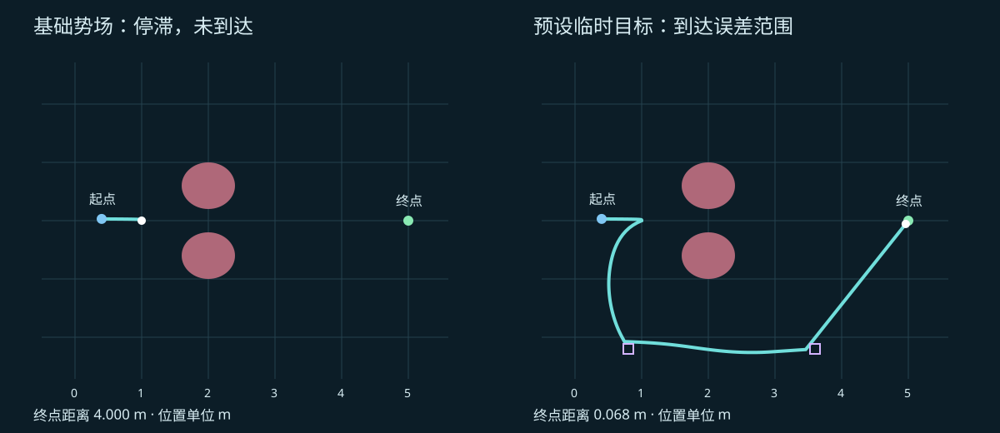

# 人工势场：目标拉我，障碍推我，怎么还走不动？

上集硅宝刚准备掏出 RRT，老板说：“先别种树。目标拉你，障碍推你，顺着合力走，不就行了？”

这办法确实直观。问题是：**地图上明明有路，合力却可能在到达之前变成零。** 本节把“推和拉”写成势能与梯度，再亲手观察停滞、判断失败和尝试恢复。

> 完整视频已发布，可通过本页“头条观看”入口打开；本站提供讲义与浏览器实验，不重复托管该集MP4。实验是静态二维点机器人教学模型，位置用米。障碍半径已经包含机器人尺寸膨胀；不是三维规划或真实硬件实测。

## 1. 给空间造一张看不见的地形

用位置向量 `p = [x, y]` 表示机器人，终点为 `g`。为每个位置定义一个势能标量：

```text
U(p) = U_att(p) + Σ U_rep,i(p)
U_att(p) = ½ k_a ‖p − g‖²
```

目标附近像低谷，障碍附近像山包。这个高度是**算法构造的势能**，不是车间地面高度，也不直接按焦耳解释。

势能只告诉我们“这里有多高”。梯度 `∇U` 指向局部上升最快的方向；想往低处走，就取负梯度：

```text
F_att = −∇U_att = k_a(g − p)
```

它就像一根朝目标拽的虚拟弹簧。这里的“力”是几何移动方向和强度，**不是直接发给电机的牛顿数**。

## 2. 离障碍有多近，要量边界而不是圆心

对圆心为 `c_i`、膨胀后半径为 `R_i` 的障碍，边界净距为：

```text
ρ_i = ‖p − c_i‖ − R_i
∇ρ_i = (p − c_i) / ‖p − c_i‖
```

设影响距离为 `ρ₀`。在 `0 < ρ_i < ρ₀` 内，使用排斥势：

```text
U_rep,i = ½ k_r (1/ρ_i − 1/ρ₀)²
F_rep,i = k_r (1/ρ_i − 1/ρ₀) / ρ_i² · ∇ρ_i
```

在 `ρ_i ≥ ρ₀` 时，两者均为零；`ρ_i ≤ 0` 是碰撞状态，不属于上述自由空间公式的定义域。

倒数让靠近边界的惩罚迅速增大；减去 `1/ρ₀` 则让影响范围边界处的势能和斥力降为零。最后的单位向量负责“朝外推”。别只背一串倒数：**前面的系数决定推多狠，后面的向量决定往哪推。**

## 3. 合力给方向，整段检查决定能不能走

```text
F = F_att + Σ F_rep,i
p_next = p + αF
```

本例将单步位移限制在 `0.075 m` 内，然后进行解析线段与圆盘碰撞检查。若线段碰撞、越出边界或使当前目标对应的势能增加，就把步长减半，最多回溯12次；仍不接受则保持当前位置。

只检查新位置不够：两个端点都在障碍外，中间连接仍可能穿过障碍。这也是网站实验明确保留**整段检查**的原因。

理想连续一阶模型满足 `dU/dt = −‖∇U‖² ≤ 0`。离散步长却不自动具有这个性质，因而这里另外使用回溯。即使每步势能下降，也不能推出最终一定到达目标。

## 4. “各部门意见加起来等于零”

默认实验参数与已保存的 Python 制作工程一致：

| 参数 | 数值 |
| --- | --- |
| 起点、终点 | `(0.4, 0.03)`、`(5, 0)` m |
| 两个障碍圆心 | `(2, 0.6)`、`(2, −0.6)` m |
| 膨胀半径 | 0.4 m |
| 吸引系数、斥力系数 | 1、2.1444572361897034 |
| 影响净距、步长系数 | 1.5 m、0.035 |
| 迭代预算、到达误差 | 2400、0.07 m |

基础人工势场停在约 `(1, 0)`：离终点仍有4 m，但吸引与排斥几乎抵消。局部“下坡”方向消失了，地图上绕过去的路并没有消失。



*原始默认实验轨迹。左侧未到达，右侧通过预设临时目标到达误差范围；两条轨迹终止位置不同，不能按路径长度给算法排优劣。圆盘为已膨胀障碍。*

网页按原实现检测停滞：运行超过70次循环后，最近60个位置相对当前点都在3 mm内。**到达判断与停滞判断分开**：未到达、步子很小，不等于任务完成。

停滞也不一定都是局部极小值；步长、回溯连续拒绝等因素也需要检查。缩小步长可能修复离散跳步，却不能保证爬出真正的局部低谷。

## 5. 先找门，再讨论工位

浏览器右侧保留原实验的确定性恢复策略：首次检测到停滞后，依次切换到 `(0.8, −2.2)`、`(3.6, −2.2)`，最后回到原终点。

这些是**人为预设的教学临时目标**，不是人工势场自动找到的路线。每个候选移动仍经过整段检碰与当前目标势能回溯。目标切换会改变势能函数，所以这并不意味着原终点对应的势能全程下降。

| 默认结果 | 基础势场 | 预设临时目标 |
| --- | ---: | ---: |
| 终态 | 停滞，未到达 | 进入0.07 m误差范围 |
| 循环次数（含终止判断） | 79 | 349 |
| 路径长度 | 0.612836 m | 8.255716 m |
| 最终目标距离 | 4.000000 m | 0.068486 m |
| 线段检查次数（含最终复检） | 158 | 696 |

这张表展示的是**失败与恢复**，不是谁更短、更快的性能排名。当前浏览器每次改变参数都会重新计算两种方案；回放速度只改变观看速度，不代表计算效率或机器人速度。默认逐点结果与原 Python 报告一致。

## 6. 随机扰动与全局规划，各有自己的责任

原始 Python 工程还保留两组扩展对照：

- **受限随机扰动**：保存种子，限制次数，整段检查每次扰动。可能跳出局部低谷，也可能再次掉回去，不能保证成功。
- **RRT-Connect 引导与已验证路线回退**：先在预算内寻找经过检碰的全局路线；人工势场仍可能无法跟随每个中间目标，因此保留明确的回退分支。预算内找不到路线要报告失败，不宣称切换算法就必成功。

网页当前实时计算基础势场和临时目标两个确定性分支；随机扰动与 RRT-Connect 完整对照请运行原始 Python。不同方法随机数消耗不同，相同种子不代表逐个使用相同样本；检查次数也不是运行时间。

## 7. 从几何方向到可执行动作，还有一段路

回到机械臂，只给末端加斥力不够：手绕开了，肘部仍可能碰撞。工作空间控制点的方向需要通过雅可比映射到关节空间，最后仍须检查完整连杆几何；稀疏几个控制点不等于整条机械臂安全。

本例只验证二维几何线段与已膨胀圆盘不相交；没有验证动力学、速度、加速度、力矩、跟踪误差或真机安全。虚拟力得到的方向，仍要接上前面学习的时间参数化、约束验收与控制器。

**本节记住三件事：势能定义偏好，负梯度提供局部方向，失败检测与恢复策略负责诚实收尾。** 硅宝可以暂时卡住，但不能把“还在计算”当作到站回执。

## 原始实验与复现

- [原始 Python 实验、说明与核验报告](https://github.com/luckyPT/silicon-baby-steps/tree/main/experiments/original/16)
- [浏览器人工势场实现](https://github.com/luckyPT/silicon-baby-steps/blob/main/src/algorithms/potential-field.ts)
- [默认轨迹与解析检碰回归测试](https://github.com/luckyPT/silicon-baby-steps/blob/main/tests/potential-field.test.ts)

运行：`python experiments/original/16/experiment.py`，依赖 NumPy。脚本重写同目录 `qa/experiment.json`；保留的报告来自原制作工程。下一集转向 PRM：能否把已找到的连通关系存下来，让多个查询重复利用？
