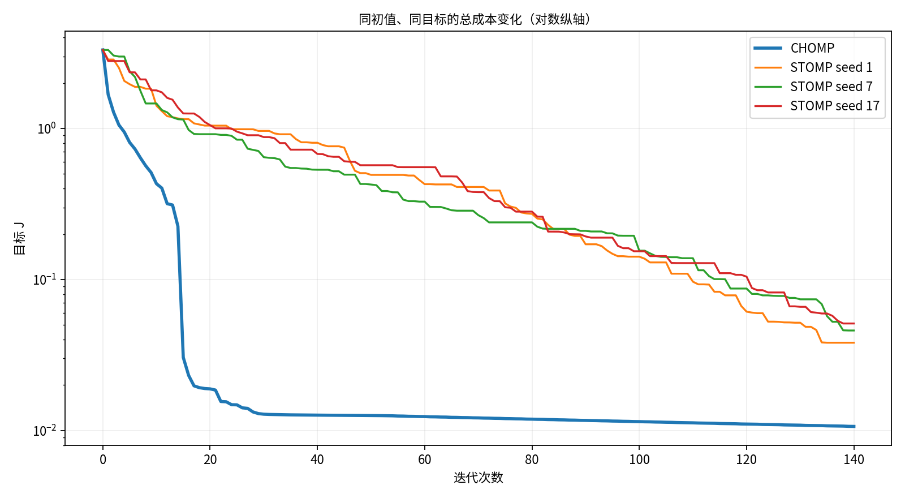
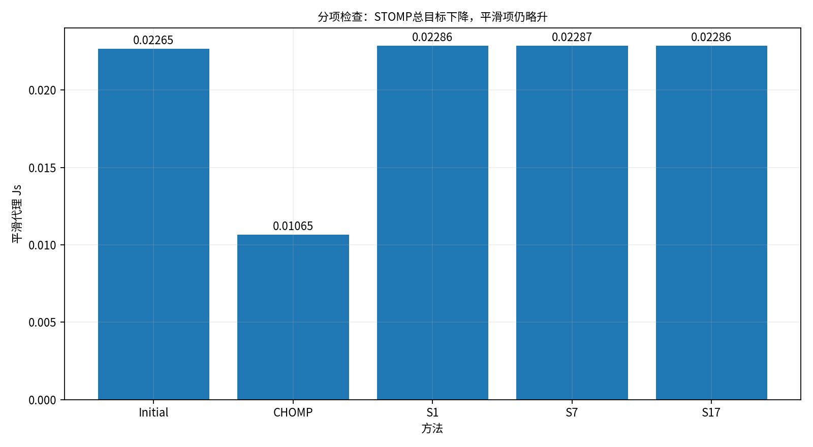
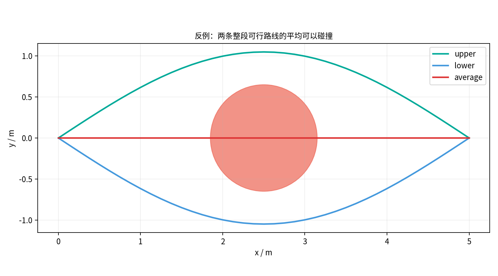
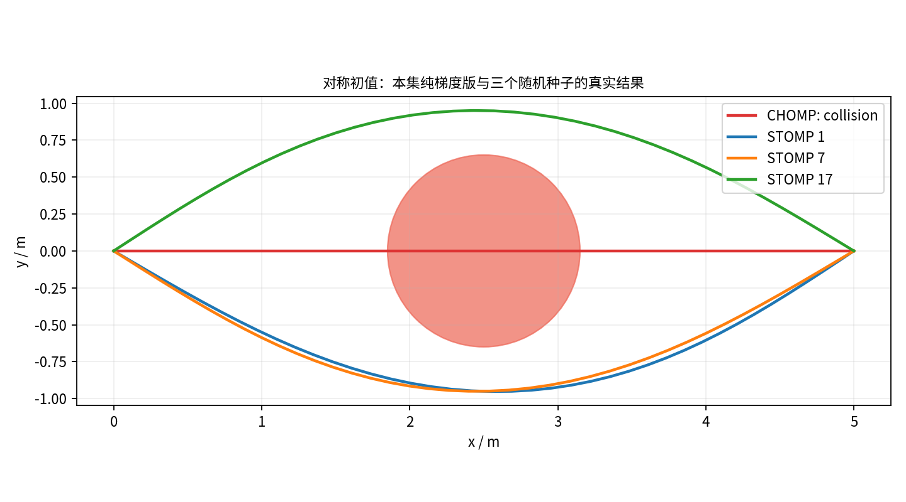

# CHOMP / STOMP：让整条路线一起改

> 本节讲义与交互实验已提供；完整视频的网页同步待补。实验是**静态二维点机器人**，不是完整机械臂、真实运动时间或真机安全认证。原来的可行路线始终保留，不用未验收的优化结果覆盖它。

老板递来一条已经验过的路线：“能到，就是拐得有点像我周一早上的精神状态。”

硅宝这次不推倒重来，而是把整条路线上的中间点一起调整：**CHOMP 用梯度和轨迹度量协调修改，STOMP 用关联扰动与概率权重合成修改。**二者都不是把折线涂成绿色就算通过。

## 1. 先把“改顺一点”变成一笔可核对的账

沿用第17集种子17、第一组查询的最终路线，按弧长重新采样成41个配置点。两端固定，只改39个内点；每点有横纵两个坐标，所以共有78个内部变量。重采样后再次做整段检碰，初始最小净距约0.05357米。

本例使用同一目标：

```text
J = Js + 35 Jo
Js = 1/2 Σ ||q[i+1] − 2q[i] + q[i−1]||²
Jo ≈ 沿每条线段累计的障碍距离场惩罚
```

`Js` 是固定参数网格上的二阶差分平滑代理，省略共同步长比例，**不是某台电机的真实加速度**。平滑项变小也不代表路线一定更短。

令 `d` 为到最近圆盘边界的带符号净距，外正内负；障碍已经包含点机器人建模所需的膨胀。影响范围 ε=0.30米：

- `d ≥ ε`：惩罚为0；
- `0 ≤ d < ε`：惩罚为 `(d−ε)²/(2ε)`；
- `d < 0`：惩罚为 `−d + ε/2`。

每段采用五点高斯求积近似障碍线积分。CHOMP 的解析梯度也对**同一个离散目标**求导，并经过中心有限差分核验。优化积分负责指方向；解析线段—圆盘检测负责最终几何验收，两者不能互相冒充。

## 2. CHOMP：不是只拽走最危险的一个点

只沿欧氏梯度拉动一个危险点，可能制造尖角。CHOMP 的关键是轨迹空间的度量：局部修改通过它传播到整条路线。

只保留二阶差分算子中内部变量对应的列，记为 `D`，令 `A = DᵀD`。固定端点后，本例 `A` 正定。更新可写成：

```text
A Δ = −η ∇J
Q_new = Q + Δ
```

本实现限制每轮每个点最多修改0.16米；若总目标不下降，步长减半回溯。找不到可接受步长就记录停滞，不靠继续播动画假装进展。

一个**独立手算例子**：

```text
A = [[5, −4], [−4, 5]]
A⁻¹ = (1/9) [[5, 4], [4, 5]]
g = (9, 0), η = 0.1
欧氏修改 = (−0.9, 0)
协变修改 = (−0.5, −0.4)
```

第二个变量没有直接梯度，也跟着协调改变。这组数字不是主实验39个内点的实际位移。

原始CHOMP还有工作空间身体点、运动学雅可比和其他扩展；本节是点机器人的有限离散机制，不宣称完整复现论文全部算法。

## 3. STOMP：让候选评分，不让机器人试撞

每轮生成32份加噪候选。起终点不扰动；内点噪声通过与 `A⁻¹` 成比例的协方差关联起来，避免每个点各自乱抖。主实验扰动幅度 σ=0.30米。

对每个位置，状态成本由相邻障碍积分段分摊得到。跨候选分别归一化：

```text
z[k,i] = (S[k,i] − min_k S[k,i]) / (max_k S[k,i] − min_k S[k,i])
p[k,i] = exp(−10 z[k,i]) / Σ_k exp(−10 z[k,i])
Δq[i] = Σ_k p[k,i] ε[k,i]
Q_new = Q + M ΔQ
```

成本全相同时采用均匀权重。`M` 来自 `A⁻¹` 的列缩放，每列最大元素为1/39。先按位置加权，再整体平滑；不是只挑第一名，也不是所有候选简单平均。

本教学实现**额外加入总目标下降的回溯接受检查**。这是工程保护，不声称论文算法表原本就包含该步骤。STOMP 没有偷偷调用成本解析梯度。

独立手算采用温度1的简单指数式：成本 `(1,2,3)` 的权重约为 `(0.665,0.245,0.090)`；扰动 `(−0.2,0.1,0.3)` 的加权修改约为−0.0815。主实验使用上面的min-max归一化式，两组公式不要混读。

## 4. 原始Python日志：同一目标改善，不是每个指标都赢



*图1：原始Python日志。相同初值、地图、目标及140轮；一边算梯度，一边每轮评32份候选，计算量并不相同。纵轴为对数。*

| 原始实验 | 总目标 J | 平滑代理 Js | 路径长 / m | 最小净距 / m |
|---|---:|---:|---:|---:|
| 初始路线 | 3.316179 | 0.022651 | 6.345717 | 0.053572 |
| CHOMP，140轮 | 0.010651 | 0.010651 | 6.257858 | 0.299421 |
| STOMP，种子1，140轮 | 0.038162 | 0.022865 | 6.373431 | 0.270915 |
| STOMP，种子7，140轮 | 0.045982 | 0.022866 | 6.368218 | 0.270172 |
| STOMP，种子17，140轮 | 0.051165 | 0.022857 | 6.373483 | 0.259778 |

以上四个最终结果都通过本例解析整段检碰。它们不是全局最优证明，也不代表所有地图上的性能排名。



*图2：三组STOMP的总目标下降，但平滑项略升，路线也略长。障碍惩罚下降更多，使加权总账改善；不能据此宣称各分项都改善。*

网页实验会实时重算。CHOMP默认数值与原始Python结果有回归核对；网页STOMP使用 **Mulberry32 + Box–Muller**，原片使用 NumPy PCG64。同种子在网页实现内可复现，但不承诺与Python随机序列或表中结果逐点相同。网页分别展示本次真实指标，保留失败。

## 5. 两条安全路线的平均，可能穿过障碍



*图3：上绕与下绕的曲线分别通过整段检碰，但对应点取平均后的直线穿过圆心。*

老板一听“平均”，眼睛就亮了：“左右都能走，平均一下，总该更稳吧？”

几何里的平均值，不负责替我们做人情。可行区域通常不是凸的。即使参与加权的若干候选安全，合成后的路线也不自动安全，仍须重新验收。

## 6. 对称初值：如实展示停滞与脱困边界



*图4：原始Python机制反例。单圆盘挡在直线正中，本集确定性纯梯度CHOMP跑80轮仍保持y=0、仍碰撞。三个STOMP种子用160轮、σ=0.55米打破对称并通过复检；预算与主实验不同，不是等成本性能竞赛。*

网页可切换到这张地图。为了方便对照，切换后两边同设160轮，STOMP σ=0.55米；实际输出以当前日志为准，随机扰动并不普遍保证逃出局部极小值。

也不能把本例纯梯度版的失败，推广成所有CHOMP变体都失败。原论文讨论过其他扩展，本节没有全部实现。

失败时先查步长、单位、权重和距离场。若梯度很小却仍碰撞，继续多跑几千轮未必会长出新的绕行方向；应考虑换初值、多通道，回到PRM/RRT先找路，再优化。**保留预算和失败日志，保留已通过验收的旧路线。**

## 7. 怎样亲手复现

打开本节交互实验室：

1. 默认主地图观察两种方法的总目标、分项、路线长与净距；
2. 单步或播放，看到每一轮真的计算，而不是播放预录视频；
3. 修改STOMP种子和扰动幅度，同一配置可重新运行；
4. 切到对称失败地图，观察“不下降”和“仍碰撞”是两种不同问题；
5. 导出本次完整日志。成本评估计数不含显示/验收调用，不能直接当成运行时间。

原始实验位于 [experiments/original/18](https://github.com/luckyPT/silicon-baby-steps/tree/main/experiments/original/18)。保留原脚本、初始路由和完整日志；只需NumPy：

```bash
python -m pip install numpy
python experiments/original/18/experiment.py
```

几何通过以后，仍要接之前的时间参数化、关节约束与控制验收。本集没有力矩、负载、闭环跟踪或真机执行结论。

## 原始资料

- Zucker等，CHOMP，IJRR 2013：[论文](https://publications.ri.cmu.edu/storage/publications/pub_files/2013/5/CHOMP_IJRR.pdf)、[作者资料页](https://www.nathanratliff.com/thesis-research/chomp)。
- Kalakrishnan等，STOMP，ICRA 2011：[论文](https://whiteoak.umd.edu/roswiki/attachments/Papers%282f%29ICRA2011_Kalakrishnan/kalakrishnan_icra2011.pdf)。

下一集继续认识TrajOpt与GPMP2，看看凸近似和概率推断如何安排整条轨迹。
