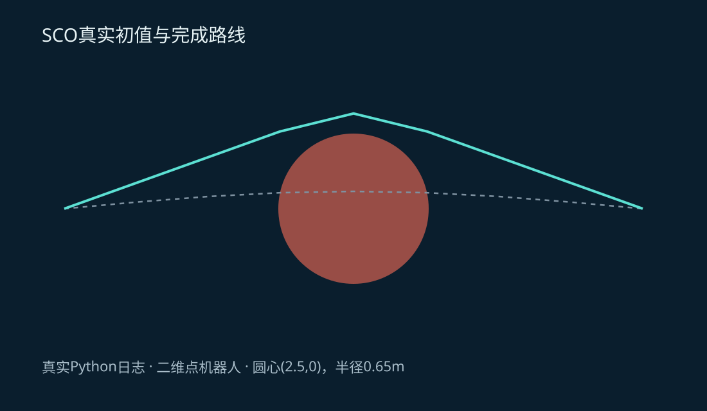
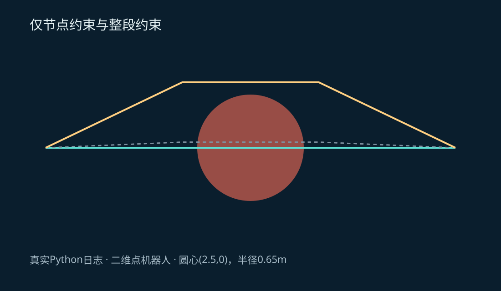
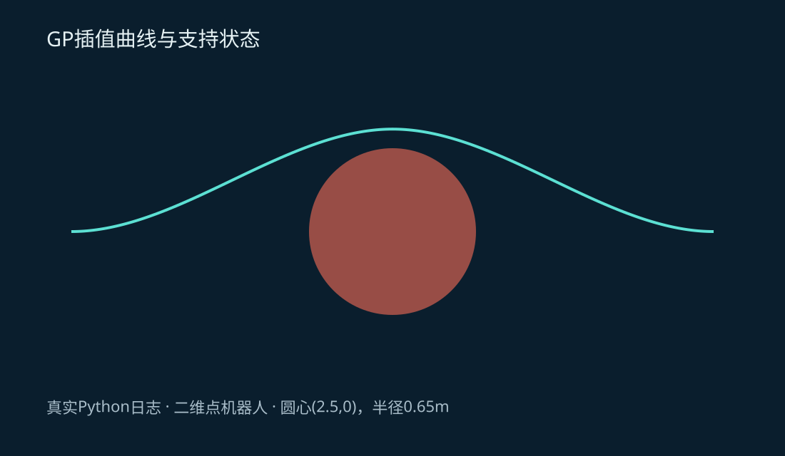
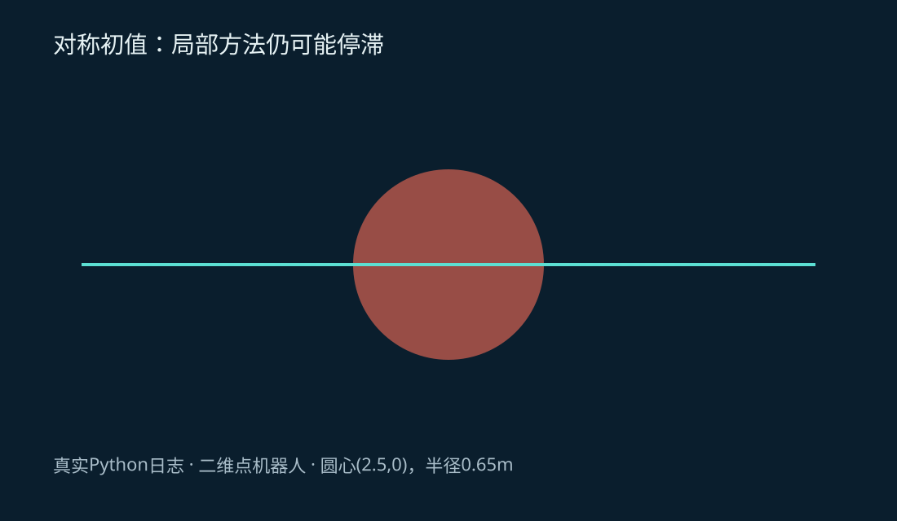

# 第19集：TrajOpt / GPMP2——路径变顺了，怎么还会撞？

## 1. 接着修改整条轨迹

上一集用CHOMP与STOMP说明梯度、轨迹度量和随机扰动。本集继续处理整条轨迹，但换两个思路：把局部非线性问题近似成凸子问题；把运动先验和障碍要求写成因子残差。这里是自写的静态二维点机器人教学实现，并非官方TrajOpt或GPMP2完整复现。

起点为(0,0)，目标为(5,0)，圆障碍中心(2.5,0)、半径0.65米。碰撞余量设为0.15米。三维视频只是教学展示，规划自由度仍是二维。

## 2. TrajOpt式逐次凸优化

轨迹离散为位置序列q，两端固定。本实验平滑目标为相邻差分平方和：

$$J(q)=\sum_i\|q_{i+1}-q_i\|^2.$$

令d(q)表示轨迹线段到圆的净距，要求d≥ε。在当前轨迹q̄附近，将它近似为d(q̄)+∇d(q̄)ᵀΔq。引入非负松弛s，将凸子问题写为最小化J(q̄+Δq)+μΣs，并满足线性化距离加s不小于ε、每个坐标的变化不超过信赖域半径。

当前模型用线段上离圆心最近的点计算距离，并把端点梯度按线段参数分配给相邻节点。在最近点切换等非光滑位置，局部模型与有限步长仍有局限。



图1：实线为真实SCO完成路线，虚线为初始路线。圆与坐标均来自实验记录。

凸子问题解得好，不代表原问题真实改善。代码分别计算预测改善和真实惩罚目标改善，以两者比值决定是否接受。接受后可以适当扩大信赖域，拒绝后缩小；同时分阶段增加惩罚权重μ=2、20、200。这里用SLSQP求解构造出的凸子问题，不把求解器名称等同于完整TrajOpt软件。

## 3. 只查节点，为什么会漏掉中间碰撞？

四个轨迹节点都在圆外时，它们之间的直线仍可能穿过圆。只给节点添加障碍惩罚，优化后节点净距通过，整段净距却为−0.65米。沿同样的四节点结构改用整段约束，才得到净距约+0.15米的绕行路线。



图2：两条路线都来自实际求解。不能用“节点没撞”代替连接段检碰，也不能通过增加显示帧数证明连续安全。

## 4. GPMP2式先验与因子图

每个支持状态包括位置与速度x=(p,v)。本实验采用常速度转移：

$$\Phi(\Delta t)=\begin{bmatrix}I&\Delta t I\\0&I\end{bmatrix},\qquad Q(\Delta t)=\begin{bmatrix}\Delta t^3I/3&\Delta t^2I/2\\\Delta t^2I/2&\Delta t I\end{bmatrix}.$$

相邻状态的先验残差是xᵢ₊₁−Φxᵢ，并用Q的Cholesky因子白化。障碍残差为max(0,ε−d)/σ，本例σ=0.03。把先验与障碍残差拼起来，求解非线性最小二乘；这就是把多类要求放入因子目标的教学版本。



图3：GP实验输出的Hermite插值曲线。曲线经过支持状态，不等于支持状态之间也自动安全。

这里用三次Hermite插值计算位置，在支持间隔内加入障碍残差，并用曲线距离平方的导数根检查整个多项式段。最终曲线净距约0.148896米，大于零但略低于0.15米惩罚余量。软惩罚没有强制每个约束都精确达到余量。

## 5. 同样要保留卡住与恢复

完全对称的直线初值会停在障碍中线，局部线性化不能替你选择绕上方还是下方。换成轻微上绕或下绕的初值，得到不同侧的局部解。实际工程还应检查尺度、步长、约束建模，并从全局规划器获取不同拓扑的初始路线。



图4：对称初值失败记录；没有把失败路线当作可执行输出。

## 6. 本例结果与比较边界

| 教学实验 | 最终验收 | 结论范围 |
|---|---|---|
| 仅节点障碍约束 | 节点通过，整段净距−0.65m | 节点可行不代表连续段可行 |
| SCO整段约束 | 整段净距约+0.15m | 本例局部求解与解析线段复检通过 |
| GP先验与插值障碍因子 | 整曲线净距约+0.148896m | 避开圆，但未完全达到软惩罚余量 |
| 完全对称初值 | 整段仍碰撞 | 局部优化依赖初值，需恢复机制 |

两个实验的状态变量、目标与预算不同，不能据此排名速度或宣称某算法普遍更安全。线段距离解析梯度与中心差分的最大误差约1.83×10⁻¹⁰；这只是有限样本的代码核对，不是普遍收敛证明。

## 7. 网页实验与完整复现

[打开真实阶段回放](#/lesson/19/lab)，切换初值、节点漏检、整段修复与GP曲线结果。网页读取真实日志，不在浏览器中重新运行Python求解器。

[获取实验代码、依赖与原始结果](https://github.com/luckyPT/silicon-baby-steps/tree/main/experiments/original/19)，在该目录运行：

```bash
python -m pip install -r requirements.txt
python experiment.py
```

## 8. 原始资料

- Schulman等，Finding Locally Optimal, Collision-Free Trajectories with Sequential Convex Optimization：https://roboticsproceedings.org/rss09/p31.pdf
- Dong等，Motion Planning as Probabilistic Inference using Gaussian Processes and Factor Graphs：https://roboticsproceedings.org/rss12/p01.pdf
- GPMP2官方实现：https://github.com/gtrll/gpmp2
