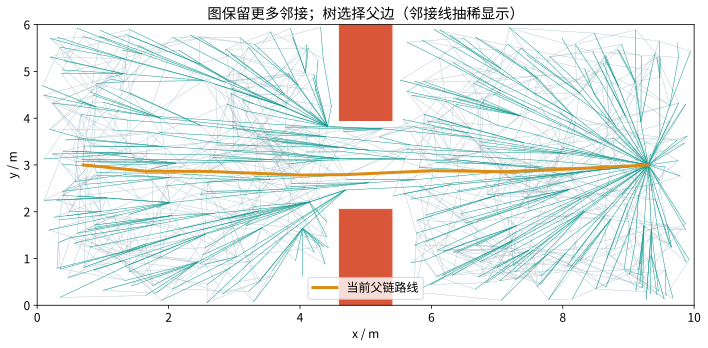
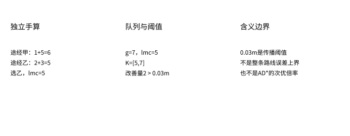
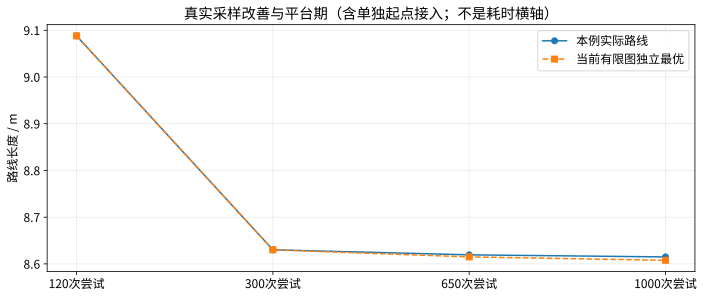
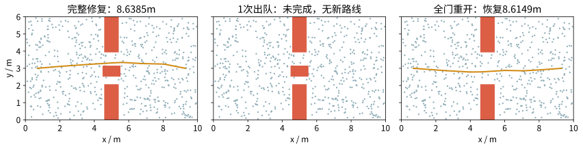

# 第26集：RRTX——障碍一动，原来的搜索树还能用吗？

## 1. 问题：连续空间采样结果如何复用

前面23—25集讲离散图搜索复用，本集回到采样规划。RRTX维护采样图及其通向目标的父边子树，障碍出现、消失后，撤销失效依赖并利用已有邻接重连。节点暂时失去目标连接，不等于把采样点整段删除。



图1：来自种子7的真实602节点图；灰蓝邻接线为可读性抽稀，青线是父边，金线是当前路线。图中的边显示来自完成阶段，事件动画另按真实日志回放。

## 2. 核心变量与独立手算

树根在目标。g保存接受过的代价估计，lmc是一种一步前瞻代价；本集按原论文使用邻居lmc进行候选比较，而不是直接照搬前几集的rhs递推。目标g=lmc=0，未知为无穷。

$$lmc(v)\leftarrow\min_{u\in N^+(v)}[c(v,u)+lmc(u)],\quad K(v)=[\min(g(v),lmc(v)),g(v)].$$

更新须结合有效邻接、父子循环排除与依赖撤销条件；这不是脱离这些条件便可随意迭代的公式。

独立手算：途经甲1+5=6，途经乙2+3=5，选乙。如果g=7、lmc=5，则K=[5,7]，改善量2。手算数值不对应大图的特定节点。



图2：主实验ε=0.03m，用于传播触发g−lmc>ε。这是局部一致性阈值，不是AD*的次优倍率，也不表示整条路径最多多0.03m。本集不为非零阈值结果声称全局误差上界。

## 3. 图如何增长

状态空间[0,10]×[0,6]m，固定S=(0.7,3)、T=(9.3,3)。固定朝向方形机器人半宽0.12m，障碍作轴向膨胀，线段对膨胀盒做完整slab检碰，不用稀疏采点冒充整段检查。局部边为欧氏直线，不能解释成汽车、机械臂或动力学轨迹。

随机种子7，均匀采样；最近邻与邻域线性搜索。步长上限δ=1.4m，γ=480，二维半径r=min(δ,sqrt(γ log n/(πn)))。所有采样都来自固定种子，不为某个速度排名筛选。

累计随机尝试120、300、650、1000，实际保留114、282、602、920个节点；另有一次显式起点接入。尝试可能因碰撞、无法连接而失败。不能把尝试次数、节点数、出队次数或墙钟时间混用。



图3：实际路线9.088053→8.630135→8.619350→8.614937m；最后一阶段在经历图更新恢复后继续采样，不能当成无中断的纯静态基准。有限图独立最优另画，有限采样不代表连续空间全局最优。

## 4. 新障碍：先撤销后代依赖，再传播

在原路线穿越门洞边的中点附近设置新盒，具体y范围由实际旧路线决定，非手绘假碰撞。406条已存无向边的有效性变化；180个节点处于失效父边的后代闭包。先完整收集后代，再设置g/lmc为无穷并断开父边，保留节点与几何邻接；边界节点触发报价重传。目标节点作为边界时同样需要触发传播。

主实验保留602节点，不新增采样，修复得到8.638516m；独立Dijkstra在同一有限图得到8.629998m。差异保留，不声称ε>0时精确图最优。新路径每条边在新地图独立复检，并从坐标重新求长度。

## 5. 重开、无路和预算中断

障碍移除后，曾受影响的边重新与全部当前障碍核对，避免忽略重叠障碍。只恢复实际可用的边；本例回到8.614937m。整门封死则左右不连通，完整查询返回无路；重开恢复同一批节点上的路径。

预算测试在完成变化边检查和后代撤销之后，只允许一次有效出队。旧路线在新地图检碰失败；真实部分状态仍有104个队列成员，没有新路线。程序不交付旧失效路线，也不把完整修复结果冒充预算内结果。这个预算不包含先前全部边检查与后代遍历开销，不能解释成总时限；停止离散演示不是真机制动安全。



图4：左为完成修复，中为一次真实出队后未完成状态，右为全门重开后的恢复。三个面板都是程序快照。

## 6. 真实日志与有条件对照

|阶段|节点数|实际长度m|独立图最优m|有效出队|失效后代|变化/插入边检碰|
|---|---:|---:|---:|---:|---:|---:|
|sample120|114|9.088053|9.088053|280|0|575|
|sample300|282|8.630135|8.630135|501|0|3221|
|sample650|602|8.619350|8.614937|443|0|12461|
|closure|602|8.638516|8.629998|287|180|16123|
|reopen|602|8.614937|8.614937|147|0|16123|
|no_path|602|无路|无路|57|305|16123|
|recovery|602|8.614937|8.614937|305|0|16123|
|sample1000|920|8.614937|8.607719|347|0|16312|

出队、邻接扫描、重连、过期堆项和检碰分别记录于qa/experiment.json。287次修复出队不代表287次总操作，也不能直接与Dijkstra settled数比较成速度倍数。本集没有跨算法通用排名或硬实时承诺。

## 7. 验证与实现边界

3种子1/7/17，每个260次初始随机尝试，再各30次封路、重开、门洞全部阻断等图变化，共90次零阈值查询。每次与独立前向Dijkstra比较同一有限图最短代价，通过；附加目标附近失效与恢复检查也通过。所有交付父链检查无环、端点、逐段可行与实际长度。有限测试不替代理论证明。

这是按原论文Algorithms 4、5、8、9、11、12核心机制写的教学变体：保留全部已存局部邻接、修复时清空队列、线性搜索邻居和变化边；未复刻原始/运行双邻居裁剪，未实现当前位置关键字截断，没有移动机器人执行。**不继承原论文的渐近复杂度、完整渐近最优证明或实机性能结论。** 原论文ε讨论与其完整邻接策略相关，本代码仅演示机制与有限图验证。

未来障碍运动、传感器延迟、连续时序冲突、动力学制动与真机均未模拟。下一集时空A*专门引入时间维度。

## 8. 复现

```bash
python -m pip install -r requirements.txt
python experiment.py
python make_notes.py
```

原始来源：Otte & Frazzoli，RRTX: Asymptotically Optimal Single-Query Sampling-Based Motion Planning with Quick Replanning，IJRR 2016，DOI 10.1177/0278364915594679。作者公开稿：https://ottelab.com/html_stuff/pdf_files/Otte.Frazzoli.IJRR15.pdf 。PDF只作制作期核对，不随工程再分发。


## 网页实验与完整复现

[打开本集实验回放](#/lesson/26/lab)：切换真实实验阶段、查看路线及指标对照。回放读取已生成日志，不在浏览器中重跑Python求解器。

[获取原始实验与依赖](https://github.com/luckyPT/silicon-baby-steps/tree/main/experiments/original/26)。在该目录运行 `python -m pip install -r requirements.txt` 和 `python experiment.py`，可重新计算原始实验。
