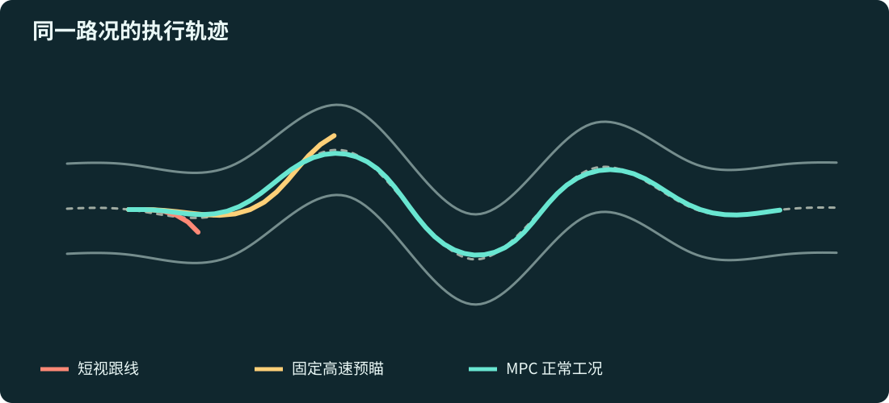
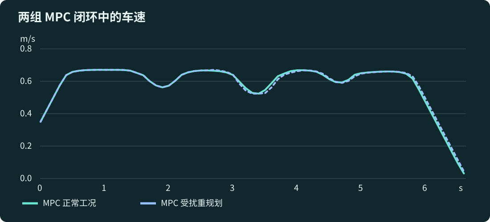

# 第28集：MPC——老板只让我推辆车，我把它推下了跑道

机械臂推着小车沿同一条 S 弯走。只追眼前的点，小车越线。看得更远，仍用固定高速目标，小车还是越线。这个实验把问题拆成四件事：**模型怎样预测、约束怎样检查、目标怎样取舍、优化器怎样更新动作**。

## 1. 用自行车模型推演下一步

状态为 `(x, y, ψ, v, δ)`，依次表示后轴位置、车头朝向、纵向速度和前轮转角。两个控制输入是加速度 `a` 和前轮转角变化率 `ω`。轴距 0.19 m，每个控制周期 0.1 s。离散预测使用：

```text
x(k+1) = x(k) + Δt · v(k) · cos ψ(k)
y(k+1) = y(k) + Δt · v(k) · sin ψ(k)
ψ(k+1) = ψ(k) + Δt · v(k) · tan δ(k) / L
v(k+1) = v(k) + Δt · a(k)
δ(k+1) = δ(k) + Δt · ω(k)
```

每轮预测 20 步，覆盖两秒。速度和转向既改变当下的动作，也会改变后续整条预测轨迹。网站滑块按仿真时间展示当前状态和重新求解后的预测。



图1 · 三条线分别来自短视跟线、固定高速预瞄与 MPC 的位置采样。越线判定计算车身四角，因此有些车身越线时，后轴位置仍落在路内。

## 2. 硬约束与优化目标

预测区间逐步检查四角的道路余量，以及速度、前轮转角和横向加速度。加速度与转角变化率直接作为输入上下界。车速上限 0.90 m/s，前轮转角绝对值上限 0.62 rad，加速度和转角变化率限值分别为 0.75 m/s² 和 1.7 rad/s。道路以中线的纵坐标加减 0.235 m 定义，预测再预留 0.010 m。横向加速度近似为 `v² tan(δ)/L`，预测上限为 1.03 m/s²。离散周期内用 0.01 s 间距检查教学轨迹，采样最大值略高于预测上限且小于 1.05 m/s²。

代价函数同时惩罚中线偏差、车头偏差、目标速度偏差和过大的控制输入。末端还惩罚离目标太远和剩余速度。这样优化器在可行范围内兼顾跟线、行进速度和平顺性。高目标速度的基线共享道路、车辆和加速度/转向执行限制，但不会按未来曲率联合调速，也没有主动施加 MPC 的车身与横向约束。



图2 · 正常与受扰工况实际记录的车速。S 弯内出现几次减速和恢复，接近终点后明显制动。横轴是仿真秒数。曲线容易重合，受扰后的偏移见网页同一时刻的预测与执行轨迹。

## 3. 为什么算二十步，只执行一步

SLSQP 接收 40 个连续动作变量。每轮用当前状态和候选动作推演未来，计算代价与约束，在局部近似下更新动作并检查新候选。上一轮剩下的控制序列向前移一步，用作下一轮的初值。仿真执行第一组输入后，用新测得的状态重建优化问题。

受扰工况在仿真时刻 2.6 s 将横向位置偏移 2.5 cm、朝向偏移约 2.6°。之前的预测还留在页面上作对照。下一周期的预测以改变后的状态作为起点，所以可以看到新的转向和减速安排。一般非线性优化只能求出当前条件下的局部结果，部署时还要处理求解超时和无可行解。

## 4. 实验结果与复现

| 工况 | 记录时长 | 四角最小边界余量 | 末帧速度 |
| --- | ---: | ---: | ---: |
| 短视跟线 | 0.7 s | −7.9 cm | 0.781 m/s |
| 固定高速预瞄 | 1.7 s | −6.3 cm | 0.848 m/s |
| MPC 正常工况 | 6.6 s | +5.1 cm | 0.031 m/s |
| MPC 受扰重规划 | 6.6 s | +4.8 cm | 0.043 m/s |

两组基线越线后提前终止，记录时长不用于比较完赛速度。两组 MPC 各完成 66 轮可行优化，在模型的停车阈值内完成。边界余量用四角与道路边线的纵坐标差计算，应用范围限定为这条路、这个车体模型和给定的扰动。视频里还包含一段简化的 MuJoCo 接触闭环回放，其三轴机械臂、抓握和转向均为教学设定。上表和网站回放使用可复算的运动学对照。

从仓库根目录运行：

```bash
python -m pip install -r experiments/original/28/requirements.txt
python experiments/original/28/experiment.py --output public/experiments/28.json
```
