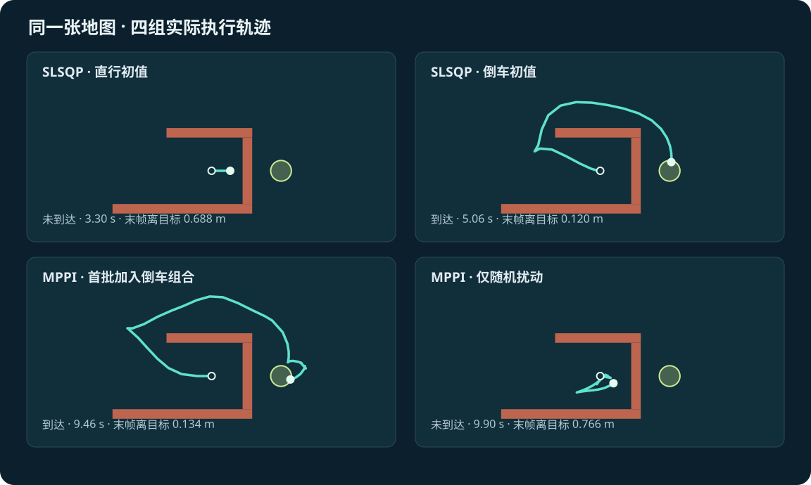

# 第29集：想出去，先倒车！MPC 与 MPPI

终点就在小车前面，中间却隔着一面墙。出口在车后方，出去后还要绕过墙角。直行初值的局部优化把车开到墙前停住。换一个会倒车的初始方案，同一个优化器就能开出去。硅宝用这四组实验带硅盈看清楚，模型、求解器和采样设计分别改变了什么。

## 1. 同一辆车，同一个预测问题

**MPC（Model Predictive Control，模型预测控制）描述的是怎样闭环控制。MPPI（Model Predictive Path Integral，模型预测路径积分）可以用来求解这个滚动优化问题。** 本集比较的是用 SLSQP 做局部梯度优化的 MPC，以及用 MPPI 采样更新控制序列的 MPC。

两边都用同一个平面小车模型。状态为位置和朝向 `(x, y, θ)`，输入为线速度和角速度 `(v, ω)`。负线速度表示倒车。教学模型允许原地转向，控制器逐步按恒定输入积分：

```text
dx/dt = v · cos θ
dy/dt = v · sin θ
dθ/dt = ω
```

车身简化为半径 0.14 m 的圆，线速度和角速度的幅值上限分别是 0.98 m/s 和 2.75 rad/s。每个周期 0.22 s，向前预测 32 步，也就是 **7.04 s**。两边共用地图、车体、目标位置、动作上下限、优化时域和基础代价。基础代价包括窗口末端离目标的距离、途中离目标的距离、动作幅度和相邻动作的变化量。避障的实现有所不同，见下一节。

## 2. 求解器怎样改变下一步

| | SLSQP 局部优化 | MPPI 采样优化 |
| --- | --- | --- |
| 怎样更新 | 从一条初始控制序列出发，用目标和约束的局部导数迭代 | 从参考序列生成多组控制候选，分别推演并按代价给权重 |
| 本集怎么处理墙 | 在预测点施加净距约束，规划目标净距 2.8 cm | 对净距不足的采样加罚，更新后再检碰，必要时退回安全候选 |
| 受什么影响 | 初值所在的路线和可行域形状 | 采样分布、相关性、批大小、代价和温度参数 |
| 本集展现的代价 | 两个初值分别落在停墙前和成功绕行的结果上 | 纯随机扰动未覆盖到可完成的动作组合。引入组合后，有限样本能探索更多可行路线 |

本集的 MPPI 每批推演 3,600 条控制序列。每条序列都跑过完整的 32 步窗口，教学实现用 `exp(−(Sᵢ − Smin)/λ)` 计算相对权重，再归一化。这里 `Sᵢ` 是带避障罚项的候选代价，温度参数 `λ = 0.43`。用控制候选的加权平均更新序列，再把更新结果送进模型推演。平均后的控制序列可能对应一条撞墙路线，所以代码额外验收，并在需要时回退。这是本实验的实现选择。结构化组只在第一轮第一批加入倒车、转向、前进等动作组合，之后仍围绕更新过的序列扰动。

MPPI 的全称是 **Model Predictive Path Integral**。路径积分指理论上对许多可能的未来状态轨迹取加权期望。实现使用有限样本近似这个期望，因此算法名称强调的是推导中的积分形式。原始论文使用广义重要性采样给出更完整的推导。[Williams 等人的 MPPI 论文](https://doi.org/10.2514/1.G001921) · [Nav2 的 MPPI 控制器文档](https://ros-navigation.github.io/mkdocs.nav2.org/jazzy/configuration_and_development/configuration_guide/controller_plugins/mppi_controller/configuring_mppic/)

## 3. 每轮只看当前前瞻窗口

在每一轮里，两种控制器都从**当前实测状态**出发，优化接下来的 7.04 秒。目标位置可以参与给整个窗口打分，即使小车在这 7.04 秒内还到不了终点。选定序列后，只执行第一个周期的动作。下一轮用新状态重新预测，上一轮剩下的动作向前移一步，作为新一轮的参考。

例如，本集种子 29 的结构化 MPPI 第一个动作是约 **−0.880 m/s**，先向远离终点的方向退。整次到达用了 **9.46 s**，由多个相互重叠的 7.04 秒窗口接力完成。若下一次测得的位置或障碍变了，也在下一轮更新输入。更大的地图仍可给控制器单独提供全局路线或局部子目标，帮助它处理超出窗口的绕路。



图1 · 每幅图的青线来自种子 29 的实际执行位置，红色是墙，绿色圆为到达判定区。空心点是起点，实心点是末帧，车身大小请看实验回放。

## 4. 实验结果与复现

| 设置 | 到达 / 运行 | 种子 29 的仿真时长 | 末帧离目标 | 最小净距 |
| --- | ---: | ---: | ---: | ---: |
| SLSQP · 直行初值 | 0 / 1 | 3.30 s | 0.688 m | 2.8 cm |
| SLSQP · 倒车初值 | 1 / 1 | 5.06 s | 0.120 m | 2.7 cm |
| MPPI · 首批加入倒车组合 | 5 / 5 | 9.46 s | 0.134 m | 9.8 cm |
| MPPI · 仅随机扰动 | 0 / 3 | 9.90 s | 0.766 m | 7.0 cm |

到达定义为车心到目标的距离小于 0.14 m。最小净距为执行轨迹采样上的车身到墙距离，执行步内用更密的采样检查。时长是仿真钟上的记录时长，失败组分别在停滞或用完控制步数后退出。这里的局部优化两组各跑一次，MPPI 两组分别跑五个和三个种子。结论限定于这张地图、这套代价、避障处理和采样设置。

打开[互动回放](https://letsgogo.top/planning/#/lesson/29/lab)，切换直行初值、倒车初值和两组 MPPI，先在 0 秒看首个命令的正负，再拖动滑块比较金色预测线与青色实际执行线。同一个模型每轮都在回答眼前的控制问题，初值或采样中有没有能绕开墙的动作组合，会改变优化器能找到的方案。

从仓库根目录运行：

```bash
python -m pip install -r experiments/original/29/requirements.txt
python experiments/original/29/experiment.py --output public/experiments/29.json
```
